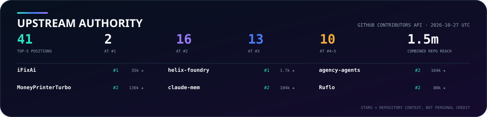
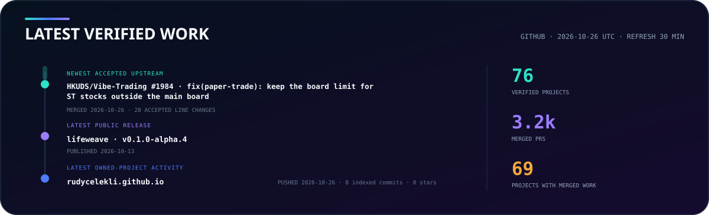
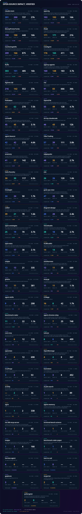
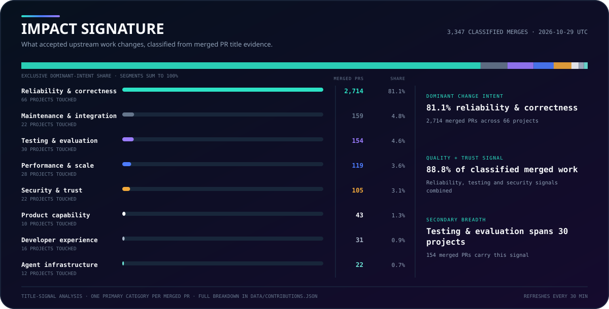

<div align="center">



<br />

[](https://www.linkedin.com/in/rudymizrahi/)
[](https://www.gradiahq.com)
[](https://orcid.org/0009-0000-7043-3766)
[](https://github.com/rudycelekli?tab=followers)

**Charlotte-based Forward Deployed AI Researcher · Agentic AI Engineer**

<sub>Building verifiable, long-horizon agent systems · Research, implementation, and open source</sub>

[Gradia](https://www.gradiahq.com) · [Snorkel AI](https://snorkel.ai/) · [AxiomConsulting.ai](https://axiomconsulting.ai/) · [Agentics Foundation](https://agentics.org/leadership/)

</div>

## I build AI systems that can prove what happened.

I am **Rudy Mizrahi Celekli**, also known professionally as **Rudy Celekli**. My work focuses on verifiable long-horizon agent environments, evaluator robustness, deterministic replay, causal fault isolation, and evidence-bound execution.

The operating principle is simple: preserve the world state, replay the action, challenge the evaluator, isolate the failure, and retain enough evidence for another person to check the claim. Public ownership, upstream contribution, measured results, and exploratory work stay explicitly separate.

[**Canonical research profile**](https://rudycelekli.github.io/) · [**Model-readable evidence**](https://rudycelekli.github.io/llms.txt) · [**ORCID**](https://orcid.org/0009-0000-7043-3766) · [**Gradia research role**](https://www.gradiahq.com/about)

### Start with the evidence you need

| If you are… | Start here |
|:--|:--|
| **Researching agent reliability** | [Evaluation environments, replay, and research record](https://rudycelekli.github.io/) |
| **Maintaining open source** | [Live upstream contribution explorer](https://rudycelekli.github.io/contributions.html) |
| **Deploying AI in an enterprise** | [Gradia](https://www.gradiahq.com) and [AxiomConsulting.ai](https://axiomconsulting.ai/) |
| **Building the Charlotte AI community** | [AI Tinkerers Charlotte](https://charlotte.aitinkerers.org/) |

<!-- top-contributor-proof:start -->
## Upstream authority



**All 40 current Top-5 positions:**

**GitHub rank #1:** [**iFixAi**](https://github.com/ifixai-ai/iFixAi) · 35k ★ · [**helix-foundry**](https://github.com/HelixDB/helix-foundry) · 1.7k ★

**GitHub rank #2:** [**agency-agents**](https://github.com/msitarzewski/agency-agents) · 164k ★ · [**MoneyPrinterTurbo**](https://github.com/harry0703/MoneyPrinterTurbo) · 135k ★ · [**claude-mem**](https://github.com/thedotmack/claude-mem) · 103k ★ · [**Ruflo**](https://github.com/ruvnet/ruflo) · 79k ★ · [**marketingskills**](https://github.com/coreyhaines31/marketingskills) · 57k ★ · [**anatomy**](https://github.com/wheresryan22/anatomy) · 21k ★ · [**openrig**](https://github.com/mvschwarz/openrig) · 8.2k ★ · [**CCBaga**](https://github.com/liseami/CCBaga) · 3.1k ★ · [**edgequake**](https://github.com/raphaelmansuy/edgequake) · 2.3k ★ · [**open-ontologies**](https://github.com/fabio-rovai/open-ontologies) · 1.4k ★ · [**Agentic-QE**](https://github.com/proffesor-for-testing/agentic-qe) · 515 ★ · [**cortexdb**](https://github.com/liliang-cn/cortexdb) · 468 ★ · [**imajev**](https://github.com/mohit67890/imajev) · 409 ★ · [**graphicle**](https://github.com/Graphicle-AI/graphicle) · 363 ★ · [**agent-chrome-relay**](https://github.com/aindeev/agent-chrome-relay) · 282 ★ · [**OpenGTM**](https://github.com/debpalash/OpenGTM) · 73 ★

**GitHub rank #3:** [**OpenMontage**](https://github.com/calesthio/OpenMontage) · 72k ★ · [**ai-job-search**](https://github.com/ai-job-search-dev/ai-job-search) · 66k ★ · [**diagram-design**](https://github.com/cathrynlavery/diagram-design) · 61k ★ · [**oh-my-claudecode**](https://github.com/Yeachan-Heo/oh-my-claudecode) · 40k ★ · [**ai-memory**](https://github.com/akitaonrails/ai-memory) · 14k ★ · [**e2e**](https://github.com/tester-army/e2e) · 12k ★ · [**autoharness**](https://github.com/tigerless-labs/autoharness) · 11k ★ · [**cost-xray**](https://github.com/tigerless-labs/cost-xray) · 6.3k ★ · [**open-duet**](https://github.com/Anil-matcha/open-duet) · 6.2k ★ · [**Peekaboo**](https://github.com/openclaw/Peekaboo) · 5.4k ★ · [**agent-memory**](https://github.com/tigerless-labs/agent-memory) · 4.7k ★ · [**harnessrouter**](https://github.com/HarnessRouter/harnessrouter) · 3.7k ★ · [**talorys**](https://github.com/rociiu/talorys) · 1.4k ★

**GitHub rank #4:** [**gods-eye-view**](https://github.com/bilawalsidhu/gods-eye-view) · 60k ★ · [**CowAgent**](https://github.com/zhayujie/CowAgent) · 48k ★ · [**Vibe-Trading**](https://github.com/HKUDS/Vibe-Trading) · 37k ★ · [**Hands-On-AI-Engineering**](https://github.com/Sumanth077/Hands-On-AI-Engineering) · 4.1k ★ · [**leantoken**](https://github.com/morluto/leantoken) · 125 ★

**GitHub rank #5:** [**rea**](https://github.com/morluto/rea) · 391k ★ · [**mcp-go**](https://github.com/mark3labs/mcp-go) · 9.2k ★ · [**agent-beacon**](https://github.com/Asymptote-Labs/agent-beacon) · 2.9k ★ · [**mcpproxy-go**](https://github.com/smart-mcp-proxy/mcpproxy-go) · 399 ★

[Sort and inspect all 40 Top-5 positions with GitHub evidence →](https://rudycelekli.github.io/contributions.html?sort=rank&top5=1)

<sub>All-time rank from GitHub's Contributors API · repository stars are reach, not personal credit · refreshed 2026-10-26 UTC</sub>
<!-- top-contributor-proof:end -->

<!-- building-now:start -->
## Three systems, one research program

| System | Problem | Inspectable response | Maturity |
|:--|:--|:--|:--|
| **[Gradia](https://www.gradiahq.com)** | AI implementation is difficult to reproduce, inspect, and improve across long-running work. | A research and implementation lab connecting **Blocks · Factory · Verify · Workers · Intelligence**, with [AxiomConsulting.ai](https://axiomconsulting.ai/) as its forward-deployed implementation arm. | Research foundation established; broader verified-software-factory products remain in development. |
| **[KYA Evidence](https://github.com/rudycelekli/kya-evidence)** | Agent identity and capability claims are usually broader than their evidence. | A portable, scope-bound Know Your Agent protocol that binds the exact system, evidence, and relying-party policy. | Experimental public reference implementation and standardization path, not an adopted industry standard. |
| **Proof stack** | Agent output can look plausible while its execution record, evaluator, or regression boundary is wrong. | [Gradia Guard](https://github.com/rudycelekli/gradia-guard) records proof-bound execution, [ProofSeal](https://github.com/rudycelekli/proofseal) retains behavioral claims, and [TestLore](https://github.com/rudycelekli/testlore) turns testing history into reusable quality intelligence. | Public source with linked code, releases, and explicit claim boundaries. |

**Current public frontier:** [TestLore](https://github.com/rudycelekli/testlore) · [Gradia Guard](https://github.com/rudycelekli/gradia-guard) · [ProofSeal](https://github.com/rudycelekli/proofseal) · [code-transplant](https://github.com/rudycelekli/code-transplant)

<sub>Frontier selections are re-ranked every 30 minutes from public reach, shipping recency, releases, attributed work, and repository completeness · last ranked 2026-10-26 UTC · private Gradia repository evidence remains private</sub>
<!-- building-now:end -->

## Latest verified work



<sub>This is a generated point-in-time pulse. A merge is accepted upstream work; a release is public shipping evidence; repository activity alone is neither.</sub>

<!-- contribution-stats:start -->
## Open-source impact, verified

Every 30 minutes, the ledger discovers public upstream attribution and rebuilds this timeline from individual GitHub receipts. Only merged PRs contribute accepted-code totals. The amber orbit is the [current public open queue](https://github.com/search?q=author%3Arudycelekli+is%3Apr+is%3Aopen+created%3A%3E%3D2025-01-01&type=pullrequests), never accepted work. Stars and forks describe repository reach, not personal credit.





### Complete evidence ledger

All 77 verified upstream projects are shown here. **[Open the sortable evidence explorer →](https://rudycelekli.github.io/contributions.html)**

| Project, purpose and evidence | Primary impact | GitHub API rank | Attributed commits | Merged PRs | Accepted lines (+ / −) | Files | Repository reach |
|:--|:--|--:|--:|--:|--:|--:|--:|
| **[claude-mem](https://github.com/thedotmack/claude-mem)** · [GitHub-listed contributor](https://github.com/thedotmack/claude-mem/graphs/contributors)<br><sub>Persistent Context Across Sessions for Every Agent – Captures everything your agent does during sessions, compresses it with AI, and injects relevant…</sub> | **Reliability & correctness**<br><sub>214 of 225 merged PRs</sub> | [#2](https://github.com/thedotmack/claude-mem/graphs/contributors) | 226 | [225](https://github.com/thedotmack/claude-mem/pulls?q=is%3Apr+author%3Arudycelekli+is%3Amerged) | +26,037 / −2,259 | 798 | 103,359 ★ · 9,124 forks |
| **[openrig](https://github.com/mvschwarz/openrig)** · [GitHub-listed contributor](https://github.com/mvschwarz/openrig/graphs/contributors)<br><sub>Build your own network of agents from Claude Code, Codex and Pi: persistent teams with roles, shared context and owned work.</sub> | **Reliability & correctness**<br><sub>203 of 218 merged PRs</sub> | [#2](https://github.com/mvschwarz/openrig/graphs/contributors) | 218 | [218](https://github.com/mvschwarz/openrig/pulls?q=is%3Apr+author%3Arudycelekli+is%3Amerged) | +16,690 / −1,342 | 617 | 8,209 ★ · 674 forks |
| **[MoneyPrinterTurbo](https://github.com/harry0703/MoneyPrinterTurbo)** · [GitHub-listed contributor](https://github.com/harry0703/MoneyPrinterTurbo/graphs/contributors)<br><sub>Generate HD short videos from a topic or keyword with an automated AI workflow.</sub> | **Reliability & correctness**<br><sub>181 of 208 merged PRs</sub> | [#2](https://github.com/harry0703/MoneyPrinterTurbo/graphs/contributors) | 208 | [208](https://github.com/harry0703/MoneyPrinterTurbo/pulls?q=is%3Apr+author%3Arudycelekli+is%3Amerged) | +15,773 / −1,133 | 487 | 135,407 ★ · 21,471 forks |
| **[iFixAi](https://github.com/ifixai-ai/iFixAi)** · [GitHub-listed contributor](https://github.com/ifixai-ai/iFixAi/graphs/contributors)<br><sub>Independent Auditing of AI Agents. Run by human or the agent itself, to answer the most crucial question in the AI Agent Economy. Is the agent doing…</sub> | **Reliability & correctness**<br><sub>150 of 200 merged PRs</sub> | [#1](https://github.com/ifixai-ai/iFixAi/graphs/contributors) | 200 | [200](https://github.com/ifixai-ai/iFixAi/pulls?q=is%3Apr+author%3Arudycelekli+is%3Amerged) | +25,243 / −1,001 | 612 | 34,929 ★ · 1,716 forks |
| **[CowAgent](https://github.com/zhayujie/CowAgent)** · [GitHub-listed contributor](https://github.com/zhayujie/CowAgent/graphs/contributors)<br><sub>Open-source personal AI assistant &amp; Agent Harness. Plans tasks, runs tools and skills, self-evolves with memory and knowledge. Multi-agent, multi-mod…</sub> | **Reliability & correctness**<br><sub>180 of 197 merged PRs</sub> | [#4](https://github.com/zhayujie/CowAgent/graphs/contributors) | 218 | [197](https://github.com/zhayujie/CowAgent/pulls?q=is%3Apr+author%3Arudycelekli+is%3Amerged) | +16,508 / −1,307 | 491 | 47,609 ★ · 10,406 forks |
| **[agency-agents](https://github.com/msitarzewski/agency-agents)** · [GitHub-listed contributor](https://github.com/msitarzewski/agency-agents/graphs/contributors)<br><sub>A complete AI agency at your fingertips - From frontend wizards to Reddit community ninjas, from whimsy injectors to reality checkers. Each agent is…</sub> | **Reliability & correctness**<br><sub>98 of 177 merged PRs</sub> | [#2](https://github.com/msitarzewski/agency-agents/graphs/contributors) | 190 | [177](https://github.com/msitarzewski/agency-agents/pulls?q=is%3Apr+author%3Arudycelekli+is%3Amerged) | +2,879 / −1,038 | 212 | 164,212 ★ · 26,493 forks |
| **[marketingskills](https://github.com/coreyhaines31/marketingskills)** · [GitHub-listed contributor](https://github.com/coreyhaines31/marketingskills/graphs/contributors)<br><sub>Marketing skills for Claude Code and AI agents. CRO, copywriting, SEO, analytics, and growth engineering.</sub> | **Reliability & correctness**<br><sub>120 of 167 merged PRs</sub> | [#2](https://github.com/coreyhaines31/marketingskills/graphs/contributors) | 210 | [167](https://github.com/coreyhaines31/marketingskills/pulls?q=is%3Apr+author%3Arudycelekli+is%3Amerged) | +12,400 / −1,496 | 881 | 56,660 ★ · 8,373 forks |
| **[Ruflo](https://github.com/ruvnet/ruflo)** · [GitHub-listed contributor](https://github.com/ruvnet/ruflo/graphs/contributors)<br><sub>Agent orchestration &amp; autonomous workflows.</sub> | **Reliability & correctness**<br><sub>143 of 166 merged PRs</sub> | [#2](https://github.com/ruvnet/ruflo/graphs/contributors) | 318 | [166](https://github.com/ruvnet/ruflo/pulls?q=is%3Apr+author%3Arudycelekli+is%3Amerged) | +15,462 / −2,072 | 518 | 79,478 ★ · 9,326 forks |
| **[Agentic-QE](https://github.com/proffesor-for-testing/agentic-qe)** · [GitHub-listed contributor](https://github.com/proffesor-for-testing/agentic-qe/graphs/contributors)<br><sub>Agentic quality engineering infrastructure.</sub> | **Reliability & correctness**<br><sub>102 of 162 merged PRs</sub> | [#2](https://github.com/proffesor-for-testing/agentic-qe/graphs/contributors) | 256 | [162](https://github.com/proffesor-for-testing/agentic-qe/pulls?q=is%3Apr+author%3Arudycelekli+is%3Amerged) | +42,374 / −7,477 | 996 | 515 ★ · 103 forks |
| **[Vibe-Trading](https://github.com/HKUDS/Vibe-Trading)** · [GitHub-listed contributor](https://github.com/HKUDS/Vibe-Trading/graphs/contributors)<br><sub>&quot;Vibe-Trading: Your Personal Trading Agent&quot;.</sub> | **Reliability & correctness**<br><sub>106 of 124 merged PRs</sub> | [#4](https://github.com/HKUDS/Vibe-Trading/graphs/contributors) | 144 | [124](https://github.com/HKUDS/Vibe-Trading/pulls?q=is%3Apr+author%3Arudycelekli+is%3Amerged) | +8,024 / −684 | 321 | 36,745 ★ · 5,940 forks |
| **[colibri](https://github.com/JustVugg/colibri)** · [GitHub-listed contributor](https://github.com/JustVugg/colibri/graphs/contributors)<br><sub>Run frontier MoE models on hardware you already own — pure C, zero deps, experts streamed from disk. Tiny engine, immense model. 🐦.</sub> | **Reliability & correctness**<br><sub>99 of 113 merged PRs</sub> | [#9](https://github.com/JustVugg/colibri/graphs/contributors) | 39 | [113](https://github.com/JustVugg/colibri/pulls?q=is%3Apr+author%3Arudycelekli+is%3Amerged) | +6,929 / −328 | 273 | 44,034 ★ · 5,002 forks |
| **[agent-beacon](https://github.com/Asymptote-Labs/agent-beacon)** · [GitHub-listed contributor](https://github.com/Asymptote-Labs/agent-beacon/graphs/contributors)<br><sub>The cross-harness, self-improving memory layer for AI agents. Join our community: https://discord.com/invite/zdNChS2fBu.</sub> | **Reliability & correctness**<br><sub>97 of 107 merged PRs</sub> | [#5](https://github.com/Asymptote-Labs/agent-beacon/graphs/contributors) | 96 | [107](https://github.com/Asymptote-Labs/agent-beacon/pulls?q=is%3Apr+author%3Arudycelekli+is%3Amerged) | +7,947 / −1,471 | 391 | 2,860 ★ · 258 forks |
| **[ai-memory](https://github.com/akitaonrails/ai-memory)** · [GitHub-listed contributor](https://github.com/akitaonrails/ai-memory/graphs/contributors)<br><sub>Solution for long term memory for agent coding CLIs and to facilitate handoff between different agent vendors.</sub> | **Reliability & correctness**<br><sub>99 of 100 merged PRs</sub> | [#3](https://github.com/akitaonrails/ai-memory/graphs/contributors) | 171 | [100](https://github.com/akitaonrails/ai-memory/pulls?q=is%3Apr+author%3Arudycelekli+is%3Amerged) | +8,680 / −537 | 261 | 13,745 ★ · 974 forks |
| **[rea](https://github.com/morluto/rea)** · [GitHub-listed contributor](https://github.com/morluto/rea/graphs/contributors)<br><sub>Reverse engineer anything with agents, from app behavior down to native binaries.</sub> | **Reliability & correctness**<br><sub>81 of 83 merged PRs</sub> | [#5](https://github.com/morluto/rea/graphs/contributors) | 91 | [83](https://github.com/morluto/rea/pulls?q=is%3Apr+author%3Arudycelekli+is%3Amerged) | +32,808 / −2,976 | 666 | 390,578 ★ · 97,859 forks |
| **[oh-my-claudecode](https://github.com/Yeachan-Heo/oh-my-claudecode)** · [GitHub-listed contributor](https://github.com/Yeachan-Heo/oh-my-claudecode/graphs/contributors)<br><sub>Teams-first Multi-agent orchestration for Claude Code.</sub> | **Reliability & correctness**<br><sub>75 of 81 merged PRs</sub> | [#3](https://github.com/Yeachan-Heo/oh-my-claudecode/graphs/contributors) | 97 | [81](https://github.com/Yeachan-Heo/oh-my-claudecode/pulls?q=is%3Apr+author%3Arudycelekli+is%3Amerged) | +15,003 / −2,398 | 358 | 40,288 ★ · 3,597 forks |
| **[Peekaboo](https://github.com/openclaw/Peekaboo)** · [GitHub-listed contributor](https://github.com/openclaw/Peekaboo/graphs/contributors)<br><sub>Peekaboo is a macOS CLI &amp; optional MCP server that enables AI agents to capture screenshots of applications, or the entire system, with optional visu…</sub> | **Reliability & correctness**<br><sub>62 of 64 merged PRs</sub> | [#3](https://github.com/openclaw/Peekaboo/graphs/contributors) | 64 | [64](https://github.com/openclaw/Peekaboo/pulls?q=is%3Apr+author%3Arudycelekli+is%3Amerged) | +6,708 / −861 | 276 | 5,394 ★ · 413 forks |
| **[cortexdb](https://github.com/liliang-cn/cortexdb)** · [GitHub-listed contributor](https://github.com/liliang-cn/cortexdb/graphs/contributors)<br><sub>AI memory and a knowledge graph in one SQLite file. Pure Go: vectors, RAG, agent memory, RDF/SPARQL, Cypher, 80+ MCP tools. Works without an embeddin…</sub> | **Reliability & correctness**<br><sub>54 of 58 merged PRs</sub> | [#2](https://github.com/liliang-cn/cortexdb/graphs/contributors) | 58 | [58](https://github.com/liliang-cn/cortexdb/pulls?q=is%3Apr+author%3Arudycelekli+is%3Amerged) | +3,775 / −253 | 124 | 468 ★ · 26 forks |
| **[OpenGTM](https://github.com/debpalash/OpenGTM)** · [GitHub-listed contributor](https://github.com/debpalash/OpenGTM/graphs/contributors)<br><sub>Open-source, self-hosted alternative to Clay.com for lead sourcing, enrichment waterfalls, AI research, buying signals, and outbound automation.</sub> | **Reliability & correctness**<br><sub>50 of 53 merged PRs</sub> | [#2](https://github.com/debpalash/OpenGTM/graphs/contributors) | 60 | [53](https://github.com/debpalash/OpenGTM/pulls?q=is%3Apr+author%3Arudycelekli+is%3Amerged) | +4,852 / −251 | 138 | 73 ★ · 23 forks |
| **[gods-eye-view](https://github.com/bilawalsidhu/gods-eye-view)** · [GitHub-listed contributor](https://github.com/bilawalsidhu/gods-eye-view/graphs/contributors)<br><sub>A spy satellite simulator in your browser, except the data is real. Live open source spatial intelligence on a photorealistic 3D globe.</sub> | **Reliability & correctness**<br><sub>43 of 49 merged PRs</sub> | [#4](https://github.com/bilawalsidhu/gods-eye-view/graphs/contributors) | 93 | [49](https://github.com/bilawalsidhu/gods-eye-view/pulls?q=is%3Apr+author%3Arudycelekli+is%3Amerged) | +5,501 / −448 | 301 | 60,356 ★ · 11,782 forks |
| **[ai-job-search](https://github.com/ai-job-search-dev/ai-job-search)** · [GitHub-listed contributor](https://github.com/ai-job-search-dev/ai-job-search/graphs/contributors)<br><sub>The job search that runs on your machine. AI job application framework built on Claude Code: evaluate postings, tailor CVs, write cover letters, prep…</sub> | **Reliability & correctness**<br><sub>38 of 41 merged PRs</sub> | [#3](https://github.com/ai-job-search-dev/ai-job-search/graphs/contributors) | 41 | [41](https://github.com/ai-job-search-dev/ai-job-search/pulls?q=is%3Apr+author%3Arudycelekli+is%3Amerged) | +3,123 / −158 | 143 | 66,247 ★ · 20,836 forks |
| **[e2e](https://github.com/tester-army/e2e)** · [GitHub-listed contributor](https://github.com/tester-army/e2e/graphs/contributors)<br><sub>Next generation e2e testing framework for web and mobile apps.</sub> | **Reliability & correctness**<br><sub>22 of 39 merged PRs</sub> | [#3](https://github.com/tester-army/e2e/graphs/contributors) | 39 | [39](https://github.com/tester-army/e2e/pulls?q=is%3Apr+author%3Arudycelekli+is%3Amerged) | +2,269 / −202 | 189 | 11,939 ★ · 627 forks |
| **[anatomy](https://github.com/wheresryan22/anatomy)** · [GitHub-listed contributor](https://github.com/wheresryan22/anatomy/graphs/contributors)<br><sub>An agent skill for creating detailed, interactive isometric illustrations of real-world machines and complex systems. Generates polished SVGs with op…</sub> | **Reliability & correctness**<br><sub>30 of 37 merged PRs</sub> | [#2](https://github.com/wheresryan22/anatomy/graphs/contributors) | 41 | [37](https://github.com/wheresryan22/anatomy/pulls?q=is%3Apr+author%3Arudycelekli+is%3Amerged) | +2,220 / −227 | 142 | 20,994 ★ · 1,694 forks |
| **[mcpproxy-go](https://github.com/smart-mcp-proxy/mcpproxy-go)** · [GitHub-listed contributor](https://github.com/smart-mcp-proxy/mcpproxy-go/graphs/contributors)<br><sub>Supercharge AI Agents, Safely.</sub> | **Reliability & correctness**<br><sub>28 of 37 merged PRs</sub> | [#5](https://github.com/smart-mcp-proxy/mcpproxy-go/graphs/contributors) | 37 | [37](https://github.com/smart-mcp-proxy/mcpproxy-go/pulls?q=is%3Apr+author%3Arudycelekli+is%3Amerged) | +2,158 / −203 | 98 | 399 ★ · 67 forks |
| **[edgequake](https://github.com/raphaelmansuy/edgequake)** · [GitHub-listed contributor](https://github.com/raphaelmansuy/edgequake/graphs/contributors)<br><sub>EdegQuake 🌋 High-performance GraphRAG inspired from LightRag written in Rust; Transform documents into intelligent knowledge graphs for superior retr…</sub> | **Reliability & correctness**<br><sub>28 of 35 merged PRs</sub> | [#2](https://github.com/raphaelmansuy/edgequake/graphs/contributors) | 48 | [35](https://github.com/raphaelmansuy/edgequake/pulls?q=is%3Apr+author%3Arudycelekli+is%3Amerged) | +2,402 / −259 | 77 | 2,286 ★ · 274 forks |
| **[open-ontologies](https://github.com/fabio-rovai/open-ontologies)** · [GitHub-listed contributor](https://github.com/fabio-rovai/open-ontologies/graphs/contributors)<br><sub>Plan, apply and roll back changes to a production ontology, with a blast radius report and a proof an auditor can re-check.</sub> | **Reliability & correctness**<br><sub>26 of 33 merged PRs</sub> | [#2](https://github.com/fabio-rovai/open-ontologies/graphs/contributors) | 55 | [33](https://github.com/fabio-rovai/open-ontologies/pulls?q=is%3Apr+author%3Arudycelekli+is%3Amerged) | +4,608 / −215 | 113 | 1,421 ★ · 189 forks |
| **[harnessrouter](https://github.com/HarnessRouter/harnessrouter)** · [GitHub-listed contributor](https://github.com/HarnessRouter/harnessrouter/graphs/contributors)<br><sub>HarnessRouter Community Edition: the self-hosted, Apache-2.0 edition of the unified interface for agent harnesses. Run Codex, Claude Code, Hermes, PI…</sub> | **Maintenance & integration**<br><sub>25 of 32 merged PRs</sub> | [#3](https://github.com/HarnessRouter/harnessrouter/graphs/contributors) | 32 | [32](https://github.com/HarnessRouter/harnessrouter/pulls?q=is%3Apr+author%3Arudycelekli+is%3Amerged) | +1,989 / −106 | 77 | 3,685 ★ · 392 forks |
| **[helix-foundry](https://github.com/HelixDB/helix-foundry)** · [GitHub-listed contributor](https://github.com/HelixDB/helix-foundry/graphs/contributors)<br><sub>Your company&#x27;s data, connected into one ontology, on your own computer. A local-first data workspace built on HelixDB and DuckDB.</sub> | **Reliability & correctness**<br><sub>16 of 32 merged PRs</sub> | [#1](https://github.com/HelixDB/helix-foundry/graphs/contributors) | 32 | [32](https://github.com/HelixDB/helix-foundry/pulls?q=is%3Apr+author%3Arudycelekli+is%3Amerged) | +6,690 / −277 | 122 | 1,668 ★ · 252 forks |
| **[Hands-On-AI-Engineering](https://github.com/Sumanth077/Hands-On-AI-Engineering)** · [GitHub-listed contributor](https://github.com/Sumanth077/Hands-On-AI-Engineering/graphs/contributors)<br><sub>A curated collection of practical AI projects implementing OCR systems, RAG, AI agents, and other AI use cases.</sub> | **Reliability & correctness**<br><sub>28 of 30 merged PRs</sub> | [#4](https://github.com/Sumanth077/Hands-On-AI-Engineering/graphs/contributors) | 30 | [30](https://github.com/Sumanth077/Hands-On-AI-Engineering/pulls?q=is%3Apr+author%3Arudycelekli+is%3Amerged) | +3 / −1,014 | 95 | 4,051 ★ · 975 forks |
| **[talorys](https://github.com/rociiu/talorys)** · [GitHub-listed contributor](https://github.com/rociiu/talorys/graphs/contributors)<br><sub>Your personal AI agent in your own Cloudflare account. Chat, memory, tasks, notes and scheduled reminders, deployed with one command: npx create-talo…</sub> | **Reliability & correctness**<br><sub>17 of 27 merged PRs</sub> | [#3](https://github.com/rociiu/talorys/graphs/contributors) | 27 | [27](https://github.com/rociiu/talorys/pulls?q=is%3Apr+author%3Arudycelekli+is%3Amerged) | +1,027 / −97 | 62 | 1,389 ★ · 124 forks |
| **[VLMEvalKit](https://github.com/open-compass/VLMEvalKit)** · [GitHub-listed contributor](https://github.com/open-compass/VLMEvalKit/graphs/contributors)<br><sub>Open-source evaluation toolkit of large multi-modality models (LMMs), support 220+ LMMs, 80+ benchmarks.</sub> | **Reliability & correctness**<br><sub>16 of 26 merged PRs</sub> | [#7](https://github.com/open-compass/VLMEvalKit/graphs/contributors) | 26 | [26](https://github.com/open-compass/VLMEvalKit/pulls?q=is%3Apr+author%3Arudycelekli+is%3Amerged) | +2,051 / −102 | 69 | 4,462 ★ · 782 forks |
| **[diagram-design](https://github.com/cathrynlavery/diagram-design)** · [GitHub-listed contributor](https://github.com/cathrynlavery/diagram-design/graphs/contributors)<br><sub>Editorial diagram design for Claude Code, Codex, GitHub Copilot, Cursor, Factory Droid, Qoder, and Pi. 45 diagram types. Self-contained HTML + SVG. N…</sub> | **Reliability & correctness**<br><sub>24 of 24 merged PRs</sub> | [#3](https://github.com/cathrynlavery/diagram-design/graphs/contributors) | 24 | [24](https://github.com/cathrynlavery/diagram-design/pulls?q=is%3Apr+author%3Arudycelekli+is%3Amerged) | +3,141 / −218 | 77 | 61,330 ★ · 3,991 forks |
| **[hindsight](https://github.com/vectorize-io/hindsight)** · [GitHub-listed contributor](https://github.com/vectorize-io/hindsight/graphs/contributors)<br><sub>Hindsight: Agent Memory That Learns.</sub> | **Reliability & correctness**<br><sub>23 of 24 merged PRs</sub> | [#13](https://github.com/vectorize-io/hindsight/graphs/contributors) | 24 | [24](https://github.com/vectorize-io/hindsight/pulls?q=is%3Apr+author%3Arudycelekli+is%3Amerged) | +1,546 / −116 | 58 | 54,071 ★ · 6,275 forks |
| **[utopia](https://github.com/deeplethe/utopia)** · [GitHub-listed contributor](https://github.com/deeplethe/utopia/graphs/contributors)<br><sub>World&#x27;s first open-source enterprise world model.</sub> | **Maintenance & integration**<br><sub>14 of 22 merged PRs</sub> | [#6](https://github.com/deeplethe/utopia/graphs/contributors) | 13 | [22](https://github.com/deeplethe/utopia/pulls?q=is%3Apr+author%3Arudycelekli+is%3Amerged) | +536 / −46 | 31 | 8,552 ★ · 1,169 forks |
| **[autoharness](https://github.com/tigerless-labs/autoharness)** · [GitHub-listed contributor](https://github.com/tigerless-labs/autoharness/graphs/contributors)<br><sub>Autoharness — a self-learning skill layer for Claude Code — distills skills from your real sessions, updates them as you work, and prunes the ones th…</sub> | **Reliability & correctness**<br><sub>19 of 21 merged PRs</sub> | [#3](https://github.com/tigerless-labs/autoharness/graphs/contributors) | 30 | [21](https://github.com/tigerless-labs/autoharness/pulls?q=is%3Apr+author%3Arudycelekli+is%3Amerged) | +1,065 / −52 | 54 | 10,789 ★ · 622 forks |
| **[mcp-go](https://github.com/mark3labs/mcp-go)** · [GitHub-listed contributor](https://github.com/mark3labs/mcp-go/graphs/contributors)<br><sub>A Go implementation of the Model Context Protocol (MCP), enabling seamless integration between LLM applications and external data sources and tools.</sub> | **Reliability & correctness**<br><sub>20 of 20 merged PRs</sub> | [#5](https://github.com/mark3labs/mcp-go/graphs/contributors) | 20 | [20](https://github.com/mark3labs/mcp-go/pulls?q=is%3Apr+author%3Arudycelekli+is%3Amerged) | +1,281 / −332 | 48 | 9,189 ★ · 915 forks |
| **[VoiceStudio](https://github.com/debpalash/VoiceStudio)** · [GitHub-listed contributor](https://github.com/debpalash/VoiceStudio/graphs/contributors)<br><sub>VoiceStudio is the open-source, fully-local ElevenLabs alternative — voice cloning, voice design, video dubbing, dictation, transcription &amp; audiobook…</sub> | **Reliability & correctness**<br><sub>18 of 19 merged PRs</sub> | [#6](https://github.com/debpalash/VoiceStudio/graphs/contributors) | 39 | [19](https://github.com/debpalash/VoiceStudio/pulls?q=is%3Apr+author%3Arudycelekli+is%3Amerged) | +2,645 / −139 | 83 | 88,724 ★ · 9,783 forks |
| **[open-duet](https://github.com/Anil-matcha/open-duet)** · [GitHub-listed contributor](https://github.com/Anil-matcha/open-duet/graphs/contributors)<br><sub>Open-source, self-hosted alternative to Claude Duet: AI coworkers (named agents) with instructions, memory, routines, their own isolated computer, an…</sub> | **Reliability & correctness**<br><sub>13 of 19 merged PRs</sub> | [#3](https://github.com/Anil-matcha/open-duet/graphs/contributors) | 21 | [19](https://github.com/Anil-matcha/open-duet/pulls?q=is%3Apr+author%3Arudycelekli+is%3Amerged) | +2,288 / −93 | 45 | 6,196 ★ · 777 forks |
| **[ghidra](https://github.com/NationalSecurityAgency/ghidra)** · [GitHub-listed contributor](https://github.com/NationalSecurityAgency/ghidra/graphs/contributors)<br><sub>Ghidra is a software reverse engineering (SRE) framework.</sub> | **Maintenance & integration**<br><sub>11 of 19 merged PRs</sub> | [#27](https://github.com/NationalSecurityAgency/ghidra/graphs/contributors) | 20 | [19](https://github.com/NationalSecurityAgency/ghidra/pulls?q=is%3Apr+author%3Arudycelekli+is%3Amerged) | +521 / −91 | 26 | 94,626 ★ · 10,626 forks |
| **[OpenMontage](https://github.com/calesthio/OpenMontage)** · [GitHub-listed contributor](https://github.com/calesthio/OpenMontage/graphs/contributors)<br><sub>World&#x27;s first open-source, agentic video production system. 12 production pipelines, 100+ tools, 700+ agent skill and production-knowledge files. Tur…</sub> | **Performance & scale**<br><sub>7 of 14 merged PRs</sub> | [#3](https://github.com/calesthio/OpenMontage/graphs/contributors) | 14 | [14](https://github.com/calesthio/OpenMontage/pulls?q=is%3Apr+author%3Arudycelekli+is%3Amerged) | +2,260 / −98 | 37 | 72,132 ★ · 9,368 forks |
| **[CCBaga](https://github.com/liseami/CCBaga)** · [GitHub-listed contributor](https://github.com/liseami/CCBaga/graphs/contributors)<br><sub>Open-source software.</sub> | **Reliability & correctness**<br><sub>11 of 12 merged PRs</sub> | [#2](https://github.com/liseami/CCBaga/graphs/contributors) | 20 | [12](https://github.com/liseami/CCBaga/pulls?q=is%3Apr+author%3Arudycelekli+is%3Amerged) | +1,758 / −63 | 50 | 3,102 ★ · 327 forks |
| **[benchmark-radar](https://github.com/ktwu01/benchmark-radar)** · [GitHub-listed contributor](https://github.com/ktwu01/benchmark-radar/graphs/contributors)<br><sub>Track 33,707+ AI benchmark, eval, dataset, and data-quality records from 40 public sources, with linked evidence and daily updates.</sub> | **Maintenance & integration**<br><sub>5 of 11 merged PRs</sub> | [#7](https://github.com/ktwu01/benchmark-radar/graphs/contributors) | 25 | [11](https://github.com/ktwu01/benchmark-radar/pulls?q=is%3Apr+author%3Arudycelekli+is%3Amerged) | +2,030 / −69 | 33 | 306 ★ · 50 forks |
| **[agent-memory](https://github.com/tigerless-labs/agent-memory)** · [GitHub-listed contributor](https://github.com/tigerless-labs/agent-memory/graphs/contributors)<br><sub>Long-term memory runtime for AI agents — plain Markdown as the source of truth, local ranked retrieval, and an independent sleep-time Manage layer. C…</sub> | **Reliability & correctness**<br><sub>6 of 11 merged PRs</sub> | [#3](https://github.com/tigerless-labs/agent-memory/graphs/contributors) | 14 | [11](https://github.com/tigerless-labs/agent-memory/pulls?q=is%3Apr+author%3Arudycelekli+is%3Amerged) | +35,038 / −5,624 | 311 | 4,734 ★ · 202 forks |
| **[agent-skills](https://github.com/addyosmani/agent-skills)** · [GitHub-listed contributor](https://github.com/addyosmani/agent-skills/graphs/contributors)<br><sub>Production-grade engineering skills for AI coding agents.</sub> | **Testing & evaluation**<br><sub>4 of 9 merged PRs</sub> | [#9](https://github.com/addyosmani/agent-skills/graphs/contributors) | 9 | [9](https://github.com/addyosmani/agent-skills/pulls?q=is%3Apr+author%3Arudycelekli+is%3Amerged) | +184 / −24 | 15 | 110,741 ★ · 11,570 forks |
| **[graphicle](https://github.com/Graphicle-AI/graphicle)** · [GitHub-listed contributor](https://github.com/Graphicle-AI/graphicle/graphs/contributors)<br><sub>Code graph and memory for your coding agents, in one Rust program. For Claude Code, Codex, Cursor and any MCP client.</sub> | **Reliability & correctness**<br><sub>9 of 9 merged PRs</sub> | [#2](https://github.com/Graphicle-AI/graphicle/graphs/contributors) | 9 | [9](https://github.com/Graphicle-AI/graphicle/pulls?q=is%3Apr+author%3Arudycelekli+is%3Amerged) | +382 / −31 | 16 | 363 ★ · 27 forks |
| **[archify](https://github.com/tt-a1i/archify)** · [GitHub-listed contributor](https://github.com/tt-a1i/archify/graphs/contributors)<br><sub>Turn any idea, plan, or codebase into a beautiful interactive diagram. An agent skill for Claude Code, Codex, and more.</sub> | **Reliability & correctness**<br><sub>5 of 8 merged PRs</sub> | [#13](https://github.com/tt-a1i/archify/graphs/contributors) | 8 | [8](https://github.com/tt-a1i/archify/pulls?q=is%3Apr+author%3Arudycelekli+is%3Amerged) | +480 / −125 | 72 | 89,717 ★ · 6,076 forks |
| **[hyperframes](https://github.com/heygen-com/hyperframes)** · [GitHub-listed contributor](https://github.com/heygen-com/hyperframes/graphs/contributors)<br><sub>Write HTML. Render video. Built for agents.</sub> | **Reliability & correctness**<br><sub>6 of 8 merged PRs</sub> | [#20](https://github.com/heygen-com/hyperframes/graphs/contributors) | 8 | [8](https://github.com/heygen-com/hyperframes/pulls?q=is%3Apr+author%3Arudycelekli+is%3Amerged) | +466 / −12 | 15 | 72,897 ★ · 6,594 forks |
| **[WeKnora](https://github.com/Tencent/WeKnora)** · [GitHub-listed contributor](https://github.com/Tencent/WeKnora/graphs/contributors)<br><sub>Open-source LLM knowledge platform: turn raw documents into a queryable RAG, an autonomous reasoning agent, and a self-maintaining Wiki.</sub> | **Reliability & correctness**<br><sub>8 of 8 merged PRs</sub> | [#42](https://github.com/Tencent/WeKnora/graphs/contributors) | 8 | [8](https://github.com/Tencent/WeKnora/pulls?q=is%3Apr+author%3Arudycelekli+is%3Amerged) | +908 / −47 | 16 | 35,540 ★ · 4,793 forks |
| **[agent-chrome-relay](https://github.com/aindeev/agent-chrome-relay)** · [GitHub-listed contributor](https://github.com/aindeev/agent-chrome-relay/graphs/contributors)<br><sub>Let your AI agents use your Chrome, signed in as you, in background tabs. By Alexey Indeev · blog: read.aindeev.com · X: @AlexeyIndeev.</sub> | **Reliability & correctness**<br><sub>7 of 7 merged PRs</sub> | [#2](https://github.com/aindeev/agent-chrome-relay/graphs/contributors) | 7 | [7](https://github.com/aindeev/agent-chrome-relay/pulls?q=is%3Apr+author%3Arudycelekli+is%3Amerged) | +715 / −33 | 25 | 282 ★ · 11 forks |
| **[headroom](https://github.com/headroomlabs-ai/headroom)** · [GitHub-listed contributor](https://github.com/headroomlabs-ai/headroom/graphs/contributors)<br><sub>Compress tool outputs, logs, files, and RAG chunks before they reach the LLM. 20% fewer tokens for coding agents, 60-95% fewer tokens for JSON, same…</sub> | **Reliability & correctness**<br><sub>6 of 6 merged PRs</sub> | [#50](https://github.com/headroomlabs-ai/headroom/graphs/contributors) | 6 | [6](https://github.com/headroomlabs-ai/headroom/pulls?q=is%3Apr+author%3Arudycelekli+is%3Amerged) | +369 / −34 | 14 | 77,909 ★ · 6,059 forks |
| **[cost-xray](https://github.com/tigerless-labs/cost-xray)** · [GitHub-listed contributor](https://github.com/tigerless-labs/cost-xray/graphs/contributors)<br><sub>See what Claude Code and Codex actually send to the API — and what each part costs.</sub> | **Reliability & correctness**<br><sub>4 of 6 merged PRs</sub> | [#3](https://github.com/tigerless-labs/cost-xray/graphs/contributors) | 6 | [6](https://github.com/tigerless-labs/cost-xray/pulls?q=is%3Apr+author%3Arudycelekli+is%3Amerged) | +109 / −6 | 12 | 6,322 ★ · 383 forks |
| **[openclaw](https://github.com/openclaw/openclaw)** · [Default-branch commit verified](https://github.com/openclaw/openclaw/commits?author=rudycelekli)<br><sub>The AI that really does things. Any OS. Any Platform. The lobster way. 🦞.</sub> | **Reliability & correctness**<br><sub>4 of 4 merged PRs</sub> | — | 4 | [4](https://github.com/openclaw/openclaw/pulls?q=is%3Apr+author%3Arudycelekli+is%3Amerged) | +681 / −17 | 12 | 393,141 ★ · 82,649 forks |
| **[trueforge](https://github.com/truefoundry/trueforge)** · [GitHub-listed contributor](https://github.com/truefoundry/trueforge/graphs/contributors)<br><sub>The open-source agent harness - the runtime layer that turns an LLM into a working agent.</sub> | **Developer experience**<br><sub>2 of 3 merged PRs</sub> | [#23](https://github.com/truefoundry/trueforge/graphs/contributors) | 3 | [3](https://github.com/truefoundry/trueforge/pulls?q=is%3Apr+author%3Arudycelekli+is%3Amerged) | +36 / −17 | 6 | 6,383 ★ · 545 forks |
| **[retentioneering-tools](https://github.com/retentioneering/retentioneering-tools)** · [GitHub-listed contributor](https://github.com/retentioneering/retentioneering-tools/graphs/contributors)<br><sub>Python toolkit, MCP server, and agent skills for reproducible, auditable clickstream and event log analytics. Helps AI agents, data scientists and an…</sub> | **Reliability & correctness**<br><sub>3 of 3 merged PRs</sub> | [#6](https://github.com/retentioneering/retentioneering-tools/graphs/contributors) | 3 | [3](https://github.com/retentioneering/retentioneering-tools/pulls?q=is%3Apr+author%3Arudycelekli+is%3Amerged) | +330 / −40 | 14 | 940 ★ · 144 forks |
| **[leantoken](https://github.com/morluto/leantoken)** · [GitHub-listed contributor](https://github.com/morluto/leantoken/graphs/contributors)<br><sub>Code intelligence for agents: find the code that matters and keep your context window and tokens lean.</sub> | **Reliability & correctness**<br><sub>3 of 3 merged PRs</sub> | [#4](https://github.com/morluto/leantoken/graphs/contributors) | 3 | [3](https://github.com/morluto/leantoken/pulls?q=is%3Apr+author%3Arudycelekli+is%3Amerged) | +430 / −22 | 8 | 125 ★ · 18 forks |
| **[nanobot](https://github.com/HKUDS/nanobot)** · [GitHub-listed contributor](https://github.com/HKUDS/nanobot/graphs/contributors)<br><sub>Ultra-lightweight, open-source, self-hosted personal AI agent framework in Python with WebUI, tools, memory, MCP, multi-agent workflows, automation,…</sub> | **Reliability & correctness**<br><sub>2 of 2 merged PRs</sub> | [#113](https://github.com/HKUDS/nanobot/graphs/contributors) | 3 | [2](https://github.com/HKUDS/nanobot/pulls?q=is%3Apr+author%3Arudycelekli+is%3Amerged) | +163 / −52 | 7 | 49,366 ★ · 8,681 forks |
| **[plexo](https://github.com/anmolkapil/plexo)** · [GitHub-listed contributor](https://github.com/anmolkapil/plexo/graphs/contributors)<br><sub>Speed up downloads by combining multiple network connections in parallel.</sub> | **Reliability & correctness**<br><sub>2 of 2 merged PRs</sub> | [#9](https://github.com/anmolkapil/plexo/graphs/contributors) | 2 | [2](https://github.com/anmolkapil/plexo/pulls?q=is%3Apr+author%3Arudycelekli+is%3Amerged) | +100 / −3 | 4 | 5,039 ★ · 355 forks |
| **[ms-365-mcp-server](https://github.com/Softeria/ms-365-mcp-server)** · [GitHub-listed contributor](https://github.com/Softeria/ms-365-mcp-server/graphs/contributors)<br><sub>A Model Context Protocol (MCP) server for interacting with Microsoft 365 and Microsoft Office services through the Graph API.</sub> | **Reliability & correctness**<br><sub>2 of 2 merged PRs</sub> | [#25](https://github.com/Softeria/ms-365-mcp-server/graphs/contributors) | 2 | [2](https://github.com/Softeria/ms-365-mcp-server/pulls?q=is%3Apr+author%3Arudycelekli+is%3Amerged) | +105 / −13 | 4 | 1,084 ★ · 402 forks |
| **[opentakeoff](https://github.com/Kentucky-ai/opentakeoff)** · [GitHub-listed contributor](https://github.com/Kentucky-ai/opentakeoff/graphs/contributors)<br><sub>Open-source (AGPL-3.0) PDF takeoff for construction &amp; flooring — the first engine an AI agent drives natively over MCP, not bolted on. Rooms measured…</sub> | **Reliability & correctness**<br><sub>2 of 2 merged PRs</sub> | [#7](https://github.com/Kentucky-ai/opentakeoff/graphs/contributors) | 2 | [2](https://github.com/Kentucky-ai/opentakeoff/pulls?q=is%3Apr+author%3Arudycelekli+is%3Amerged) | +65 / −12 | 11 | 698 ★ · 155 forks |
| **[agno](https://github.com/agno-agi/agno)** · [GitHub-listed contributor](https://github.com/agno-agi/agno/graphs/contributors)<br><sub>The self-improving agent platform.</sub> | **Reliability & correctness**<br><sub>1 of 1 merged PRs</sub> | [#302](https://github.com/agno-agi/agno/graphs/contributors) | 1 | [1](https://github.com/agno-agi/agno/pulls?q=is%3Apr+author%3Arudycelekli+is%3Amerged) | +332 / −6 | 2 | 42,902 ★ · 6,187 forks |
| **[xerj](https://github.com/xerj-org/xerj)** · [GitHub-listed contributor](https://github.com/xerj-org/xerj/graphs/contributors)<br><sub>Local-first search engine and MCP server for AI agents. One Rust binary indexes code, docs, logs, JSONL/CSV and PDFs for BM25 full-text, vector and h…</sub> | **Product capability**<br><sub>1 of 1 merged PRs</sub> | [#60](https://github.com/xerj-org/xerj/graphs/contributors) | 1 | [1](https://github.com/xerj-org/xerj/pulls?q=is%3Apr+author%3Arudycelekli+is%3Amerged) | +2 / −1 | 1 | 16,785 ★ · 1,169 forks |
| **[litestream](https://github.com/benbjohnson/litestream)** · [GitHub-listed contributor](https://github.com/benbjohnson/litestream/graphs/contributors)<br><sub>Streaming replication for SQLite.</sub> | **Reliability & correctness**<br><sub>1 of 1 merged PRs</sub> | [#30](https://github.com/benbjohnson/litestream/graphs/contributors) | 1 | [1](https://github.com/benbjohnson/litestream/pulls?q=is%3Apr+author%3Arudycelekli+is%3Amerged) | +83 / −2 | 2 | 14,538 ★ · 448 forks |
| **[agentsview](https://github.com/kenn-io/agentsview)** · [GitHub-listed contributor](https://github.com/kenn-io/agentsview/graphs/contributors)<br><sub>Local-first session search, analytics, insights, and token use statistics for coding agents, supporting Claude Code, Codex, and more than 50 other ag…</sub> | **Reliability & correctness**<br><sub>1 of 1 merged PRs</sub> | [#72](https://github.com/kenn-io/agentsview/graphs/contributors) | 1 | [1](https://github.com/kenn-io/agentsview/pulls?q=is%3Apr+author%3Arudycelekli+is%3Amerged) | +294 / −24 | 5 | 6,279 ★ · 662 forks |
| **[AReaL](https://github.com/areal-project/AReaL)** · [GitHub-listed contributor](https://github.com/areal-project/AReaL/graphs/contributors)<br><sub>The RL Bridge for LLM-based Agent Applications. Made Simple &amp; Flexible.</sub> | **Reliability & correctness**<br><sub>1 of 1 merged PRs</sub> | [#105](https://github.com/areal-project/AReaL/graphs/contributors) | 1 | [1](https://github.com/areal-project/AReaL/pulls?q=is%3Apr+author%3Arudycelekli+is%3Amerged) | +47 / −10 | 3 | 5,872 ★ · 637 forks |
| **[RuVector](https://github.com/ruvnet/RuVector)** · [GitHub-listed contributor](https://github.com/ruvnet/RuVector/graphs/contributors)<br><sub>RuVector provides High Performance, Real-Time decisions and agent memory , Self-Learning Ai, Vector GNN DB built in Rust.</sub> | **Reliability & correctness**<br><sub>1 of 1 merged PRs</sub> | [#18](https://github.com/ruvnet/RuVector/graphs/contributors) | 1 | [1](https://github.com/ruvnet/RuVector/pulls?q=is%3Apr+author%3Arudycelekli+is%3Amerged) | +50 / −2 | 4 | 4,634 ★ · 617 forks |
| **[yutto](https://github.com/yutto-dev/yutto)** · [GitHub-listed contributor](https://github.com/yutto-dev/yutto/graphs/contributors)<br><sub>:ice_cube: 一个可爱且任性的 B 站视频下载器.</sub> | **Reliability & correctness**<br><sub>1 of 1 merged PRs</sub> | [#23](https://github.com/yutto-dev/yutto/graphs/contributors) | 1 | [1](https://github.com/yutto-dev/yutto/pulls?q=is%3Apr+author%3Arudycelekli+is%3Amerged) | +5 / −5 | 1 | 2,111 ★ · 178 forks |
| **[cacheable](https://github.com/jaredwray/cacheable)** · [GitHub-listed contributor](https://github.com/jaredwray/cacheable/graphs/contributors)<br><sub>a robust, scalable, and maintained set of caching packages.</sub> | **Reliability & correctness**<br><sub>1 of 1 merged PRs</sub> | [#35](https://github.com/jaredwray/cacheable/graphs/contributors) | 1 | [1](https://github.com/jaredwray/cacheable/pulls?q=is%3Apr+author%3Arudycelekli+is%3Amerged) | +19 / −2 | 2 | 2,011 ★ · 205 forks |
| **[terminal-bench-science](https://github.com/harbor-framework/terminal-bench-science)** · [GitHub-listed contributor](https://github.com/harbor-framework/terminal-bench-science/graphs/contributors)<br><sub>Terminal-Bench-Science: Evaluating AI agents on research workflows across scientific domains.</sub> | **Performance & scale**<br><sub>1 of 1 merged PRs</sub> | [#42](https://github.com/harbor-framework/terminal-bench-science/graphs/contributors) | 1 | [1](https://github.com/harbor-framework/terminal-bench-science/pulls?q=is%3Apr+author%3Arudycelekli+is%3Amerged) | +1 / −1 | 1 | 767 ★ · 499 forks |
| **[xpath](https://github.com/antchfx/xpath)** · [GitHub-listed contributor](https://github.com/antchfx/xpath/graphs/contributors)<br><sub>XPath package for golang, supports HTML, XML, JSON document query and more.</sub> | **Maintenance & integration**<br><sub>1 of 1 merged PRs</sub> | [#24](https://github.com/antchfx/xpath/graphs/contributors) | 1 | [1](https://github.com/antchfx/xpath/pulls?q=is%3Apr+author%3Arudycelekli+is%3Amerged) | +51 / −2 | 4 | 742 ★ · 114 forks |
| **[imajev](https://github.com/mohit67890/imajev)** · [GitHub-listed contributor](https://github.com/mohit67890/imajev/graphs/contributors)<br><sub>Open Jev-style typed-decision model that also takes images: photo + app state + typed questions in, calibrated probabilities out, locally.</sub> | **Maintenance & integration**<br><sub>1 of 1 merged PRs</sub> | [#2](https://github.com/mohit67890/imajev/graphs/contributors) | 1 | [1](https://github.com/mohit67890/imajev/pulls?q=is%3Apr+author%3Arudycelekli+is%3Amerged) | +164 / −2 | 4 | 409 ★ · 48 forks |
| **[benchmark-radar-paper](https://github.com/ktwu01/benchmark-radar-paper)** · [GitHub-listed contributor](https://github.com/ktwu01/benchmark-radar-paper/graphs/contributors)<br><sub>Benchmark Radar technical paper: LaTeX manuscript, figures, and Overleaf collaboration.</sub> | **Security & trust**<br><sub>1 of 1 merged PRs</sub> | [#9](https://github.com/ktwu01/benchmark-radar-paper/graphs/contributors) | 1 | [1](https://github.com/ktwu01/benchmark-radar-paper/pulls?q=is%3Apr+author%3Arudycelekli+is%3Amerged) | +7 / −4 | 3 | 3 ★ · 11 forks |
| **[graphify](https://github.com/Graphify-Labs/graphify)** · [GitHub-listed contributor](https://github.com/Graphify-Labs/graphify/graphs/contributors)<br><sub>Turn any codebase, with its docs, SQL schemas, configs, and PDFs, into a queryable knowledge graph. A /graphify skill for Claude Code, Cursor, Codex,…</sub> | **Repository contribution**<br><sub>GitHub commit attribution</sub> | [#21](https://github.com/Graphify-Labs/graphify/graphs/contributors) | 13 | [0](https://github.com/Graphify-Labs/graphify/pulls?q=is%3Apr+author%3Arudycelekli+is%3Amerged) | — | — | 135,980 ★ · 12,976 forks |
| **[hermes-agent](https://github.com/NousResearch/hermes-agent)** · [Default-branch commit verified](https://github.com/NousResearch/hermes-agent/commits?author=rudycelekli)<br><sub>The agent that grows with you.</sub> | **Default-branch engineering**<br><sub>GitHub commit attribution</sub> | — | 4 | [0](https://github.com/NousResearch/hermes-agent/pulls?q=is%3Apr+author%3Arudycelekli+is%3Amerged) | — | — | 257,342 ★ · 56,374 forks |
| **[text-to-cad](https://github.com/earthtojake/text-to-cad)** · [GitHub graph verified](https://github.com/rudycelekli?tab=overview&from=2026-10-01&to=2026-10-31)<br><sub>Give your agent CAD superpowers.</sub> | **Repository contribution**<br><sub>GitHub commit attribution</sub> | — | 4 | [0](https://github.com/earthtojake/text-to-cad/pulls?q=is%3Apr+author%3Arudycelekli+is%3Amerged) | — | — | 23,287 ★ · 2,260 forks |
| **[plugins](https://github.com/cursor/plugins)** · [GitHub graph verified](https://github.com/rudycelekli?tab=overview&from=2026-10-01&to=2026-10-31)<br><sub>Cursor plugin specification and official plugins.</sub> | **Repository contribution**<br><sub>GitHub commit attribution</sub> | — | 3 | [0](https://github.com/cursor/plugins/pulls?q=is%3Apr+author%3Arudycelekli+is%3Amerged) | — | — | 14,169 ★ · 1,421 forks |
| **[goplaces](https://github.com/openclaw/goplaces)** · [GitHub graph verified](https://github.com/rudycelekli?tab=overview&from=2026-10-01&to=2026-10-31)<br><sub>Modern Google Places CLI in Go.</sub> | **Repository contribution**<br><sub>GitHub commit attribution</sub> | — | 3 | [0](https://github.com/openclaw/goplaces/pulls?q=is%3Apr+author%3Arudycelekli+is%3Amerged) | — | — | 261 ★ · 37 forks |
| **[mcporter](https://github.com/openclaw/mcporter)** · [GitHub graph verified](https://github.com/rudycelekli?tab=overview&from=2026-10-01&to=2026-10-31)<br><sub>Call MCPs via TypeScript, masquerading as simple TypeScript API. Or package them as cli.</sub> | **Repository contribution**<br><sub>GitHub commit attribution</sub> | — | 2 | [0](https://github.com/openclaw/mcporter/pulls?q=is%3Apr+author%3Arudycelekli+is%3Amerged) | — | — | 5,088 ★ · 359 forks |
| **[poltergeist](https://github.com/steipete/poltergeist)** · [GitHub graph verified](https://github.com/rudycelekli?tab=overview&from=2026-10-01&to=2026-10-31)<br><sub>The ghost that keeps your builds fresh - Universal hot reload, file watcher and build automation for any language.</sub> | **Repository contribution**<br><sub>GitHub commit attribution</sub> | — | 2 | [0](https://github.com/steipete/poltergeist/pulls?q=is%3Apr+author%3Arudycelekli+is%3Amerged) | — | — | 446 ★ · 40 forks |

<sub>Showing all 77 verified upstream projects · 29 qualifying owned public repositories tracked separately · [sortable explorer](https://rudycelekli.github.io/contributions.html) · [machine-readable evidence](./data/contributions.json)</sub>

<sub>Impact categories are deterministic dominant-intent signals from merged PR titles, not a substitute for code review. GitHub contributor rank is the API's one-based all-time ordering; unavailable rank is not treated as zero.</sub>
<sub>Last verified 2026-10-26 UTC · visual + evidence refreshed every 30 minutes by [GitHub Actions](./.github/workflows/refresh-contribution-stats.yml) · [machine-readable evidence](./data/contributions.json)</sub>
<!-- contribution-stats:end -->

## Agentic power, engineered

[Agentic Power](https://heroforge-agentic-power.artful-fly-4358.chatgpt.site/) asks how much accepted skilled work one hour of human direction can command. I expose the numerator, denominator, assumptions, and uncertainty because a large multiplier without its evidence boundary is not a serious measurement.

<!-- agentic-power-profile:start -->
### Live Agentic Power snapshot



| Measurement | Current evidence | Confidence boundary |
|:--|:--|:--|
| **Provisional AP** | **265.0×**, with a 171.9×–420.1× scenario range | Derived estimate, not a time-tracked audit |
| **Accepted-work numerator** | 39,488.6 skilled Human-Equivalent Hours (987.2 engineer-weeks) | Model-based task equivalence from accepted evidence |
| **Direction denominator** | 149.0 hours, midpoint of 127.7–170.3 | Operator recall: 1.5–2.0 active hours per week |
| **Evidence coverage** | 3,231 merged upstream PRs plus 6,532 authored default-branch commits across 109 accessible repositories | Private work remains redacted; only accessible repositories are counted |

Direction includes active briefing, steering, review, correction, and coordination. It excludes agent runtime and waiting. This is a transparent scenario with inspectable inputs, not a completed Full Evidence Audit.

<sub>[Framework and formula](https://heroforge-agentic-power.artful-fly-4358.chatgpt.site/) · [calculation evidence](./data/agentic-power.json) · public upstream evidence and visuals refreshed every 30 minutes; redacted repository snapshot retained until a private read credential is available</sub>
<!-- agentic-power-profile:end -->

## Operating principles

```text
Direct       goals, constraints, acceptance criteria, escalation
Orchestrate  models, agents, tools, memory, and bounded loops
Verify       receipts, replay, tests, independent challenge
Improve      measured failure becomes a better next run
```

- **Can we trust the record?** Proof-bound execution evidence.
- **Can we trust the score?** Adversarial evaluator stress testing.
- **Can we reproduce the result?** Deterministic replay and committed artifacts.
- **Can an agent remember?** Regression memory before another change reaches history.

The standard is not that an AI system sounds convincing. It is that the system can show its work without asking you to trust the system.

## Building the human layer

I lead [**AI Tinkerers Charlotte**](https://charlotte.aitinkerers.org/), a demo-first room for people shipping real AI systems, and serve as [**Regional Ambassador for the Agentics Foundation**](https://agentics.org/leadership/), connecting builders working on practical agentic AI.

---

<div align="center">

### Building AI that can survive contact with reality.

[**Connect on LinkedIn →**](https://www.linkedin.com/in/rudymizrahi/) &nbsp;&nbsp; [**Explore Gradia →**](https://www.gradiahq.com) &nbsp;&nbsp; [**Inspect the evidence →**](https://rudycelekli.github.io/contributions.html) &nbsp;&nbsp; [**Research record →**](https://orcid.org/0009-0000-7043-3766)

<sub>Based in Charlotte · working in public · claims stay attached to evidence</sub>

</div>
