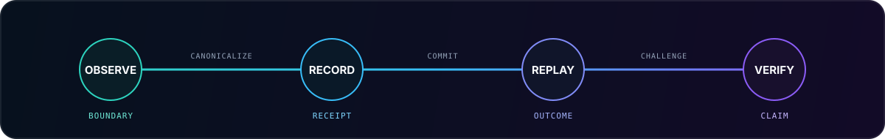
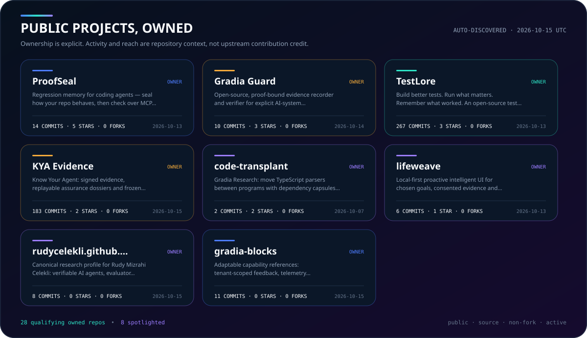
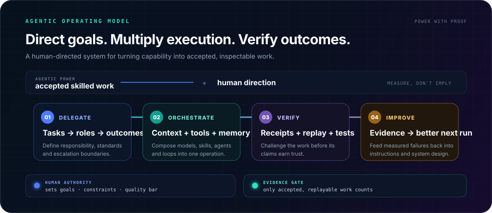

<div align="center">


<br />

[](https://www.linkedin.com/in/rudymizrahi/)
[](https://www.gradiahq.com)
[](https://orcid.org/0009-0000-7043-3766)
[](https://github.com/rudycelekli?tab=followers)

<br />

**Charlotte-based Forward Deployed AI Researcher · Agentic AI Engineer**

<sub>Building verifiable, long-horizon agent systems · Research, implementation & open source</sub>

[Gradia — AI Research & Implementation Lab](https://www.gradiahq.com) · [Snorkel AI](https://snorkel.ai/) · [AxiomConsulting.ai — A Gradia Company](https://axiomconsulting.ai/)

</div>

## Research identity

**Rudy Mizrahi Celekli**, also known professionally as **Rudy Celekli**, is a Charlotte-based forward-deployed AI researcher and open-source engineer focused on verifiable long-horizon agent environments, evaluator robustness, deterministic replay, causal fault isolation, and evidence-bound AI execution.

I build systems that make autonomous behavior inspectable: preserve the world state, replay the action, challenge the evaluator, isolate the failure, and retain enough evidence for another person to check the claim. Public ownership, upstream contribution, measured results, and exploratory work stay explicitly separate.

[**Canonical research profile**](https://rudycelekli.github.io/) · [Model-readable evidence](https://rudycelekli.github.io/llms.txt) · [ORCID](https://orcid.org/0009-0000-7043-3766) · [Live open-source evidence](#open-source-impact-verified) · [Gradia research role](https://www.gradiahq.com/about)

<!-- top-contributor-proof:start -->
<div align="center">

**GitHub all-time Top-5 contributor at**

[**iFixAi**](https://github.com/ifixai-ai/iFixAi) `#1` · 29k ★ &nbsp;·&nbsp; [**helix-foundry**](https://github.com/HelixDB/helix-foundry) `#1` · 1.6k ★ &nbsp;·&nbsp; [**agency-agents**](https://github.com/msitarzewski/agency-agents) `#2` · 161k ★ &nbsp;·&nbsp; [**MoneyPrinterTurbo**](https://github.com/harry0703/MoneyPrinterTurbo) `#2` · 132k ★ &nbsp;·&nbsp; [**claude-mem**](https://github.com/thedotmack/claude-mem) `#2` · 101k ★ &nbsp;·&nbsp; [**Ruflo**](https://github.com/ruvnet/ruflo) `#2` · 76k ★ &nbsp;·&nbsp; [**marketingskills**](https://github.com/coreyhaines31/marketingskills) `#2` · 55k ★ &nbsp;·&nbsp; [**anatomy**](https://github.com/wheresryan22/anatomy) `#2` · 15k ★ &nbsp;·&nbsp; [**openrig**](https://github.com/mvschwarz/openrig) `#2` · 7.7k ★ &nbsp;·&nbsp; [**Peekaboo**](https://github.com/openclaw/Peekaboo) `#2` · 5.3k ★ &nbsp;·&nbsp; [**CCBaga**](https://github.com/liseami/CCBaga) `#2` · 2.6k ★ &nbsp;·&nbsp; [**edgequake**](https://github.com/raphaelmansuy/edgequake) `#2` · 2.3k ★ &nbsp;·&nbsp; [**Agentic-QE**](https://github.com/proffesor-for-testing/agentic-qe) `#2` · 505 ★ &nbsp;·&nbsp; [**cortexdb**](https://github.com/liliang-cn/cortexdb) `#2` · 445 ★ &nbsp;·&nbsp; [**imajev**](https://github.com/mohit67890/imajev) `#2` · 396 ★ &nbsp;·&nbsp; [**agent-chrome-relay**](https://github.com/aindeev/agent-chrome-relay) `#2` · 289 ★ &nbsp;·&nbsp; [**OpenGTM**](https://github.com/debpalash/OpenGTM) `#2` · 56 ★ &nbsp;·&nbsp; [**diagram-design**](https://github.com/cathrynlavery/diagram-design) `#3` · 57k ★ &nbsp;·&nbsp; [**autoharness**](https://github.com/tigerless-labs/autoharness) `#3` · 11k ★ &nbsp;·&nbsp; [**e2e**](https://github.com/tester-army/e2e) `#3` · 11k ★ &nbsp;·&nbsp; [**open-dots**](https://github.com/Anil-matcha/open-dots) `#3` · 5.9k ★ &nbsp;·&nbsp; [**cost-xray**](https://github.com/tigerless-labs/cost-xray) `#3` · 5.5k ★ &nbsp;·&nbsp; [**talorys**](https://github.com/rociiu/talorys) `#3` · 1.3k ★ &nbsp;·&nbsp; [**open-ontologies**](https://github.com/fabio-rovai/open-ontologies) `#3` · 1.1k ★ &nbsp;·&nbsp; [**rea**](https://github.com/morluto/rea) `#4` · 307k ★ &nbsp;·&nbsp; [**gods-eye-view**](https://github.com/bilawalsidhu/gods-eye-view) `#4` · 58k ★ &nbsp;·&nbsp; [**CowAgent**](https://github.com/zhayujie/CowAgent) `#4` · 47k ★ &nbsp;·&nbsp; [**oh-my-claudecode**](https://github.com/Yeachan-Heo/oh-my-claudecode) `#4` · 40k ★ &nbsp;·&nbsp; [**leantoken**](https://github.com/morluto/leantoken) `#4` · 97 ★ &nbsp;·&nbsp; [**utopia**](https://github.com/deeplethe/utopia) `#5` · 8.4k ★

<sub>All-time rank from GitHub's Contributors API · repository stars are reach, not personal credit · refreshed 2026-10-17 UTC</sub>

</div>
<!-- top-contributor-proof:end -->

<!-- building-now:start -->
## Building now



**Strategic anchors:**

**[Gradia — AI Research & Implementation Lab](https://www.gradiahq.com)** connects applied research, evaluation, reusable software, and hands-on enterprise implementation. It is building a verified software factory around **Blocks · Factory · Verify · Workers · Intelligence**, with [AxiomConsulting.ai](https://axiomconsulting.ai/) as its implementation, forward-deployed AI engineering, and architecture arm. The research and evaluation foundation is established; the broader factory products remain in development.

**[KYA Evidence · Know Your Agent](https://github.com/rudycelekli/kya-evidence)** for portable, scope-bound agent assurance: bind the exact system, accept signed evidence under explicit relying-party policy, and produce an explainable, contestable assessment. This is an experimental reference implementation and standardization path—not an adopted industry standard.

**Public frontier, selected automatically and shown in 2 rotating views:**

1. **[Gradia Guard](https://github.com/rudycelekli/gradia-guard)** · [source-v0.1.0-beta.8 pre-release](https://github.com/rudycelekli/gradia-guard/releases/tag/source-v0.1.0-beta.8): Open-source, proof-bound evidence recorder and verifier for explicit AI-system execution boundaries.
2. **[TestLore](https://github.com/rudycelekli/testlore)**: Build better tests. Run what matters. Remember what worked. An open-source test intelligence and quality engineering layer.
3. **[ProofSeal](https://github.com/rudycelekli/proofseal)**: Regression memory for coding agents: seal how your repo behaves, then check over MCP (or in CI) that an edit didn't regress it: pass/drift/regressed/missing. With seal history, bisection, and staleness queries.
4. **[code-transplant](https://github.com/rudycelekli/code-transplant)** · [v0.1.0 pre-release](https://github.com/rudycelekli/code-transplant/releases/tag/v0.1.0): Gradia Research: move TypeScript parsers between programs with dependency capsules and reproducible behavioral evidence.
5. **[Kin Connect](https://github.com/rudycelekli/kin-connect)** · [v0.2.1 pre-release](https://github.com/rudycelekli/kin-connect/releases/tag/v0.2.1): Your agent. Your people. Open-source agent-to-agent introductions for friendship, dating, and collaboration.
6. **[lifeweave](https://github.com/rudycelekli/lifeweave)** · [v0.1.0-alpha.4 pre-release](https://github.com/rudycelekli/lifeweave/releases/tag/v0.1.0-alpha.4): Local-first proactive intelligent UI for chosen goals, consented evidence and working personal or business surfaces.

<sub>Public frontier selections are re-evaluated every 30 minutes from GitHub reach, shipping and release recency, attributed work, and project completeness · last ranked 2026-10-17 UTC · Gradia and KYA Evidence are intentionally separate strategic anchors; the broader Gradia factory is described as in development and its private repository evidence remains private</sub>
<!-- building-now:end -->

## Watch the operating brief



<sub>35 seconds · seven chapters · live evidence · reduced-motion safe · narrative format inspired by [RuVector’s vector walkthrough](https://github.com/ruvnet/ruvector/blob/main/assets/ruvector/ruvector-walkthrough.md)</sub>

[Inspect public proof](#open-source-impact-verified) · [Explore the proof stack](#the-proof-stack) · [Audit Agentic Power](#agentic-power-engineered) · [Meet the human layer](#building-the-human-layer)

## Intelligence is cheap. Evidence is the product.

I’m a forward deployed AI researcher and agentic AI engineer building systems that make autonomous behavior **observable, replayable, and independently verifiable**.

My work sits where agent infrastructure meets experimental science: record what happened, challenge the evaluator, preserve the evidence, and make every important claim reproducible by someone else.



<!-- contribution-stats:start -->
## Open-source impact, verified

My upstream work is discovered automatically across public repositories outside my account. A project enters when GitHub verifies at least one attribution signal: its Contributors index, its contribution graph, an authored commit on the default branch, or an authored merged PR on any branch. **GitHub-listed contributor** remains the highest attribution tier and is applied automatically when GitHub's Contributors API catches up. GitHub API rank is the one-based position returned by that repository's Contributors API; **—** means the rank is unavailable or still pending, not that the contribution is unranked. Only merged PRs contribute accepted-line and accepted-file totals; graph credit never converts an open or closed-unmerged PR into accepted work. Stars and forks describe repository reach, not personal credit.


**[Open the live sortable evidence explorer →](https://rudycelekli.github.io/contributions.html)** — sort by GitHub contributor rank, merged PRs, attributed commits, accepted line changes, repository stars, or a transparent balanced view.

| Project and evidence | GitHub API rank | Attributed commits | Merged PRs | Accepted lines (+ / −) | Files | Repository reach |
|:--|--:|--:|--:|--:|--:|--:|
| **[claude-mem](https://github.com/thedotmack/claude-mem)** · [GitHub-listed contributor](https://github.com/thedotmack/claude-mem/graphs/contributors) | [#2](https://github.com/thedotmack/claude-mem/graphs/contributors) | 201 | [200](https://github.com/thedotmack/claude-mem/pulls?q=is%3Apr+author%3Arudycelekli+is%3Amerged) | +24,616 / −2,113 | 737 | 101,410 ★ · 8,891 forks |
| **[openrig](https://github.com/mvschwarz/openrig)** · [GitHub-listed contributor](https://github.com/mvschwarz/openrig/graphs/contributors) | [#2](https://github.com/mvschwarz/openrig/graphs/contributors) | 197 | [197](https://github.com/mvschwarz/openrig/pulls?q=is%3Apr+author%3Arudycelekli+is%3Amerged) | +15,673 / −1,271 | 552 | 7,694 ★ · 609 forks |
| **[MoneyPrinterTurbo](https://github.com/harry0703/MoneyPrinterTurbo)** · [GitHub-listed contributor](https://github.com/harry0703/MoneyPrinterTurbo/graphs/contributors) | [#2](https://github.com/harry0703/MoneyPrinterTurbo/graphs/contributors) | 190 | [190](https://github.com/harry0703/MoneyPrinterTurbo/pulls?q=is%3Apr+author%3Arudycelekli+is%3Amerged) | +14,986 / −1,094 | 448 | 132,385 ★ · 20,870 forks |
| **[iFixAi](https://github.com/ifixai-ai/iFixAi)** · [GitHub-listed contributor](https://github.com/ifixai-ai/iFixAi/graphs/contributors) | [#1](https://github.com/ifixai-ai/iFixAi/graphs/contributors) | 171 | [171](https://github.com/ifixai-ai/iFixAi/pulls?q=is%3Apr+author%3Arudycelekli+is%3Amerged) | +19,684 / −872 | 496 | 29,136 ★ · 1,593 forks |
| **[marketingskills](https://github.com/coreyhaines31/marketingskills)** · [GitHub-listed contributor](https://github.com/coreyhaines31/marketingskills/graphs/contributors) | [#2](https://github.com/coreyhaines31/marketingskills/graphs/contributors) | 209 | [166](https://github.com/coreyhaines31/marketingskills/pulls?q=is%3Apr+author%3Arudycelekli+is%3Amerged) | +12,352 / −1,493 | 875 | 55,252 ★ · 8,187 forks |
| **[CowAgent](https://github.com/zhayujie/CowAgent)** · [GitHub-listed contributor](https://github.com/zhayujie/CowAgent/graphs/contributors) | [#4](https://github.com/zhayujie/CowAgent/graphs/contributors) | 176 | [165](https://github.com/zhayujie/CowAgent/pulls?q=is%3Apr+author%3Arudycelekli+is%3Amerged) | +12,700 / −1,056 | 411 | 47,446 ★ · 10,394 forks |
| **[Ruflo](https://github.com/ruvnet/ruflo)** · [GitHub-listed contributor](https://github.com/ruvnet/ruflo/graphs/contributors) | [#2](https://github.com/ruvnet/ruflo/graphs/contributors) | 311 | [159](https://github.com/ruvnet/ruflo/pulls?q=is%3Apr+author%3Arudycelekli+is%3Amerged) | +14,846 / −2,021 | 503 | 76,039 ★ · 9,001 forks |
| **[Agentic-QE](https://github.com/proffesor-for-testing/agentic-qe)** · [GitHub-listed contributor](https://github.com/proffesor-for-testing/agentic-qe/graphs/contributors) | [#2](https://github.com/proffesor-for-testing/agentic-qe/graphs/contributors) | 238 | [153](https://github.com/proffesor-for-testing/agentic-qe/pulls?q=is%3Apr+author%3Arudycelekli+is%3Amerged) | +24,817 / −4,084 | 603 | 505 ★ · 100 forks |
| **[agency-agents](https://github.com/msitarzewski/agency-agents)** · [GitHub-listed contributor](https://github.com/msitarzewski/agency-agents/graphs/contributors) | [#2](https://github.com/msitarzewski/agency-agents/graphs/contributors) | 160 | [148](https://github.com/msitarzewski/agency-agents/pulls?q=is%3Apr+author%3Arudycelekli+is%3Amerged) | +2,750 / −971 | 183 | 160,889 ★ · 26,031 forks |
| **[rea](https://github.com/morluto/rea)** · [GitHub-listed contributor](https://github.com/morluto/rea/graphs/contributors) | [#4](https://github.com/morluto/rea/graphs/contributors) | 91 | [83](https://github.com/morluto/rea/pulls?q=is%3Apr+author%3Arudycelekli+is%3Amerged) | +32,808 / −2,976 | 666 | 307,220 ★ · 77,718 forks |
| **[Peekaboo](https://github.com/openclaw/Peekaboo)** · [GitHub-listed contributor](https://github.com/openclaw/Peekaboo/graphs/contributors) | [#2](https://github.com/openclaw/Peekaboo/graphs/contributors) | 62 | [62](https://github.com/openclaw/Peekaboo/pulls?q=is%3Apr+author%3Arudycelekli+is%3Amerged) | +6,623 / −859 | 270 | 5,336 ★ · 412 forks |
| **[Vibe-Trading](https://github.com/HKUDS/Vibe-Trading)** · [GitHub-listed contributor](https://github.com/HKUDS/Vibe-Trading/graphs/contributors) | [#8](https://github.com/HKUDS/Vibe-Trading/graphs/contributors) | 70 | [51](https://github.com/HKUDS/Vibe-Trading/pulls?q=is%3Apr+author%3Arudycelekli+is%3Amerged) | +4,252 / −325 | 137 | 35,722 ★ · 5,798 forks |
| **[colibri](https://github.com/JustVugg/colibri)** · [GitHub-listed contributor](https://github.com/JustVugg/colibri/graphs/contributors) | [#9](https://github.com/JustVugg/colibri/graphs/contributors) | 39 | [50](https://github.com/JustVugg/colibri/pulls?q=is%3Apr+author%3Arudycelekli+is%3Amerged) | +4,177 / −150 | 144 | 42,600 ★ · 4,753 forks |
| **[OpenGTM](https://github.com/debpalash/OpenGTM)** · [GitHub-listed contributor](https://github.com/debpalash/OpenGTM/graphs/contributors) | [#2](https://github.com/debpalash/OpenGTM/graphs/contributors) | 55 | [49](https://github.com/debpalash/OpenGTM/pulls?q=is%3Apr+author%3Arudycelekli+is%3Amerged) | +4,476 / −235 | 128 | 56 ★ · 16 forks |
| **[oh-my-claudecode](https://github.com/Yeachan-Heo/oh-my-claudecode)** · [GitHub-listed contributor](https://github.com/Yeachan-Heo/oh-my-claudecode/graphs/contributors) | [#4](https://github.com/Yeachan-Heo/oh-my-claudecode/graphs/contributors) | 46 | [49](https://github.com/Yeachan-Heo/oh-my-claudecode/pulls?q=is%3Apr+author%3Arudycelekli+is%3Amerged) | +10,630 / −1,925 | 234 | 40,005 ★ · 3,587 forks |
| **[agent-beacon](https://github.com/Asymptote-Labs/agent-beacon)** · [GitHub-listed contributor](https://github.com/Asymptote-Labs/agent-beacon/graphs/contributors) | [#6](https://github.com/Asymptote-Labs/agent-beacon/graphs/contributors) | 45 | [45](https://github.com/Asymptote-Labs/agent-beacon/pulls?q=is%3Apr+author%3Arudycelekli+is%3Amerged) | +4,095 / −816 | 232 | 1,836 ★ · 171 forks |
| **[cortexdb](https://github.com/liliang-cn/cortexdb)** · [GitHub-listed contributor](https://github.com/liliang-cn/cortexdb/graphs/contributors) | [#2](https://github.com/liliang-cn/cortexdb/graphs/contributors) | 45 | [45](https://github.com/liliang-cn/cortexdb/pulls?q=is%3Apr+author%3Arudycelekli+is%3Amerged) | +2,925 / −207 | 98 | 445 ★ · 20 forks |
| **[anatomy](https://github.com/wheresryan22/anatomy)** · [GitHub-listed contributor](https://github.com/wheresryan22/anatomy/graphs/contributors) | [#2](https://github.com/wheresryan22/anatomy/graphs/contributors) | 41 | [37](https://github.com/wheresryan22/anatomy/pulls?q=is%3Apr+author%3Arudycelekli+is%3Amerged) | +2,220 / −227 | 142 | 15,080 ★ · 1,155 forks |
| **[edgequake](https://github.com/raphaelmansuy/edgequake)** · [GitHub-listed contributor](https://github.com/raphaelmansuy/edgequake/graphs/contributors) | [#2](https://github.com/raphaelmansuy/edgequake/graphs/contributors) | 48 | [35](https://github.com/raphaelmansuy/edgequake/pulls?q=is%3Apr+author%3Arudycelekli+is%3Amerged) | +2,402 / −259 | 77 | 2,269 ★ · 268 forks |
| **[e2e](https://github.com/tester-army/e2e)** · [GitHub-listed contributor](https://github.com/tester-army/e2e/graphs/contributors) | [#3](https://github.com/tester-army/e2e/graphs/contributors) | 34 | [34](https://github.com/tester-army/e2e/pulls?q=is%3Apr+author%3Arudycelekli+is%3Amerged) | +1,794 / −162 | 150 | 11,079 ★ · 553 forks |
| **[helix-foundry](https://github.com/HelixDB/helix-foundry)** · [GitHub-listed contributor](https://github.com/HelixDB/helix-foundry/graphs/contributors) | [#1](https://github.com/HelixDB/helix-foundry/graphs/contributors) | 30 | [30](https://github.com/HelixDB/helix-foundry/pulls?q=is%3Apr+author%3Arudycelekli+is%3Amerged) | +6,597 / −269 | 117 | 1,573 ★ · 239 forks |
| **[gods-eye-view](https://github.com/bilawalsidhu/gods-eye-view)** · [GitHub-listed contributor](https://github.com/bilawalsidhu/gods-eye-view/graphs/contributors) | [#4](https://github.com/bilawalsidhu/gods-eye-view/graphs/contributors) | 54 | [26](https://github.com/bilawalsidhu/gods-eye-view/pulls?q=is%3Apr+author%3Arudycelekli+is%3Amerged) | +1,842 / −155 | 117 | 57,636 ★ · 11,232 forks |
| **[hindsight](https://github.com/vectorize-io/hindsight)** · [GitHub-listed contributor](https://github.com/vectorize-io/hindsight/graphs/contributors) | [#13](https://github.com/vectorize-io/hindsight/graphs/contributors) | 24 | [24](https://github.com/vectorize-io/hindsight/pulls?q=is%3Apr+author%3Arudycelekli+is%3Amerged) | +1,546 / −116 | 58 | 50,850 ★ · 6,128 forks |
| **[diagram-design](https://github.com/cathrynlavery/diagram-design)** · [GitHub-listed contributor](https://github.com/cathrynlavery/diagram-design/graphs/contributors) | [#3](https://github.com/cathrynlavery/diagram-design/graphs/contributors) | 20 | [20](https://github.com/cathrynlavery/diagram-design/pulls?q=is%3Apr+author%3Arudycelekli+is%3Amerged) | +2,191 / −183 | 66 | 56,980 ★ · 3,623 forks |
| **[VoiceStudio](https://github.com/debpalash/VoiceStudio)** · [GitHub-listed contributor](https://github.com/debpalash/VoiceStudio/graphs/contributors) | [#6](https://github.com/debpalash/VoiceStudio/graphs/contributors) | 39 | [19](https://github.com/debpalash/VoiceStudio/pulls?q=is%3Apr+author%3Arudycelekli+is%3Amerged) | +2,645 / −139 | 83 | 73,251 ★ · 8,016 forks |
| **[open-ontologies](https://github.com/fabio-rovai/open-ontologies)** · [GitHub-listed contributor](https://github.com/fabio-rovai/open-ontologies/graphs/contributors) | [#3](https://github.com/fabio-rovai/open-ontologies/graphs/contributors) | 25 | [19](https://github.com/fabio-rovai/open-ontologies/pulls?q=is%3Apr+author%3Arudycelekli+is%3Amerged) | +3,528 / −165 | 70 | 1,077 ★ · 143 forks |
| **[open-dots](https://github.com/Anil-matcha/open-dots)** · [GitHub-listed contributor](https://github.com/Anil-matcha/open-dots/graphs/contributors) | [#3](https://github.com/Anil-matcha/open-dots/graphs/contributors) | 19 | [17](https://github.com/Anil-matcha/open-dots/pulls?q=is%3Apr+author%3Arudycelekli+is%3Amerged) | +2,055 / −78 | 38 | 5,853 ★ · 710 forks |
| **[VLMEvalKit](https://github.com/open-compass/VLMEvalKit)** · [GitHub-listed contributor](https://github.com/open-compass/VLMEvalKit/graphs/contributors) | [#13](https://github.com/open-compass/VLMEvalKit/graphs/contributors) | 14 | [14](https://github.com/open-compass/VLMEvalKit/pulls?q=is%3Apr+author%3Arudycelekli+is%3Amerged) | +1,242 / −78 | 42 | 4,444 ★ · 793 forks |
| **[ghidra](https://github.com/NationalSecurityAgency/ghidra)** · [GitHub-listed contributor](https://github.com/NationalSecurityAgency/ghidra/graphs/contributors) | [#28](https://github.com/NationalSecurityAgency/ghidra/graphs/contributors) | 14 | [13](https://github.com/NationalSecurityAgency/ghidra/pulls?q=is%3Apr+author%3Arudycelekli+is%3Amerged) | +355 / −55 | 17 | 90,241 ★ · 10,098 forks |
| **[utopia](https://github.com/deeplethe/utopia)** · [GitHub-listed contributor](https://github.com/deeplethe/utopia/graphs/contributors) | [#5](https://github.com/deeplethe/utopia/graphs/contributors) | 13 | [13](https://github.com/deeplethe/utopia/pulls?q=is%3Apr+author%3Arudycelekli+is%3Amerged) | +303 / −32 | 21 | 8,412 ★ · 1,170 forks |
| **[autoharness](https://github.com/tigerless-labs/autoharness)** · [GitHub-listed contributor](https://github.com/tigerless-labs/autoharness/graphs/contributors) | [#3](https://github.com/tigerless-labs/autoharness/graphs/contributors) | 13 | [11](https://github.com/tigerless-labs/autoharness/pulls?q=is%3Apr+author%3Arudycelekli+is%3Amerged) | +660 / −29 | 28 | 11,134 ★ · 628 forks |
| **[mcp-go](https://github.com/mark3labs/mcp-go)** · [GitHub-listed contributor](https://github.com/mark3labs/mcp-go/graphs/contributors) | [#6](https://github.com/mark3labs/mcp-go/graphs/contributors) | 11 | [11](https://github.com/mark3labs/mcp-go/pulls?q=is%3Apr+author%3Arudycelekli+is%3Amerged) | +789 / −309 | 28 | 9,171 ★ · 906 forks |
| **[agent-skills](https://github.com/addyosmani/agent-skills)** · [GitHub-listed contributor](https://github.com/addyosmani/agent-skills/graphs/contributors) | [#9](https://github.com/addyosmani/agent-skills/graphs/contributors) | 9 | [9](https://github.com/addyosmani/agent-skills/pulls?q=is%3Apr+author%3Arudycelekli+is%3Amerged) | +184 / −24 | 15 | 107,828 ★ · 11,239 forks |
| **[talorys](https://github.com/rociiu/talorys)** · [GitHub-listed contributor](https://github.com/rociiu/talorys/graphs/contributors) | [#3](https://github.com/rociiu/talorys/graphs/contributors) | 9 | [9](https://github.com/rociiu/talorys/pulls?q=is%3Apr+author%3Arudycelekli+is%3Amerged) | +474 / −39 | 21 | 1,299 ★ · 112 forks |
| **[CCBaga](https://github.com/liseami/CCBaga)** · [GitHub-listed contributor](https://github.com/liseami/CCBaga/graphs/contributors) | [#2](https://github.com/liseami/CCBaga/graphs/contributors) | 16 | [8](https://github.com/liseami/CCBaga/pulls?q=is%3Apr+author%3Arudycelekli+is%3Amerged) | +1,691 / −58 | 42 | 2,568 ★ · 257 forks |
| **[benchmark-radar](https://github.com/ktwu01/benchmark-radar)** · [GitHub-listed contributor](https://github.com/ktwu01/benchmark-radar/graphs/contributors) | [#8](https://github.com/ktwu01/benchmark-radar/graphs/contributors) | 11 | [7](https://github.com/ktwu01/benchmark-radar/pulls?q=is%3Apr+author%3Arudycelekli+is%3Amerged) | +1,027 / −44 | 22 | 295 ★ · 46 forks |
| **[agent-chrome-relay](https://github.com/aindeev/agent-chrome-relay)** · [GitHub-listed contributor](https://github.com/aindeev/agent-chrome-relay/graphs/contributors) | [#2](https://github.com/aindeev/agent-chrome-relay/graphs/contributors) | 7 | [7](https://github.com/aindeev/agent-chrome-relay/pulls?q=is%3Apr+author%3Arudycelekli+is%3Amerged) | +715 / −33 | 25 | 289 ★ · 9 forks |
| **[cost-xray](https://github.com/tigerless-labs/cost-xray)** · [GitHub-listed contributor](https://github.com/tigerless-labs/cost-xray/graphs/contributors) | [#3](https://github.com/tigerless-labs/cost-xray/graphs/contributors) | 6 | [6](https://github.com/tigerless-labs/cost-xray/pulls?q=is%3Apr+author%3Arudycelekli+is%3Amerged) | +109 / −6 | 12 | 5,482 ★ · 352 forks |
| **[archify](https://github.com/tt-a1i/archify)** · [Merged-PR verified](https://github.com/tt-a1i/archify/pulls?q=is%3Apr+author%3Arudycelekli+is%3Amerged) | — | — | [5](https://github.com/tt-a1i/archify/pulls?q=is%3Apr+author%3Arudycelekli+is%3Amerged) | +176 / −54 | 15 | 84,867 ★ · 5,746 forks |
| **[openclaw](https://github.com/openclaw/openclaw)** · [Default-branch commit verified](https://github.com/openclaw/openclaw/commits?author=rudycelekli) | — | 4 | [4](https://github.com/openclaw/openclaw/pulls?q=is%3Apr+author%3Arudycelekli+is%3Amerged) | +681 / −17 | 12 | 392,286 ★ · 82,463 forks |
| **[OpenMontage](https://github.com/calesthio/OpenMontage)** · [GitHub-listed contributor](https://github.com/calesthio/OpenMontage/graphs/contributors) | [#9](https://github.com/calesthio/OpenMontage/graphs/contributors) | 4 | [4](https://github.com/calesthio/OpenMontage/pulls?q=is%3Apr+author%3Arudycelekli+is%3Amerged) | +355 / −12 | 8 | 69,160 ★ · 8,892 forks |
| **[ai-memory](https://github.com/akitaonrails/ai-memory)** · [GitHub-listed contributor](https://github.com/akitaonrails/ai-memory/graphs/contributors) | [#36](https://github.com/akitaonrails/ai-memory/graphs/contributors) | 7 | [3](https://github.com/akitaonrails/ai-memory/pulls?q=is%3Apr+author%3Arudycelekli+is%3Amerged) | +809 / −57 | 16 | 9,898 ★ · 715 forks |
| **[trueforge](https://github.com/truefoundry/trueforge)** · [GitHub-listed contributor](https://github.com/truefoundry/trueforge/graphs/contributors) | [#22](https://github.com/truefoundry/trueforge/graphs/contributors) | 3 | [3](https://github.com/truefoundry/trueforge/pulls?q=is%3Apr+author%3Arudycelekli+is%3Amerged) | +36 / −17 | 6 | 6,271 ★ · 527 forks |
| **[leantoken](https://github.com/morluto/leantoken)** · [GitHub-listed contributor](https://github.com/morluto/leantoken/graphs/contributors) | [#4](https://github.com/morluto/leantoken/graphs/contributors) | 3 | [3](https://github.com/morluto/leantoken/pulls?q=is%3Apr+author%3Arudycelekli+is%3Amerged) | +430 / −22 | 8 | 97 ★ · 12 forks |
| **[ai-job-search](https://github.com/MadsLorentzen/ai-job-search)** · [GitHub-listed contributor](https://github.com/MadsLorentzen/ai-job-search/graphs/contributors) | [#24](https://github.com/MadsLorentzen/ai-job-search/graphs/contributors) | 2 | [2](https://github.com/MadsLorentzen/ai-job-search/pulls?q=is%3Apr+author%3Arudycelekli+is%3Amerged) | +119 / −3 | 6 | 50,317 ★ · 16,922 forks |
| **[hyperframes](https://github.com/heygen-com/hyperframes)** · [GitHub-listed contributor](https://github.com/heygen-com/hyperframes/graphs/contributors) | [#58](https://github.com/heygen-com/hyperframes/graphs/contributors) | 1 | [1](https://github.com/heygen-com/hyperframes/pulls?q=is%3Apr+author%3Arudycelekli+is%3Amerged) | +2 / −1 | 1 | 65,973 ★ · 5,955 forks |
| **[agno](https://github.com/agno-agi/agno)** · [GitHub-listed contributor](https://github.com/agno-agi/agno/graphs/contributors) | [#304](https://github.com/agno-agi/agno/graphs/contributors) | 1 | [1](https://github.com/agno-agi/agno/pulls?q=is%3Apr+author%3Arudycelekli+is%3Amerged) | +332 / −6 | 2 | 42,781 ★ · 6,151 forks |
| **[agentsview](https://github.com/kenn-io/agentsview)** · [GitHub-listed contributor](https://github.com/kenn-io/agentsview/graphs/contributors) | [#71](https://github.com/kenn-io/agentsview/graphs/contributors) | 1 | [1](https://github.com/kenn-io/agentsview/pulls?q=is%3Apr+author%3Arudycelekli+is%3Amerged) | +294 / −24 | 5 | 6,141 ★ · 698 forks |
| **[agent-memory](https://github.com/tigerless-labs/agent-memory)** · [GitHub-listed contributor](https://github.com/tigerless-labs/agent-memory/graphs/contributors) | [#8](https://github.com/tigerless-labs/agent-memory/graphs/contributors) | 1 | [1](https://github.com/tigerless-labs/agent-memory/pulls?q=is%3Apr+author%3Arudycelekli+is%3Amerged) | +86 / −4 | 5 | 4,061 ★ · 175 forks |
| **[ms-365-mcp-server](https://github.com/Softeria/ms-365-mcp-server)** · [GitHub-listed contributor](https://github.com/Softeria/ms-365-mcp-server/graphs/contributors) | [#29](https://github.com/Softeria/ms-365-mcp-server/graphs/contributors) | 1 | [1](https://github.com/Softeria/ms-365-mcp-server/pulls?q=is%3Apr+author%3Arudycelekli+is%3Amerged) | +56 / −6 | 2 | 1,054 ★ · 395 forks |
| **[terminal-bench-science](https://github.com/harbor-framework/terminal-bench-science)** · [GitHub-listed contributor](https://github.com/harbor-framework/terminal-bench-science/graphs/contributors) | [#41](https://github.com/harbor-framework/terminal-bench-science/graphs/contributors) | 1 | [1](https://github.com/harbor-framework/terminal-bench-science/pulls?q=is%3Apr+author%3Arudycelekli+is%3Amerged) | +1 / −1 | 1 | 730 ★ · 482 forks |
| **[imajev](https://github.com/mohit67890/imajev)** · [GitHub-listed contributor](https://github.com/mohit67890/imajev/graphs/contributors) | [#2](https://github.com/mohit67890/imajev/graphs/contributors) | 1 | [1](https://github.com/mohit67890/imajev/pulls?q=is%3Apr+author%3Arudycelekli+is%3Amerged) | +164 / −2 | 4 | 396 ★ · 47 forks |
| **[mcpproxy-go](https://github.com/smart-mcp-proxy/mcpproxy-go)** · [GitHub-listed contributor](https://github.com/smart-mcp-proxy/mcpproxy-go/graphs/contributors) | [#29](https://github.com/smart-mcp-proxy/mcpproxy-go/graphs/contributors) | 1 | [1](https://github.com/smart-mcp-proxy/mcpproxy-go/pulls?q=is%3Apr+author%3Arudycelekli+is%3Amerged) | +60 / −4 | 2 | 395 ★ · 63 forks |
| **[benchmark-radar-paper](https://github.com/ktwu01/benchmark-radar-paper)** · [GitHub-listed contributor](https://github.com/ktwu01/benchmark-radar-paper/graphs/contributors) | [#6](https://github.com/ktwu01/benchmark-radar-paper/graphs/contributors) | 1 | [1](https://github.com/ktwu01/benchmark-radar-paper/pulls?q=is%3Apr+author%3Arudycelekli+is%3Amerged) | +7 / −4 | 3 | 2 ★ · 9 forks |
| **[hermes-agent](https://github.com/NousResearch/hermes-agent)** · [Default-branch commit verified](https://github.com/NousResearch/hermes-agent/commits?author=rudycelekli) | — | 4 | [0](https://github.com/NousResearch/hermes-agent/pulls?q=is%3Apr+author%3Arudycelekli+is%3Amerged) | — | — | 254,682 ★ · 55,357 forks |
| **[text-to-cad](https://github.com/earthtojake/text-to-cad)** · [GitHub graph verified](https://github.com/rudycelekli?tab=overview&from=2026-10-01&to=2026-10-31) | — | 3 | [0](https://github.com/earthtojake/text-to-cad/pulls?q=is%3Apr+author%3Arudycelekli+is%3Amerged) | — | — | 21,255 ★ · 2,100 forks |
| **[goplaces](https://github.com/openclaw/goplaces)** · [GitHub graph verified](https://github.com/rudycelekli?tab=overview&from=2026-10-01&to=2026-10-31) | — | 3 | [0](https://github.com/openclaw/goplaces/pulls?q=is%3Apr+author%3Arudycelekli+is%3Amerged) | — | — | 261 ★ · 36 forks |
| **[mcporter](https://github.com/openclaw/mcporter)** · [GitHub graph verified](https://github.com/rudycelekli?tab=overview&from=2026-10-01&to=2026-10-31) | — | 2 | [0](https://github.com/openclaw/mcporter/pulls?q=is%3Apr+author%3Arudycelekli+is%3Amerged) | — | — | 5,069 ★ · 355 forks |
| **[poltergeist](https://github.com/steipete/poltergeist)** · [GitHub graph verified](https://github.com/rudycelekli?tab=overview&from=2026-10-01&to=2026-10-31) | — | 2 | [0](https://github.com/steipete/poltergeist/pulls?q=is%3Apr+author%3Arudycelekli+is%3Amerged) | — | — | 447 ★ · 40 forks |

### Public projects I own

Owned public source is a separate signal: GitHub lists me as the repository owner. These projects are discovered automatically from my public, non-fork, non-archived repositories, then ranked by stars, recent activity, and GitHub-attributed commits. Ownership is not counted as upstream contributor credit.



- **[ProofSeal](https://github.com/rudycelekli/proofseal)**: public owner repository with 14 GitHub-indexed commits. Repository reach: 5 stars and 0 forks; last pushed 2026-10-13.
- **[Gradia Guard](https://github.com/rudycelekli/gradia-guard)**: public owner repository with 10 GitHub-indexed commits. Repository reach: 3 stars and 0 forks; last pushed 2026-10-17.
- **[TestLore](https://github.com/rudycelekli/testlore)**: public owner repository with 267 GitHub-indexed commits. Repository reach: 3 stars and 0 forks; last pushed 2026-10-13.
- **[KYA Evidence](https://github.com/rudycelekli/kya-evidence)**: public owner repository with 201 GitHub-indexed commits. Repository reach: 2 stars and 0 forks; last pushed 2026-10-17.
- **[code-transplant](https://github.com/rudycelekli/code-transplant)**: public owner repository with 2 GitHub-indexed commits. Repository reach: 2 stars and 0 forks; last pushed 2026-10-07.
- **[lifeweave](https://github.com/rudycelekli/lifeweave)**: public owner repository with 6 GitHub-indexed commits. Repository reach: 1 star and 0 forks; last pushed 2026-10-13.
- **[rudycelekli.github.io](https://github.com/rudycelekli/rudycelekli.github.io)**: public owner repository with 8 GitHub-indexed commits. Repository reach: 0 stars and 0 forks; last pushed 2026-10-17.
- **[gradia-blocks](https://github.com/rudycelekli/gradia-blocks)**: public owner repository with 11 GitHub-indexed commits. Repository reach: 0 stars and 0 forks; last pushed 2026-10-15.

<sub>Showing 8 of 28 qualifying owned public repositories · [browse every public source repository](https://github.com/rudycelekli?tab=repositories&type=source) · complete evidence retained in [machine-readable data](./data/contributions.json)</sub>

<sub>Last verified 2026-10-17 UTC · visual + evidence refreshed every 30 minutes by [GitHub Actions](./.github/workflows/refresh-contribution-stats.yml) · [machine-readable evidence](./data/contributions.json)</sub>
<!-- contribution-stats:end -->

## The proof stack

<table>
<tr>
<td width="50%" valign="top">

### 🛡️ [Gradia Guard](https://github.com/rudycelekli/gradia-guard)

Proof-bound evidence for AI execution. Records hash-chained decisions and actions, verifies them offline, and makes the boundary of every claim explicit.

`TypeScript` `Python` `AG-UI` `Cryptographic evidence`

</td>
<td width="50%" valign="top">

### 🌪️ [Gradia Wind Tunnel](https://github.com/rudycelekli/gradia-wind-tunnel)

An evaluation immune system. Finds reward-hacking exploits, isolates their causal slice, and tests whether scorer patches truly converge.

`Python` `Causal testing` `Offline replay` `DOI`

</td>
</tr>
<tr>
<td width="50%" valign="top">

### ⚖️ [The Value Engine Benchmark](https://github.com/rudycelekli/the-value-engine-benchmark)

An evidence-graded RL environment for multi-touch enterprise negotiation: **3,510 graded episodes**, **13 models**, and a fully reproducible methodology.

`TypeScript` `Python` `RLVR` `Evaluation`

</td>
<td width="50%" valign="top">

### 🔏 [ProofSeal](https://github.com/rudycelekli/proofseal)

Regression memory for coding agents. Seal behavioral claims once; check them over MCP or CI before a silent regression reaches history.

`JavaScript` `MCP` `CI` `Deterministic testing`

</td>
</tr>
</table>

## Agentic power, engineered

[Agentic Power](https://heroforge-agentic-power.artful-fly-4358.chatgpt.site/) asks a practical question: **how much accepted skilled work can one hour of human direction command?**

I design for that multiplier, but I won’t publish one without exposing its scope, evidence, assumptions, and uncertainty. My operating model is to delegate meaningful responsibility, compose the right tools and context, verify the result, then use the evidence to improve the next run.

<!-- agentic-power-profile:start -->
### Live Agentic Power snapshot


**AP ≈ 211.7× (operator-calibrated provisional estimate):** approximately 31,079.0 skilled Human-Equivalent Hours, or 777.0 engineer-weeks, divided by 146.8 operator-estimated human-direction hours. The transparent scenario range is 136.9× to 336.2×.

The evidence base since January 2025 combines **2,385 merged upstream PRs** with **6,532 authored, non-merge default-branch commits across 109 currently accessible repositories**: personal, private, employer, and open-source alike. Work such as Gradia is included only as a redacted aggregate: no repository names, commit messages, code, links, employer, or client details are published.

The conservative GitHub activity proxy produces 3,883.7 direction hours because it assigns attention to individual commits and repository-months. Operator recall is **1.5–2.0 active direction hours per week**; across 83.9 weeks, that calibrates the denominator to 125.8–167.8 hours, with 146.8 as the midpoint.

Direction includes active briefing, steering, reviewing, correcting, and coordinating. It excludes agent runtime and waiting. The calibration is operator-estimated rather than reconstructed from time logs, so this remains **a transparent scenario, not a completed Full Evidence Audit**.

<sub>[Framework and formula](https://heroforge-agentic-power.artful-fly-4358.chatgpt.site/) · [calculation evidence](./data/agentic-power.json) · public upstream evidence and visuals refreshed every 30 minutes; redacted repository snapshot retained until a private read credential is available</sub>
<!-- agentic-power-profile:end -->



- **Direct:** goals, constraints, acceptance criteria, and escalation rules stay explicit.
- **Orchestrate:** models, specialist agents, reusable skills, tools, memory, and loops become one working system.
- **Verify:** [Gradia Guard](https://github.com/rudycelekli/gradia-guard), [ProofSeal](https://github.com/rudycelekli/proofseal), and replayable evaluations separate completed work from plausible-looking activity.
- **Improve:** [Wind Tunnel](https://github.com/rudycelekli/gradia-wind-tunnel) and [Reward Loop](https://github.com/rudycelekli/gradia-reward-loop) turn measured failure into a better next run.

<sub>Framework concept by [Dr. Mark Allen / HeroForge.AI](https://heroforge-agentic-power.artful-fly-4358.chatgpt.site/). Visual and operating-model adaptation are original to this profile.</sub>

## What I’m exploring

```text
Can we trust the record?      → proof-bound execution evidence
Can we trust the score?       → adversarial evaluator stress testing
Can we reproduce the result?  → deterministic replay + committed artifacts
Can an agent remember?        → regression memory before commit
```

The thread through all of it is simple: **an AI system should be able to show its work without asking you to trust the AI system.**

## Working set

<div align="center">


</div>

## In the lab

- **[Gradia Universes](https://github.com/rudycelekli/gradia-universes-work-sample)** — proof-carrying, interruption-capable synthetic agent worlds with deterministic replay.
- **[Gradia Reward Loop](https://github.com/rudycelekli/gradia-reward-loop)** — oracle-witnessed reward-hacking experiments and a replay-verified paired-GRPO diagnostic.

## Building the human layer

I build communities as deliberately as systems. I lead [**AI Tinkerers Charlotte**](https://charlotte.aitinkerers.org/), a demo-first room for people shipping real AI systems, and serve as [**Regional Ambassador for the Agentics Foundation**](https://agentics.org/leadership/), connecting builders working on practical agentic AI.

---

<div align="center">

### Building AI that can survive contact with reality.

If you care about agent reliability, evaluation integrity, or evidence-first AI, explore the work and compare notes.

[**Connect on LinkedIn →**](https://www.linkedin.com/in/rudymizrahi/) &nbsp;&nbsp; [**Explore Gradia →**](https://www.gradiahq.com) &nbsp;&nbsp; [**Research record →**](https://orcid.org/0009-0000-7043-3766) &nbsp;&nbsp; [**Follow on GitHub →**](https://github.com/rudycelekli?tab=followers)

<sub>Based in Charlotte · working in public</sub>

</div>
