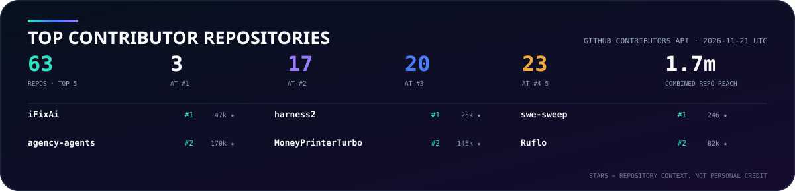
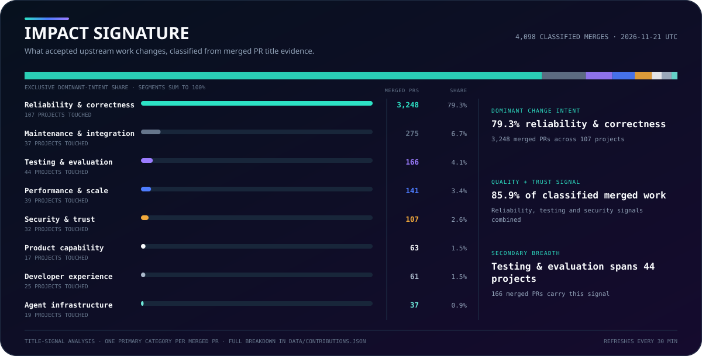

<div align="center">



<br />

[](https://www.linkedin.com/in/rudymizrahi/)
[](https://www.gradiahq.com)
[](https://orcid.org/0009-0000-7043-3766)
[](https://github.com/rudycelekli?tab=followers)

<!-- star-history-badge:start -->
<p align="center">
  <a href="https://www.star-history.com/rudycelekli">
    <picture>
      <source media="(prefers-color-scheme: dark)" srcset="https://api.star-history.com/badge?user=rudycelekli&amp;year=2026&amp;theme=dark" />
      <source media="(prefers-color-scheme: light)" srcset="https://api.star-history.com/badge?user=rudycelekli&amp;year=2026" />
      
    </picture>
  </a>
</p>
<!-- star-history-badge:end -->

**Charlotte-based Forward Deployed AI Researcher · Agentic AI Engineer**

<sub>Building verifiable, long-horizon agent systems · Research, implementation, and open source</sub>

[Gradia](https://www.gradiahq.com) · [Snorkel AI](https://snorkel.ai/) · [AxiomConsulting.ai](https://axiomconsulting.ai/) · [Agentics Foundation](https://agentics.org/leadership/)

</div>

## I build AI systems that can prove what happened.

**On a mission to make open source reliable enough to trust. One repository at a time.**

I am **Rudy Mizrahi Celekli**, also known professionally as **Rudy Celekli**. I research and build long-horizon agent systems, evaluation environments, and evidence-bound execution, with a focus on evaluator robustness, deterministic replay, and causal fault isolation.

The work has two connected fronts: building AI systems whose behavior can be inspected, and strengthening the open-source foundations those systems rely on.

Open source is shared infrastructure. A silent data error, a misleading evaluation, or an agent that fails without a useful trace can become someone else's production problem.

I work on those failure points: reproduce the problem, fix the cause, add a regression test, and get the change accepted upstream. Reliability and correctness are foundations of trust and safety.

An accepted fix improves a shared dependency. A regression test helps maintainers keep that failure from returning. My goal is fewer inherited failures and software people can depend on.

Research, owned products, upstream contributions, and measured results remain explicitly separate.

[**Canonical research profile**](https://rudycelekli.github.io/) · [**Model-readable evidence**](https://rudycelekli.github.io/llms.txt) · [**ORCID**](https://orcid.org/0009-0000-7043-3766) · [**Gradia research role**](https://www.gradiahq.com/about)

### Engineering case studies

[**Browse the repository case studies →**](https://rudycelekli.github.io/engineering/#repository-studies)

The directory covers upstream engineering and owned public projects. Selected examples include [portable agent assurance](https://rudycelekli.github.io/engineering/repositories/rudycelekli/kya-evidence.html), [live swarm observability](https://rudycelekli.github.io/engineering/repositories/rudycelekli/swarmwatch.html), and [reward-hacking evaluation](https://rudycelekli.github.io/engineering/repositories/rudycelekli/gradia-wind-tunnel.html).

- **Reject incomplete test evidence:** require a current-run Vitest report and a matching process verdict. [Case study](https://rudycelekli.github.io/engineering/vitest-execution-evidence.html) · [Merged Agentic QE #712](https://github.com/proffesor-for-testing/agentic-qe/pull/712).
- **Preserve exact Git source lines:** keep Unicode separators inside physical diff lines. [Case study](https://rudycelekli.github.io/engineering/git-physical-line-boundaries.html) · [Merged PR-Agent #4668](https://github.com/The-PR-Agent/pr-agent/pull/4668).
- **Validate AI review scores:** ignore out-of-range chunk scores while preserving valid zero. [Case study](https://rudycelekli.github.io/engineering/review-score-validation.html) · [Merged PR-Agent #4669](https://github.com/The-PR-Agent/pr-agent/pull/4669).

Each case separates the code change, original validation and limits. Upstream merge is acceptance evidence, not proof of customer deployment.

### Start with the evidence you need

| If you are… | Start here |
|:--|:--|
| **Researching agent reliability** | [Evaluation environments, replay, and research record](https://rudycelekli.github.io/) |
| **Maintaining open source** | [Live upstream contribution explorer](https://rudycelekli.github.io/contributions.html) |
| **Deploying AI in an enterprise** | [Gradia](https://www.gradiahq.com) and [AxiomConsulting.ai](https://axiomconsulting.ai/) |
| **Building the Charlotte AI community** | [AI Tinkerers Charlotte](https://charlotte.aitinkerers.org/) |

<!-- rcode:start -->
## rcode


**The coding agent you can hand to anyone.** Terminal, command center, or the Claude and Codex plan you already pay for. Every turn ends with a receipt.

[**github.com/rudycelekli/rcode**](https://github.com/rudycelekli/rcode) · MIT · macOS and Linux

```bash
curl -fsSL https://raw.githubusercontent.com/rudycelekli/rcode/main/install.sh | sh
```
<!-- rcode:end -->

<!-- top-contributor-proof:start -->
## Repositories where I’m a top contributor



**Currently ranked in the Top 5 across 65 repositories.**

**GitHub rank #1:** [**iFixAi**](https://github.com/ifixai-ai/iFixAi) · 47k ★ · [**harness2**](https://github.com/google-research/harness2) · 25k ★ · [**anymachine**](https://github.com/apekshik/anymachine) · 1.2k ★ · [**swe-sweep**](https://github.com/facebookresearch/swe-sweep) · 249 ★

**GitHub rank #2:** [**agency-agents**](https://github.com/msitarzewski/agency-agents) · 170k ★ · [**MoneyPrinterTurbo**](https://github.com/harry0703/MoneyPrinterTurbo) · 146k ★ · [**Ruflo**](https://github.com/ruvnet/ruflo) · 82k ★ · [**marketingskills**](https://github.com/coreyhaines31/marketingskills) · 62k ★ · [**anatomy**](https://github.com/wheresryan22/anatomy) · 29k ★ · [**brag**](https://github.com/latent-spaces/brag) · 22k ★ · [**Horizon**](https://github.com/Thysrael/Horizon) · 15k ★ · [**plannotator**](https://github.com/backnotprop/plannotator) · 15k ★ · [**kimi-k3-in-c**](https://github.com/FareedKhan-dev/kimi-k3-in-c) · 13k ★ · [**openrig**](https://github.com/mvschwarz/openrig) · 9.0k ★ · [**app-store-compliance**](https://github.com/mjmirza/app-store-compliance) · 6.0k ★ · [**CCBaga**](https://github.com/liseami/CCBaga) · 3.8k ★ · [**open-ontologies**](https://github.com/fabio-rovai/open-ontologies) · 3.0k ★ · [**edgequake**](https://github.com/raphaelmansuy/edgequake) · 2.3k ★ · [**graphicle**](https://github.com/Graphicle-AI/graphicle) · 624 ★ · [**Agentic-QE**](https://github.com/proffesor-for-testing/agentic-qe) · 534 ★ · [**imajev**](https://github.com/mohit67890/imajev) · 437 ★ · [**agent-chrome-relay**](https://github.com/aindeev/agent-chrome-relay) · 176 ★

**GitHub rank #3:** [**claude-mem**](https://github.com/thedotmack/claude-mem) · 120k ★ · [**OpenMontage**](https://github.com/OpenMontageInc/OpenMontage) · 83k ★ · [**ai-job-search**](https://github.com/ai-job-search-dev/ai-job-search) · 73k ★ · [**diagram-design**](https://github.com/cathrynlavery/diagram-design) · 72k ★ · [**hallmark**](https://github.com/Nutlope/hallmark) · 61k ★ · [**colibri**](https://github.com/JustVugg/colibri) · 53k ★ · [**CowAgent**](https://github.com/zhayujie/CowAgent) · 48k ★ · [**oh-my-claudecode**](https://github.com/Yeachan-Heo/oh-my-claudecode) · 41k ★ · [**stitch-skills**](https://github.com/google-labs-code/stitch-skills) · 13k ★ · [**autoharness**](https://github.com/tigerless-labs/autoharness) · 11k ★ · [**rust-anything**](https://github.com/erkamyaman/rust-anything) · 9.3k ★ · [**phonebox**](https://github.com/ersinkoc/phonebox) · 6.1k ★ · [**cost-xray**](https://github.com/tigerless-labs/cost-xray) · 5.8k ★ · [**Peekaboo**](https://github.com/openclaw/Peekaboo) · 5.5k ★ · [**harnessrouter**](https://github.com/HarnessRouter/harnessrouter) · 4.5k ★ · [**agent-memory**](https://github.com/tigerless-labs/agent-memory) · 4.3k ★ · [**helix-foundry**](https://github.com/HelixDB/helix-foundry) · 2.2k ★ · [**city2graph**](https://github.com/c2g-dev/city2graph) · 2.1k ★ · [**talorys**](https://github.com/rociiu/talorys) · 1.5k ★ · [**cortexdb**](https://github.com/liliang-cn/cortexdb) · 531 ★ · [**OpenGTM**](https://github.com/debpalash/OpenGTM) · 133 ★

**GitHub rank #4:** [**VoiceStudio**](https://github.com/debpalash/VoiceStudio) · 118k ★ · [**claude-seo**](https://github.com/AgriciDaniel/claude-seo) · 32k ★ · [**Claude-BugHunter**](https://github.com/elementalsouls/Claude-BugHunter) · 22k ★ · [**e2e**](https://github.com/e2e-inc/e2e) · 14k ★ · [**utopia**](https://github.com/deeplethe/utopia) · 8.7k ★ · [**suparagent**](https://github.com/Anil-matcha/suparagent) · 7.2k ★ · [**RuVector**](https://github.com/ruvnet/RuVector) · 4.7k ★ · [**Hands-On-AI-Engineering**](https://github.com/Sumanth077/Hands-On-AI-Engineering) · 4.1k ★ · [**deeporg**](https://github.com/dosco/deeporg) · 3.2k ★ · [**retentioneering-tools**](https://github.com/retentioneering/retentioneering-tools) · 948 ★ · [**opentakeoff**](https://github.com/Kentucky-ai/opentakeoff) · 899 ★ · [**xmlquery**](https://github.com/antchfx/xmlquery) · 490 ★ · [**jsonquery**](https://github.com/antchfx/jsonquery) · 276 ★ · [**leantoken**](https://github.com/morluto/leantoken) · 178 ★

**GitHub rank #5:** [**agent-skills**](https://github.com/addyosmani/agent-skills) · 120k ★ · [**Vibe-Trading**](https://github.com/HKUDS/Vibe-Trading) · 39k ★ · [**ai-memory**](https://github.com/akitaonrails/ai-memory) · 16k ★ · [**mcp-go**](https://github.com/mark3labs/mcp-go) · 9.2k ★ · [**plexo**](https://github.com/anmolkapil/plexo) · 5.9k ★ · [**VLMEvalKit**](https://github.com/open-compass/VLMEvalKit) · 4.5k ★ · [**xpath**](https://github.com/antchfx/xpath) · 742 ★ · [**mcpproxy-go**](https://github.com/smart-mcp-proxy/mcpproxy-go) · 434 ★

[Explore these 65 repositories and their contribution evidence →](https://rudycelekli.github.io/contributions.html?sort=rank&top5=1)

<sub>All-time rank from GitHub's Contributors API · repository stars are reach, not personal credit · refreshed 2026-11-25 UTC</sub>
<!-- top-contributor-proof:end -->

<!-- building-now:start -->
## Three systems, one research program

| System | Problem | Inspectable response | Maturity |
|:--|:--|:--|:--|
| **[Gradia](https://www.gradiahq.com)** | AI implementation is difficult to reproduce, inspect, and improve across long-running work. | A research and implementation lab connecting **Blocks · Factory · Verify · Workers · Intelligence**, with [AxiomConsulting.ai](https://axiomconsulting.ai/) as its forward-deployed implementation arm. | Research foundation established; broader verified-software-factory products remain in development. |
| **[KYA Evidence](https://github.com/rudycelekli/kya-evidence)** | Agent identity and capability claims are usually broader than their evidence. | A portable, scope-bound Know Your Agent protocol that binds the exact system, evidence, and relying-party policy. | Experimental public reference implementation and standardization path, not an adopted industry standard. |
| **Proof stack** | Agent output can look plausible while its execution record, evaluator, or regression boundary is wrong. | [Gradia Guard](https://github.com/rudycelekli/gradia-guard) records proof-bound execution, [ProofSeal](https://github.com/rudycelekli/proofseal) retains behavioral claims, and [TestLore](https://github.com/rudycelekli/testlore) turns testing history into reusable quality intelligence. | Public source with linked code, releases, and explicit claim boundaries. |

**Current public frontier:** [TestLore](https://github.com/rudycelekli/testlore) · [Gradia Guard](https://github.com/rudycelekli/gradia-guard) · [ProofSeal](https://github.com/rudycelekli/proofseal) · [rcode](https://github.com/rudycelekli/rcode)

<sub>Frontier selections are re-ranked every 30 minutes from public reach, shipping recency, releases, attributed work, and repository completeness · last ranked 2026-11-25 UTC · private Gradia repository evidence remains private</sub>
<!-- building-now:end -->

<!-- contribution-stats:start -->
## Open-source impact, verified

Accepted upstream work, grouped by the problem addressed. Categories come from PR titles; each project links to the merged changes for inspection. Only merged PRs contribute accepted-code totals.



### Complete evidence ledger

All 131 verified upstream projects are shown here. **[Open the sortable evidence explorer →](https://rudycelekli.github.io/contributions.html)**

| Project, purpose and evidence | Primary impact | GitHub API rank | Attributed commits | Merged PRs | Accepted lines (+ / −) | Files | Repository reach |
|:--|:--|--:|--:|--:|--:|--:|--:|
| **[claude-mem](https://github.com/thedotmack/claude-mem)** · [GitHub-listed contributor](https://github.com/thedotmack/claude-mem/graphs/contributors)<br><sub>Persistent Context Across Sessions for Every Agent – Captures everything your agent does during sessions, compresses it with AI, and injects relevant…</sub> | **Reliability & correctness**<br><sub>246 of 259 merged PRs</sub> | [#3](https://github.com/thedotmack/claude-mem/graphs/contributors) | 260 | [259](https://github.com/thedotmack/claude-mem/pulls?q=is%3Apr+author%3Arudycelekli+is%3Amerged) | +29,226 / −2,470 | 896 | 119,595 ★ · 10,394 forks |
| **[openrig](https://github.com/mvschwarz/openrig)** · [GitHub-listed contributor](https://github.com/mvschwarz/openrig/graphs/contributors)<br><sub>Build your own network of agents from Claude Code, Codex and Pi: persistent teams with roles, shared context and owned work.</sub> | **Reliability & correctness**<br><sub>204 of 219 merged PRs</sub> | [#2](https://github.com/mvschwarz/openrig/graphs/contributors) | 219 | [219](https://github.com/mvschwarz/openrig/pulls?q=is%3Apr+author%3Arudycelekli+is%3Amerged) | +16,732 / −1,342 | 619 | 8,973 ★ · 781 forks |
| **[MoneyPrinterTurbo](https://github.com/harry0703/MoneyPrinterTurbo)** · [GitHub-listed contributor](https://github.com/harry0703/MoneyPrinterTurbo/graphs/contributors)<br><sub>Generate HD short videos from a topic or keyword with an automated AI workflow.</sub> | **Reliability & correctness**<br><sub>182 of 209 merged PRs</sub> | [#2](https://github.com/harry0703/MoneyPrinterTurbo/graphs/contributors) | 209 | [209](https://github.com/harry0703/MoneyPrinterTurbo/pulls?q=is%3Apr+author%3Arudycelekli+is%3Amerged) | +15,802 / −1,137 | 489 | 145,537 ★ · 23,431 forks |
| **[CowAgent](https://github.com/zhayujie/CowAgent)** · [GitHub-listed contributor](https://github.com/zhayujie/CowAgent/graphs/contributors)<br><sub>Open-source personal AI assistant &amp; Agent Harness. Plans tasks, runs tools and skills, self-evolves with memory and knowledge. Multi-agent, multi-mod…</sub> | **Reliability & correctness**<br><sub>190 of 207 merged PRs</sub> | [#3](https://github.com/zhayujie/CowAgent/graphs/contributors) | 241 | [207](https://github.com/zhayujie/CowAgent/pulls?q=is%3Apr+author%3Arudycelekli+is%3Amerged) | +17,577 / −1,343 | 512 | 48,064 ★ · 10,447 forks |
| **[marketingskills](https://github.com/coreyhaines31/marketingskills)** · [GitHub-listed contributor](https://github.com/coreyhaines31/marketingskills/graphs/contributors)<br><sub>Marketing skills for Claude Code and AI agents. CRO, copywriting, SEO, analytics, and growth engineering.</sub> | **Reliability & correctness**<br><sub>141 of 189 merged PRs</sub> | [#2](https://github.com/coreyhaines31/marketingskills/graphs/contributors) | 233 | [189](https://github.com/coreyhaines31/marketingskills/pulls?q=is%3Apr+author%3Arudycelekli+is%3Amerged) | +12,908 / −1,583 | 973 | 62,495 ★ · 9,124 forks |
| **[agency-agents](https://github.com/msitarzewski/agency-agents)** · [GitHub-listed contributor](https://github.com/msitarzewski/agency-agents/graphs/contributors)<br><sub>A complete AI agency at your fingertips - From frontend wizards to Reddit community ninjas, from whimsy injectors to reality checkers. Each agent is…</sub> | **Reliability & correctness**<br><sub>98 of 177 merged PRs</sub> | [#2](https://github.com/msitarzewski/agency-agents/graphs/contributors) | 190 | [177](https://github.com/msitarzewski/agency-agents/pulls?q=is%3Apr+author%3Arudycelekli+is%3Amerged) | +2,879 / −1,038 | 212 | 170,138 ★ · 27,644 forks |
| **[Ruflo](https://github.com/ruvnet/ruflo)** · [GitHub-listed contributor](https://github.com/ruvnet/ruflo/graphs/contributors)<br><sub>Agent orchestration &amp; autonomous workflows.</sub> | **Reliability & correctness**<br><sub>145 of 168 merged PRs</sub> | [#2](https://github.com/ruvnet/ruflo/graphs/contributors) | 320 | [168](https://github.com/ruvnet/ruflo/pulls?q=is%3Apr+author%3Arudycelekli+is%3Amerged) | +15,527 / −2,076 | 522 | 82,386 ★ · 9,707 forks |
| **[Agentic-QE](https://github.com/proffesor-for-testing/agentic-qe)** · [GitHub-listed contributor](https://github.com/proffesor-for-testing/agentic-qe/graphs/contributors)<br><sub>Agentic quality engineering infrastructure.</sub> | **Reliability & correctness**<br><sub>102 of 163 merged PRs</sub> | [#2](https://github.com/proffesor-for-testing/agentic-qe/graphs/contributors) | 257 | [163](https://github.com/proffesor-for-testing/agentic-qe/pulls?q=is%3Apr+author%3Arudycelekli+is%3Amerged) | +42,403 / −7,506 | 999 | 534 ★ · 107 forks |
| **[colibri](https://github.com/JustVugg/colibri)** · [GitHub-listed contributor](https://github.com/JustVugg/colibri/graphs/contributors)<br><sub>A hierarchical inference engine for frontier MoE models: hot experts on the GPU (CUDA, Vulkan), warm ones in RAM, cold ones streamed from NVMe. Writt…</sub> | **Reliability & correctness**<br><sub>126 of 140 merged PRs</sub> | [#3](https://github.com/JustVugg/colibri/graphs/contributors) | 177 | [140](https://github.com/JustVugg/colibri/pulls?q=is%3Apr+author%3Arudycelekli+is%3Amerged) | +9,948 / −526 | 339 | 53,354 ★ · 6,455 forks |
| **[ai-memory](https://github.com/akitaonrails/ai-memory)** · [GitHub-listed contributor](https://github.com/akitaonrails/ai-memory/graphs/contributors)<br><sub>Solution for long term memory for agent coding CLIs and to facilitate handoff between different agent vendors.</sub> | **Reliability & correctness**<br><sub>133 of 136 merged PRs</sub> | [#5](https://github.com/akitaonrails/ai-memory/graphs/contributors) | 209 | [136](https://github.com/akitaonrails/ai-memory/pulls?q=is%3Apr+author%3Arudycelekli+is%3Amerged) | +10,077 / −631 | 317 | 16,367 ★ · 1,243 forks |
| **[Vibe-Trading](https://github.com/HKUDS/Vibe-Trading)** · [GitHub-listed contributor](https://github.com/HKUDS/Vibe-Trading/graphs/contributors)<br><sub>&quot;Vibe-Trading: Your Personal Trading Agent&quot;.</sub> | **Reliability & correctness**<br><sub>111 of 130 merged PRs</sub> | [#5](https://github.com/HKUDS/Vibe-Trading/graphs/contributors) | 152 | [130](https://github.com/HKUDS/Vibe-Trading/pulls?q=is%3Apr+author%3Arudycelekli+is%3Amerged) | +8,222 / −698 | 333 | 38,807 ★ · 6,327 forks |
| **[agent-beacon](https://github.com/Asymptote-Labs/agent-beacon)** · [GitHub-listed contributor](https://github.com/Asymptote-Labs/agent-beacon/graphs/contributors)<br><sub>The cross-harness, self-improving memory layer for AI agents. Join our community: https://discord.com/invite/zdNChS2fBu.</sub> | **Reliability & correctness**<br><sub>111 of 124 merged PRs</sub> | [#6](https://github.com/Asymptote-Labs/agent-beacon/graphs/contributors) | 124 | [124](https://github.com/Asymptote-Labs/agent-beacon/pulls?q=is%3Apr+author%3Arudycelekli+is%3Amerged) | +10,900 / −2,770 | 501 | 3,598 ★ · 329 forks |
| **[rea](https://github.com/morluto/rea)** · [GitHub-listed contributor](https://github.com/morluto/rea/graphs/contributors)<br><sub>Reverse engineer anything with agents, from app behavior down to native binaries.</sub> | **Reliability & correctness**<br><sub>92 of 95 merged PRs</sub> | [#7](https://github.com/morluto/rea/graphs/contributors) | 104 | [95](https://github.com/morluto/rea/pulls?q=is%3Apr+author%3Arudycelekli+is%3Amerged) | +178,103 / −30,886 | 3,339 | 477,385 ★ · 116,178 forks |
| **[oh-my-claudecode](https://github.com/Yeachan-Heo/oh-my-claudecode)** · [GitHub-listed contributor](https://github.com/Yeachan-Heo/oh-my-claudecode/graphs/contributors)<br><sub>Teams-first Multi-agent orchestration for Claude Code.</sub> | **Reliability & correctness**<br><sub>77 of 83 merged PRs</sub> | [#3](https://github.com/Yeachan-Heo/oh-my-claudecode/graphs/contributors) | 99 | [83](https://github.com/Yeachan-Heo/oh-my-claudecode/pulls?q=is%3Apr+author%3Arudycelekli+is%3Amerged) | +130,121 / −102,928 | 3,031 | 41,048 ★ · 3,659 forks |
| **[Peekaboo](https://github.com/openclaw/Peekaboo)** · [GitHub-listed contributor](https://github.com/openclaw/Peekaboo/graphs/contributors)<br><sub>Peekaboo is a macOS CLI &amp; optional MCP server that enables AI agents to capture screenshots of applications, or the entire system, with optional visu…</sub> | **Reliability & correctness**<br><sub>64 of 72 merged PRs</sub> | [#3](https://github.com/openclaw/Peekaboo/graphs/contributors) | 72 | [72](https://github.com/openclaw/Peekaboo/pulls?q=is%3Apr+author%3Arudycelekli+is%3Amerged) | +7,122 / −922 | 297 | 5,527 ★ · 421 forks |
| **[iFixAi](https://github.com/ifixai-ai/iFixAi)** · [GitHub-listed contributor](https://github.com/ifixai-ai/iFixAi/graphs/contributors)<br><sub>Independent Auditing of AI Agents. Run by human or the agent itself, to answer the most crucial question in the AI Agent Economy. Is the agent doing…</sub> | **Reliability & correctness**<br><sub>55 of 64 merged PRs</sub> | [#1](https://github.com/ifixai-ai/iFixAi/graphs/contributors) | 235 | [64](https://github.com/ifixai-ai/iFixAi/pulls?q=is%3Apr+author%3Arudycelekli+is%3Amerged) | +15,707 / −442 | 295 | 47,186 ★ · 1,835 forks |
| **[OpenSandbox](https://github.com/opensandbox-group/OpenSandbox)** · [GitHub-listed contributor](https://github.com/opensandbox-group/OpenSandbox/graphs/contributors)<br><sub>Secure, Fast, and Extensible Sandbox runtime for AI agents.</sub> | **Reliability & correctness**<br><sub>59 of 61 merged PRs</sub> | [#10](https://github.com/opensandbox-group/OpenSandbox/graphs/contributors) | 61 | [61](https://github.com/opensandbox-group/OpenSandbox/pulls?q=is%3Apr+author%3Arudycelekli+is%3Amerged) | +2,541 / −227 | 177 | 17,892 ★ · 1,729 forks |
| **[cortexdb](https://github.com/liliang-cn/cortexdb)** · [GitHub-listed contributor](https://github.com/liliang-cn/cortexdb/graphs/contributors)<br><sub>Local-first AI agent memory with a knowledge graph, ontology constraints, and traceable reasoning—all in one SQLite file.</sub> | **Reliability & correctness**<br><sub>54 of 58 merged PRs</sub> | [#3](https://github.com/liliang-cn/cortexdb/graphs/contributors) | 58 | [58](https://github.com/liliang-cn/cortexdb/pulls?q=is%3Apr+author%3Arudycelekli+is%3Amerged) | +3,775 / −253 | 124 | 531 ★ · 36 forks |
| **[Claude-BugHunter](https://github.com/elementalsouls/Claude-BugHunter)** · [GitHub-listed contributor](https://github.com/elementalsouls/Claude-BugHunter/graphs/contributors)<br><sub>A Claude Code skill bundle for bug hunting and external red-team work - 84 skills, 15 slash commands, 681 disclosed-report patterns curated across 24…</sub> | **Reliability & correctness**<br><sub>41 of 55 merged PRs</sub> | [#4](https://github.com/elementalsouls/Claude-BugHunter/graphs/contributors) | 55 | [55](https://github.com/elementalsouls/Claude-BugHunter/pulls?q=is%3Apr+author%3Arudycelekli+is%3Amerged) | +2,184 / −385 | 127 | 21,723 ★ · 2,258 forks |
| **[OpenGTM](https://github.com/debpalash/OpenGTM)** · [GitHub-listed contributor](https://github.com/debpalash/OpenGTM/graphs/contributors)<br><sub>Open-source, self-hosted alternative to Clay.com for lead sourcing, enrichment waterfalls, AI research, buying signals, and outbound automation.</sub> | **Reliability & correctness**<br><sub>50 of 53 merged PRs</sub> | [#3](https://github.com/debpalash/OpenGTM/graphs/contributors) | 60 | [53](https://github.com/debpalash/OpenGTM/pulls?q=is%3Apr+author%3Arudycelekli+is%3Amerged) | +4,852 / −251 | 138 | 133 ★ · 37 forks |
| **[ai-job-search](https://github.com/ai-job-search-dev/ai-job-search)** · [GitHub-listed contributor](https://github.com/ai-job-search-dev/ai-job-search/graphs/contributors)<br><sub>The job search that runs on your machine. AI job application framework built on Claude Code: evaluate postings, tailor CVs, write cover letters, prep…</sub> | **Reliability & correctness**<br><sub>46 of 53 merged PRs</sub> | [#3](https://github.com/ai-job-search-dev/ai-job-search/graphs/contributors) | 54 | [53](https://github.com/ai-job-search-dev/ai-job-search/pulls?q=is%3Apr+author%3Arudycelekli+is%3Amerged) | +4,101 / −243 | 169 | 73,348 ★ · 23,445 forks |
| **[gods-eye-view](https://github.com/bilawalsidhu/gods-eye-view)** · [GitHub-listed contributor](https://github.com/bilawalsidhu/gods-eye-view/graphs/contributors)<br><sub>God&#x27;s Eye View: a spy satellite simulator in your browser, except the data is real. Live open source spatial intelligence on a photorealistic 3D glob…</sub> | **Reliability & correctness**<br><sub>44 of 51 merged PRs</sub> | [#8](https://github.com/bilawalsidhu/gods-eye-view/graphs/contributors) | 97 | [51](https://github.com/bilawalsidhu/gods-eye-view/pulls?q=is%3Apr+author%3Arudycelekli+is%3Amerged) | +5,670 / −471 | 311 | 66,684 ★ · 13,198 forks |
| **[DeepTutor](https://github.com/HKUDS/DeepTutor)** · [GitHub-listed contributor](https://github.com/HKUDS/DeepTutor/graphs/contributors)<br><sub>DeepTutor: Lifelong Personalized Tutoring. https://deeptutor.info/.</sub> | **Reliability & correctness**<br><sub>48 of 49 merged PRs</sub> | [#6](https://github.com/HKUDS/DeepTutor/graphs/contributors) | 52 | [49](https://github.com/HKUDS/DeepTutor/pulls?q=is%3Apr+author%3Arudycelekli+is%3Amerged) | +2,591 / −168 | 120 | 62,429 ★ · 7,515 forks |
| **[terminal-bench-science](https://github.com/harbor-framework/terminal-bench-science)** · [GitHub-listed contributor](https://github.com/harbor-framework/terminal-bench-science/graphs/contributors)<br><sub>Terminal-Bench-Science: Evaluating AI agents on research workflows across scientific domains.</sub> | **Reliability & correctness**<br><sub>37 of 45 merged PRs</sub> | [#6](https://github.com/harbor-framework/terminal-bench-science/graphs/contributors) | 45 | [45](https://github.com/harbor-framework/terminal-bench-science/pulls?q=is%3Apr+author%3Arudycelekli+is%3Amerged) | +2,731 / −221 | 94 | 969 ★ · 594 forks |
| **[e2e](https://github.com/e2e-inc/e2e)** · [GitHub-listed contributor](https://github.com/e2e-inc/e2e/graphs/contributors)<br><sub>Next generation e2e testing framework for web and mobile apps.</sub> | **Reliability & correctness**<br><sub>23 of 44 merged PRs</sub> | [#4](https://github.com/e2e-inc/e2e/graphs/contributors) | 44 | [44](https://github.com/e2e-inc/e2e/pulls?q=is%3Apr+author%3Arudycelekli+is%3Amerged) | +3,644 / −462 | 262 | 14,207 ★ · 795 forks |
| **[mcpproxy-go](https://github.com/smart-mcp-proxy/mcpproxy-go)** · [GitHub-listed contributor](https://github.com/smart-mcp-proxy/mcpproxy-go/graphs/contributors)<br><sub>Supercharge AI Agents, Safely.</sub> | **Reliability & correctness**<br><sub>32 of 44 merged PRs</sub> | [#5](https://github.com/smart-mcp-proxy/mcpproxy-go/graphs/contributors) | 44 | [44](https://github.com/smart-mcp-proxy/mcpproxy-go/pulls?q=is%3Apr+author%3Arudycelekli+is%3Amerged) | +2,886 / −240 | 116 | 434 ★ · 76 forks |
| **[edgequake](https://github.com/raphaelmansuy/edgequake)** · [GitHub-listed contributor](https://github.com/raphaelmansuy/edgequake/graphs/contributors)<br><sub>EdegQuake 🌋 High-performance GraphRAG inspired from LightRag written in Rust; Transform documents into intelligent knowledge graphs for superior retr…</sub> | **Reliability & correctness**<br><sub>34 of 41 merged PRs</sub> | [#2](https://github.com/raphaelmansuy/edgequake/graphs/contributors) | 54 | [41](https://github.com/raphaelmansuy/edgequake/pulls?q=is%3Apr+author%3Arudycelekli+is%3Amerged) | +2,834 / −303 | 97 | 2,332 ★ · 278 forks |
| **[autoharness](https://github.com/tigerless-labs/autoharness)** · [GitHub-listed contributor](https://github.com/tigerless-labs/autoharness/graphs/contributors)<br><sub>Building the self-learning layer next-gen agents will ship with, learning skills from real work.</sub> | **Reliability & correctness**<br><sub>38 of 40 merged PRs</sub> | [#3](https://github.com/tigerless-labs/autoharness/graphs/contributors) | 55 | [40](https://github.com/tigerless-labs/autoharness/pulls?q=is%3Apr+author%3Arudycelekli+is%3Amerged) | +2,528 / −135 | 118 | 11,149 ★ · 671 forks |
| **[utopia](https://github.com/deeplethe/utopia)** · [GitHub-listed contributor](https://github.com/deeplethe/utopia/graphs/contributors)<br><sub>World&#x27;s first open-source enterprise world model.</sub> | **Maintenance & integration**<br><sub>30 of 40 merged PRs</sub> | [#4](https://github.com/deeplethe/utopia/graphs/contributors) | 40 | [40](https://github.com/deeplethe/utopia/pulls?q=is%3Apr+author%3Arudycelekli+is%3Amerged) | +1,354 / −96 | 57 | 8,665 ★ · 1,197 forks |
| **[rust-anything](https://github.com/erkamyaman/rust-anything)** · [GitHub-listed contributor](https://github.com/erkamyaman/rust-anything/graphs/contributors)<br><sub>Rewrite your whole app in Rust, one piece at a time, checked against the original&#x27;s recorded behavior at every step. CLIs, HTTP servers and libraries…</sub> | **Maintenance & integration**<br><sub>16 of 38 merged PRs</sub> | [#3](https://github.com/erkamyaman/rust-anything/graphs/contributors) | 46 | [38](https://github.com/erkamyaman/rust-anything/pulls?q=is%3Apr+author%3Arudycelekli+is%3Amerged) | +1,781 / −238 | 70 | 9,303 ★ · 761 forks |
| **[anatomy](https://github.com/wheresryan22/anatomy)** · [GitHub-listed contributor](https://github.com/wheresryan22/anatomy/graphs/contributors)<br><sub>An agent skill for creating detailed, interactive isometric illustrations of real-world machines and complex systems. Generates polished SVGs with op…</sub> | **Reliability & correctness**<br><sub>30 of 37 merged PRs</sub> | [#2](https://github.com/wheresryan22/anatomy/graphs/contributors) | 41 | [37](https://github.com/wheresryan22/anatomy/pulls?q=is%3Apr+author%3Arudycelekli+is%3Amerged) | +2,220 / −227 | 142 | 29,074 ★ · 2,468 forks |
| **[agent-skills](https://github.com/addyosmani/agent-skills)** · [GitHub-listed contributor](https://github.com/addyosmani/agent-skills/graphs/contributors)<br><sub>Production-grade engineering skills for AI coding agents.</sub> | **Reliability & correctness**<br><sub>19 of 36 merged PRs</sub> | [#5](https://github.com/addyosmani/agent-skills/graphs/contributors) | 36 | [36](https://github.com/addyosmani/agent-skills/pulls?q=is%3Apr+author%3Arudycelekli+is%3Amerged) | +292 / −67 | 47 | 120,252 ★ · 12,502 forks |
| **[plannotator](https://github.com/backnotprop/plannotator)** · [GitHub-listed contributor](https://github.com/backnotprop/plannotator/graphs/contributors)<br><sub>The workspace to stay in the loop and on top of agents - shape, decide, plan, annotate, review code, share with team, and send all feedback to agents…</sub> | **Maintenance & integration**<br><sub>20 of 34 merged PRs</sub> | [#2](https://github.com/backnotprop/plannotator/graphs/contributors) | 35 | [34](https://github.com/backnotprop/plannotator/pulls?q=is%3Apr+author%3Arudycelekli+is%3Amerged) | +1,791 / −299 | 93 | 14,932 ★ · 1,438 forks |
| **[open-ontologies](https://github.com/fabio-rovai/open-ontologies)** · [GitHub-listed contributor](https://github.com/fabio-rovai/open-ontologies/graphs/contributors)<br><sub>Plan, apply and roll back changes to a production ontology, with a blast radius report and a proof an auditor can re-check.</sub> | **Reliability & correctness**<br><sub>26 of 33 merged PRs</sub> | [#2](https://github.com/fabio-rovai/open-ontologies/graphs/contributors) | 55 | [33](https://github.com/fabio-rovai/open-ontologies/pulls?q=is%3Apr+author%3Arudycelekli+is%3Amerged) | +4,608 / −215 | 113 | 2,959 ★ · 331 forks |
| **[cost-xray](https://github.com/tigerless-labs/cost-xray)** · [GitHub-listed contributor](https://github.com/tigerless-labs/cost-xray/graphs/contributors)<br><sub>See what Claude Code and Codex actually send to the API — and what each part costs.</sub> | **Reliability & correctness**<br><sub>29 of 33 merged PRs</sub> | [#3](https://github.com/tigerless-labs/cost-xray/graphs/contributors) | 33 | [33](https://github.com/tigerless-labs/cost-xray/pulls?q=is%3Apr+author%3Arudycelekli+is%3Amerged) | +1,093 / −134 | 77 | 5,792 ★ · 377 forks |
| **[VLMEvalKit](https://github.com/open-compass/VLMEvalKit)** · [GitHub-listed contributor](https://github.com/open-compass/VLMEvalKit/graphs/contributors)<br><sub>Open-source evaluation toolkit of large multi-modality models (LMMs), support 220+ LMMs, 80+ benchmarks.</sub> | **Reliability & correctness**<br><sub>22 of 33 merged PRs</sub> | [#5](https://github.com/open-compass/VLMEvalKit/graphs/contributors) | 33 | [33](https://github.com/open-compass/VLMEvalKit/pulls?q=is%3Apr+author%3Arudycelekli+is%3Amerged) | +2,644 / −122 | 88 | 4,504 ★ · 801 forks |
| **[harnessrouter](https://github.com/HarnessRouter/harnessrouter)** · [GitHub-listed contributor](https://github.com/HarnessRouter/harnessrouter/graphs/contributors)<br><sub>HarnessRouter Community Edition: the self-hosted, Apache-2.0 edition of the unified interface for agent harnesses. Run Codex, Claude Code, Hermes, PI…</sub> | **Maintenance & integration**<br><sub>25 of 32 merged PRs</sub> | [#3](https://github.com/HarnessRouter/harnessrouter/graphs/contributors) | 32 | [32](https://github.com/HarnessRouter/harnessrouter/pulls?q=is%3Apr+author%3Arudycelekli+is%3Amerged) | +1,989 / −106 | 77 | 4,509 ★ · 501 forks |
| **[helix-foundry](https://github.com/HelixDB/helix-foundry)** · [GitHub-listed contributor](https://github.com/HelixDB/helix-foundry/graphs/contributors)<br><sub>Connect your company&#x27;s data, let an agent draft an ontology over it, and load it into HelixDB as one graph you can explore and ask questions of. Host…</sub> | **Reliability & correctness**<br><sub>16 of 32 merged PRs</sub> | [#3](https://github.com/HelixDB/helix-foundry/graphs/contributors) | 32 | [32](https://github.com/HelixDB/helix-foundry/pulls?q=is%3Apr+author%3Arudycelekli+is%3Amerged) | +6,690 / −277 | 122 | 2,191 ★ · 314 forks |
| **[openmed](https://github.com/maziyarpanahi/openmed)** · [GitHub-listed contributor](https://github.com/maziyarpanahi/openmed/graphs/contributors)<br><sub>Local-first healthcare AI: clinical NER and HIPAA PII de-identification on hardware you control. 2,200+ medical models, 35 model-backed PII languages…</sub> | **Product capability**<br><sub>15 of 32 merged PRs</sub> | [#12](https://github.com/maziyarpanahi/openmed/graphs/contributors) | 9 | [32](https://github.com/maziyarpanahi/openmed/pulls?q=is%3Apr+author%3Arudycelekli+is%3Amerged) | +15,786 / −68 | 201 | 5,842 ★ · 774 forks |
| **[agent-memory](https://github.com/tigerless-labs/agent-memory)** · [GitHub-listed contributor](https://github.com/tigerless-labs/agent-memory/graphs/contributors)<br><sub>Long-term memory runtime for AI agents — plain Markdown as the source of truth, local ranked retrieval, and an independent sleep-time Manage layer. C…</sub> | **Reliability & correctness**<br><sub>14 of 31 merged PRs</sub> | [#3](https://github.com/tigerless-labs/agent-memory/graphs/contributors) | 34 | [31](https://github.com/tigerless-labs/agent-memory/pulls?q=is%3Apr+author%3Arudycelekli+is%3Amerged) | +35,756 / −5,674 | 377 | 4,320 ★ · 212 forks |
| **[phonebox](https://github.com/ersinkoc/phonebox)** · [GitHub-listed contributor](https://github.com/ersinkoc/phonebox/graphs/contributors)<br><sub>Turn an old Android phone into a customizable desk panel and touch control deck for Windows, Linux and macOS. 124 widgets and 30 templates for system…</sub> | **Maintenance & integration**<br><sub>14 of 30 merged PRs</sub> | [#3](https://github.com/ersinkoc/phonebox/graphs/contributors) | 30 | [30](https://github.com/ersinkoc/phonebox/pulls?q=is%3Apr+author%3Arudycelekli+is%3Amerged) | +1,396 / −170 | 69 | 6,092 ★ · 737 forks |
| **[Hands-On-AI-Engineering](https://github.com/Sumanth077/Hands-On-AI-Engineering)** · [GitHub-listed contributor](https://github.com/Sumanth077/Hands-On-AI-Engineering/graphs/contributors)<br><sub>A curated collection of practical AI projects implementing OCR systems, RAG, AI agents, and other AI use cases.</sub> | **Reliability & correctness**<br><sub>28 of 30 merged PRs</sub> | [#4](https://github.com/Sumanth077/Hands-On-AI-Engineering/graphs/contributors) | 30 | [30](https://github.com/Sumanth077/Hands-On-AI-Engineering/pulls?q=is%3Apr+author%3Arudycelekli+is%3Amerged) | +3 / −1,014 | 95 | 4,124 ★ · 988 forks |
| **[deeporg](https://github.com/dosco/deeporg)** · [GitHub-listed contributor](https://github.com/dosco/deeporg/graphs/contributors)<br><sub>DeepORG (formerly GraphJin) — one AI agent for your whole organization: databases, APIs, files, and code over MCP.</sub> | **Reliability & correctness**<br><sub>27 of 30 merged PRs</sub> | [#4](https://github.com/dosco/deeporg/graphs/contributors) | 30 | [30](https://github.com/dosco/deeporg/pulls?q=is%3Apr+author%3Arudycelekli+is%3Amerged) | +2,562 / −166 | 75 | 3,238 ★ · 207 forks |
| **[diagram-design](https://github.com/cathrynlavery/diagram-design)** · [GitHub-listed contributor](https://github.com/cathrynlavery/diagram-design/graphs/contributors)<br><sub>Editorial diagram design for Claude Code, Codex, GitHub Copilot, Cursor, Factory Droid, Qoder, and Pi. 52 diagram types. Self-contained HTML + SVG. N…</sub> | **Reliability & correctness**<br><sub>27 of 27 merged PRs</sub> | [#3](https://github.com/cathrynlavery/diagram-design/graphs/contributors) | 27 | [27](https://github.com/cathrynlavery/diagram-design/pulls?q=is%3Apr+author%3Arudycelekli+is%3Amerged) | +3,393 / −233 | 85 | 72,240 ★ · 4,817 forks |
| **[talorys](https://github.com/rociiu/talorys)** · [GitHub-listed contributor](https://github.com/rociiu/talorys/graphs/contributors)<br><sub>Your personal AI agent in your own Cloudflare account. Chat, memory, tasks, notes and scheduled reminders, deployed with one command: npx create-talo…</sub> | **Reliability & correctness**<br><sub>17 of 27 merged PRs</sub> | [#3](https://github.com/rociiu/talorys/graphs/contributors) | 27 | [27](https://github.com/rociiu/talorys/pulls?q=is%3Apr+author%3Arudycelekli+is%3Amerged) | +1,027 / −97 | 62 | 1,481 ★ · 150 forks |
| **[ghidra](https://github.com/NationalSecurityAgency/ghidra)** · [GitHub-listed contributor](https://github.com/NationalSecurityAgency/ghidra/graphs/contributors)<br><sub>Ghidra is a software reverse engineering (SRE) framework.</sub> | **Maintenance & integration**<br><sub>13 of 26 merged PRs</sub> | [#21](https://github.com/NationalSecurityAgency/ghidra/graphs/contributors) | 30 | [26](https://github.com/NationalSecurityAgency/ghidra/pulls?q=is%3Apr+author%3Arudycelekli+is%3Amerged) | +607 / −116 | 33 | 101,254 ★ · 11,513 forks |
| **[OpenMontage](https://github.com/OpenMontageInc/OpenMontage)** · [GitHub-listed contributor](https://github.com/OpenMontageInc/OpenMontage/graphs/contributors)<br><sub>World&#x27;s first open-source, agentic video production system. 12 production pipelines, 100+ tools, 700+ agent skill and production-knowledge files. Tur…</sub> | **Reliability & correctness**<br><sub>16 of 26 merged PRs</sub> | [#3](https://github.com/OpenMontageInc/OpenMontage/graphs/contributors) | 27 | [26](https://github.com/OpenMontageInc/OpenMontage/pulls?q=is%3Apr+author%3Arudycelekli+is%3Amerged) | +13,227 / −909 | 160 | 83,114 ★ · 11,332 forks |
| **[suparagent](https://github.com/Anil-matcha/suparagent)** · [GitHub-listed contributor](https://github.com/Anil-matcha/suparagent/graphs/contributors)<br><sub>Open-source, self-hosted alternative to Grok Bot, Claude Duet, OpenAI Dots, Meta Muse, Instinct, Manus Cue: AI coworkers (named agents) with instruct…</sub> | **Reliability & correctness**<br><sub>18 of 25 merged PRs</sub> | [#4](https://github.com/Anil-matcha/suparagent/graphs/contributors) | 27 | [25](https://github.com/Anil-matcha/suparagent/pulls?q=is%3Apr+author%3Arudycelekli+is%3Amerged) | +2,505 / −115 | 57 | 7,168 ★ · 932 forks |
| **[city2graph](https://github.com/c2g-dev/city2graph)** · [GitHub-listed contributor](https://github.com/c2g-dev/city2graph/graphs/contributors)<br><sub>Transform geospatial relations into graphs for Graph Neural Networks and spatial network analysis.</sub> | **Maintenance & integration**<br><sub>17 of 24 merged PRs</sub> | [#3](https://github.com/c2g-dev/city2graph/graphs/contributors) | 33 | [24](https://github.com/c2g-dev/city2graph/pulls?q=is%3Apr+author%3Arudycelekli+is%3Amerged) | +1,426 / −213 | 49 | 2,051 ★ · 215 forks |
| **[hindsight](https://github.com/vectorize-io/hindsight)** · [GitHub-listed contributor](https://github.com/vectorize-io/hindsight/graphs/contributors)<br><sub>Hindsight: Agent Memory That Learns.</sub> | **Reliability & correctness**<br><sub>23 of 24 merged PRs</sub> | [#13](https://github.com/vectorize-io/hindsight/graphs/contributors) | 24 | [24](https://github.com/vectorize-io/hindsight/pulls?q=is%3Apr+author%3Arudycelekli+is%3Amerged) | +1,546 / −116 | 58 | 63,228 ★ · 7,402 forks |
| **[VoiceStudio](https://github.com/debpalash/VoiceStudio)** · [GitHub-listed contributor](https://github.com/debpalash/VoiceStudio/graphs/contributors)<br><sub>VoiceStudio is the open-source, fully-local ElevenLabs alternative — voice cloning, voice design, video dubbing, dictation, transcription &amp; audiobook…</sub> | **Reliability & correctness**<br><sub>19 of 20 merged PRs</sub> | [#4](https://github.com/debpalash/VoiceStudio/graphs/contributors) | 62 | [20](https://github.com/debpalash/VoiceStudio/pulls?q=is%3Apr+author%3Arudycelekli+is%3Amerged) | +3,785 / −201 | 131 | 117,893 ★ · 13,161 forks |
| **[headroom](https://github.com/headroomlabs-ai/headroom)** · [GitHub-listed contributor](https://github.com/headroomlabs-ai/headroom/graphs/contributors)<br><sub>Compress tool outputs, logs, files, and RAG chunks before they reach the LLM. 20% fewer tokens for coding agents, 60-95% fewer tokens for JSON, same…</sub> | **Reliability & correctness**<br><sub>16 of 20 merged PRs</sub> | [#18](https://github.com/headroomlabs-ai/headroom/graphs/contributors) | 20 | [20](https://github.com/headroomlabs-ai/headroom/pulls?q=is%3Apr+author%3Arudycelekli+is%3Amerged) | +2,127 / −107 | 51 | 80,794 ★ · 6,339 forks |
| **[mcp-go](https://github.com/mark3labs/mcp-go)** · [GitHub-listed contributor](https://github.com/mark3labs/mcp-go/graphs/contributors)<br><sub>A Go implementation of the Model Context Protocol (MCP), enabling seamless integration between LLM applications and external data sources and tools.</sub> | **Reliability & correctness**<br><sub>20 of 20 merged PRs</sub> | [#5](https://github.com/mark3labs/mcp-go/graphs/contributors) | 20 | [20](https://github.com/mark3labs/mcp-go/pulls?q=is%3Apr+author%3Arudycelekli+is%3Amerged) | +1,281 / −332 | 48 | 9,250 ★ · 962 forks |
| **[jacobian](https://github.com/morluto/jacobian)** · [GitHub-listed contributor](https://github.com/morluto/jacobian/graphs/contributors)<br><sub>Composable mathematics tools for agents.</sub> | **Reliability & correctness**<br><sub>16 of 18 merged PRs</sub> | [#7](https://github.com/morluto/jacobian/graphs/contributors) | 18 | [18](https://github.com/morluto/jacobian/pulls?q=is%3Apr+author%3Arudycelekli+is%3Amerged) | +3,318 / −131 | 54 | 377 ★ · 55 forks |
| **[Horizon](https://github.com/Thysrael/Horizon)** · [GitHub-listed contributor](https://github.com/Thysrael/Horizon/graphs/contributors)<br><sub>📡 Your own AI-powered news radar. Generates daily briefings in English &amp; Chinese. \| 用 AI 构建你专属的新闻雷达.</sub> | **Reliability & correctness**<br><sub>17 of 17 merged PRs</sub> | [#2](https://github.com/Thysrael/Horizon/graphs/contributors) | 29 | [17](https://github.com/Thysrael/Horizon/pulls?q=is%3Apr+author%3Arudycelekli+is%3Amerged) | +661 / −39 | 38 | 15,121 ★ · 2,199 forks |
| **[pr-agent](https://github.com/The-PR-Agent/pr-agent)** · [GitHub-listed contributor](https://github.com/The-PR-Agent/pr-agent/graphs/contributors)<br><sub>🚀 PR Agent: The Original Open-Source PR Reviewer. This project is not the Qodo free tier.</sub> | **Reliability & correctness**<br><sub>16 of 16 merged PRs</sub> | [#29](https://github.com/The-PR-Agent/pr-agent/graphs/contributors) | 16 | [16](https://github.com/The-PR-Agent/pr-agent/pulls?q=is%3Apr+author%3Arudycelekli+is%3Amerged) | +653 / −37 | 38 | 16,647 ★ · 2,249 forks |
| **[app-store-compliance](https://github.com/mjmirza/app-store-compliance)** · [GitHub-listed contributor](https://github.com/mjmirza/app-store-compliance/graphs/contributors)<br><sub>Avoid common App Store and Google Play rejections. Open playbook and pre-submission guard with 124 documented rejection patterns and fixes, privacy m…</sub> | **Reliability & correctness**<br><sub>12 of 16 merged PRs</sub> | [#2](https://github.com/mjmirza/app-store-compliance/graphs/contributors) | 16 | [16](https://github.com/mjmirza/app-store-compliance/pulls?q=is%3Apr+author%3Arudycelekli+is%3Amerged) | +1,009 / −99 | 38 | 5,966 ★ · 387 forks |
| **[CCBaga](https://github.com/liseami/CCBaga)** · [GitHub-listed contributor](https://github.com/liseami/CCBaga/graphs/contributors)<br><sub>Open-source software.</sub> | **Reliability & correctness**<br><sub>14 of 15 merged PRs</sub> | [#2](https://github.com/liseami/CCBaga/graphs/contributors) | 24 | [15](https://github.com/liseami/CCBaga/pulls?q=is%3Apr+author%3Arudycelekli+is%3Amerged) | +1,913 / −78 | 59 | 3,795 ★ · 388 forks |
| **[claude-seo](https://github.com/AgriciDaniel/claude-seo)** · [GitHub-listed contributor](https://github.com/AgriciDaniel/claude-seo/graphs/contributors)<br><sub>Universal SEO skill for Claude Code. 26 sub-skills + 19 sub-agents covering technical SEO, E-E-A-T, schema, GEO/AEO, agent readiness (Lighthouse Agen…</sub> | **Reliability & correctness**<br><sub>14 of 15 merged PRs</sub> | [#4](https://github.com/AgriciDaniel/claude-seo/graphs/contributors) | 15 | [15](https://github.com/AgriciDaniel/claude-seo/pulls?q=is%3Apr+author%3Arudycelekli+is%3Amerged) | +695 / −36 | 38 | 32,227 ★ · 3,941 forks |
| **[anymachine](https://github.com/apekshik/anymachine)** · [GitHub-listed contributor](https://github.com/apekshik/anymachine/graphs/contributors)<br><sub>Working mechanical rigs from a generated mesh: hinges, legs, and soft goods, every control a 0-1 parameter.</sub> | **Maintenance & integration**<br><sub>12 of 15 merged PRs</sub> | [#1](https://github.com/apekshik/anymachine/graphs/contributors) | 15 | [15](https://github.com/apekshik/anymachine/pulls?q=is%3Apr+author%3Arudycelekli+is%3Amerged) | +433 / −107 | 25 | 1,195 ★ · 130 forks |
| **[RuVector](https://github.com/ruvnet/RuVector)** · [GitHub-listed contributor](https://github.com/ruvnet/RuVector/graphs/contributors)<br><sub>RuVector provides High Performance, Real-Time decisions and agent memory , Self-Learning Ai, Vector GNN DB built in Rust.</sub> | **Reliability & correctness**<br><sub>13 of 13 merged PRs</sub> | [#4](https://github.com/ruvnet/RuVector/graphs/contributors) | 70 | [13](https://github.com/ruvnet/RuVector/pulls?q=is%3Apr+author%3Arudycelekli+is%3Amerged) | +4,811 / −1,018 | 133 | 4,717 ★ · 631 forks |
| **[testsprite-cli](https://github.com/TestSprite/testsprite-cli)** · [GitHub-listed contributor](https://github.com/TestSprite/testsprite-cli/graphs/contributors)<br><sub>Official TestSprite CLI — AI-powered automated testing from your terminal.</sub> | **Testing & evaluation**<br><sub>4 of 12 merged PRs</sub> | [#7](https://github.com/TestSprite/testsprite-cli/graphs/contributors) | 12 | [12](https://github.com/TestSprite/testsprite-cli/pulls?q=is%3Apr+author%3Arudycelekli+is%3Amerged) | +40 / −19 | 13 | 5,225 ★ · 305 forks |
| **[benchmark-radar](https://github.com/ktwu01/benchmark-radar)** · [GitHub-listed contributor](https://github.com/ktwu01/benchmark-radar/graphs/contributors)<br><sub>Track 52,867+ AI benchmark, eval, dataset, and data-quality records from 41 public sources, with linked evidence and daily updates.</sub> | **Maintenance & integration**<br><sub>5 of 11 merged PRs</sub> | [#8](https://github.com/ktwu01/benchmark-radar/graphs/contributors) | 25 | [11](https://github.com/ktwu01/benchmark-radar/pulls?q=is%3Apr+author%3Arudycelekli+is%3Amerged) | +2,030 / −69 | 33 | 412 ★ · 66 forks |
| **[brag](https://github.com/latent-spaces/brag)** · [GitHub-listed contributor](https://github.com/latent-spaces/brag/graphs/contributors)<br><sub>You built it. Now brag. Turn the project you just created into a short, shareable launch video with one command.</sub> | **Reliability & correctness**<br><sub>4 of 11 merged PRs</sub> | [#2](https://github.com/latent-spaces/brag/graphs/contributors) | 11 | [11](https://github.com/latent-spaces/brag/pulls?q=is%3Apr+author%3Arudycelekli+is%3Amerged) | +90 / −46 | 18 | 22,498 ★ · 1,745 forks |
| **[OpenBot](https://github.com/CopilotKit/OpenBot)** · [GitHub-listed contributor](https://github.com/CopilotKit/OpenBot/graphs/contributors)<br><sub>The open, self-hostable alternative to closed AI bots. Production-ready, fully customizable, and plugs into every stack: any agent, any model, any to…</sub> | **Maintenance & integration**<br><sub>7 of 11 merged PRs</sub> | [#16](https://github.com/CopilotKit/OpenBot/graphs/contributors) | 11 | [11](https://github.com/CopilotKit/OpenBot/pulls?q=is%3Apr+author%3Arudycelekli+is%3Amerged) | +1,672 / −264 | 42 | 13,448 ★ · 1,677 forks |
| **[plexo](https://github.com/anmolkapil/plexo)** · [GitHub-listed contributor](https://github.com/anmolkapil/plexo/graphs/contributors)<br><sub>Speed up downloads by combining multiple network connections in parallel.</sub> | **Reliability & correctness**<br><sub>10 of 11 merged PRs</sub> | [#5](https://github.com/anmolkapil/plexo/graphs/contributors) | 11 | [11](https://github.com/anmolkapil/plexo/pulls?q=is%3Apr+author%3Arudycelekli+is%3Amerged) | +272 / −31 | 23 | 5,893 ★ · 441 forks |
| **[hallmark](https://github.com/Nutlope/hallmark)** · [GitHub-listed contributor](https://github.com/Nutlope/hallmark/graphs/contributors)<br><sub>Anti-AI-slop design skill for Claude Code, Cursor, and Codex.</sub> | **Maintenance & integration**<br><sub>6 of 10 merged PRs</sub> | [#3](https://github.com/Nutlope/hallmark/graphs/contributors) | 10 | [10](https://github.com/Nutlope/hallmark/pulls?q=is%3Apr+author%3Arudycelekli+is%3Amerged) | +360 / −31 | 16 | 60,676 ★ · 3,315 forks |
| **[WeKnora](https://github.com/Tencent/WeKnora)** · [GitHub-listed contributor](https://github.com/Tencent/WeKnora/graphs/contributors)<br><sub>Open-source LLM knowledge platform: turn raw documents into a queryable RAG, an autonomous reasoning agent, and a self-maintaining Wiki.</sub> | **Reliability & correctness**<br><sub>10 of 10 merged PRs</sub> | [#43](https://github.com/Tencent/WeKnora/graphs/contributors) | 10 | [10](https://github.com/Tencent/WeKnora/pulls?q=is%3Apr+author%3Arudycelekli+is%3Amerged) | +1,389 / −103 | 20 | 38,166 ★ · 5,350 forks |
| **[retentioneering-tools](https://github.com/retentioneering/retentioneering-tools)** · [GitHub-listed contributor](https://github.com/retentioneering/retentioneering-tools/graphs/contributors)<br><sub>Python toolkit, MCP server, and agent skills for reproducible, auditable clickstream and event log analytics. Helps AI agents, data scientists and an…</sub> | **Reliability & correctness**<br><sub>10 of 10 merged PRs</sub> | [#4](https://github.com/retentioneering/retentioneering-tools/graphs/contributors) | 10 | [10](https://github.com/retentioneering/retentioneering-tools/pulls?q=is%3Apr+author%3Arudycelekli+is%3Amerged) | +1,196 / −120 | 51 | 948 ★ · 143 forks |
| **[swe-sweep](https://github.com/facebookresearch/swe-sweep)** · [GitHub-listed contributor](https://github.com/facebookresearch/swe-sweep/graphs/contributors)<br><sub>How many bugs can LMs find &amp; fix in large codebases?</sub> | **Reliability & correctness**<br><sub>8 of 10 merged PRs</sub> | [#1](https://github.com/facebookresearch/swe-sweep/graphs/contributors) | 10 | [10](https://github.com/facebookresearch/swe-sweep/pulls?q=is%3Apr+author%3Arudycelekli+is%3Amerged) | +578 / −117 | 118 | 249 ★ · 31 forks |
| **[graphicle](https://github.com/Graphicle-AI/graphicle)** · [GitHub-listed contributor](https://github.com/Graphicle-AI/graphicle/graphs/contributors)<br><sub>Code graph and memory for your coding agents, in one Rust program. For Claude Code, Codex, Cursor and any MCP client.</sub> | **Reliability & correctness**<br><sub>9 of 9 merged PRs</sub> | [#2](https://github.com/Graphicle-AI/graphicle/graphs/contributors) | 9 | [9](https://github.com/Graphicle-AI/graphicle/pulls?q=is%3Apr+author%3Arudycelekli+is%3Amerged) | +382 / −31 | 16 | 624 ★ · 47 forks |
| **[archify](https://github.com/tt-a1i/archify)** · [GitHub-listed contributor](https://github.com/tt-a1i/archify/graphs/contributors)<br><sub>Turn any idea, plan, or codebase into a beautiful interactive diagram. An agent skill for Claude Code, Codex, and more.</sub> | **Reliability & correctness**<br><sub>5 of 8 merged PRs</sub> | [#15](https://github.com/tt-a1i/archify/graphs/contributors) | 11 | [8](https://github.com/tt-a1i/archify/pulls?q=is%3Apr+author%3Arudycelekli+is%3Amerged) | +480 / −125 | 72 | 99,617 ★ · 6,820 forks |
| **[hyperframes](https://github.com/heygen-com/hyperframes)** · [GitHub-listed contributor](https://github.com/heygen-com/hyperframes/graphs/contributors)<br><sub>Open-source AI video editor: edit your own footage, or create and remake any video with Claude Code, Codex or the free Studio app. Write HTML, render…</sub> | **Reliability & correctness**<br><sub>6 of 8 merged PRs</sub> | [#24](https://github.com/heygen-com/hyperframes/graphs/contributors) | 8 | [8](https://github.com/heygen-com/hyperframes/pulls?q=is%3Apr+author%3Arudycelekli+is%3Amerged) | +466 / −12 | 15 | 89,697 ★ · 8,359 forks |
| **[harness2](https://github.com/google-research/harness2)** · [GitHub-listed contributor](https://github.com/google-research/harness2/graphs/contributors)<br><sub>Open-source software.</sub> | **Reliability & correctness**<br><sub>8 of 8 merged PRs</sub> | [#1](https://github.com/google-research/harness2/graphs/contributors) | 8 | [8](https://github.com/google-research/harness2/pulls?q=is%3Apr+author%3Arudycelekli+is%3Amerged) | +3,201 / −12 | 31 | 25,105 ★ · 2,515 forks |
| **[opentakeoff](https://github.com/Kentucky-ai/opentakeoff)** · [GitHub-listed contributor](https://github.com/Kentucky-ai/opentakeoff/graphs/contributors)<br><sub>Open-source (AGPL-3.0) PDF takeoff for construction &amp; flooring — the first engine an AI agent drives natively over MCP, not bolted on. Rooms measured…</sub> | **Reliability & correctness**<br><sub>6 of 7 merged PRs</sub> | [#4](https://github.com/Kentucky-ai/opentakeoff/graphs/contributors) | 7 | [7](https://github.com/Kentucky-ai/opentakeoff/pulls?q=is%3Apr+author%3Arudycelekli+is%3Amerged) | +218 / −55 | 36 | 899 ★ · 200 forks |
| **[agent-chrome-relay](https://github.com/aindeev/agent-chrome-relay)** · [GitHub-listed contributor](https://github.com/aindeev/agent-chrome-relay/graphs/contributors)<br><sub>Let your AI agents use your Chrome, signed in as you, in background tabs. By Alexey Indeev · blog: read.aindeev.com · X: @AlexeyIndeev.</sub> | **Reliability & correctness**<br><sub>7 of 7 merged PRs</sub> | [#2](https://github.com/aindeev/agent-chrome-relay/graphs/contributors) | 7 | [7](https://github.com/aindeev/agent-chrome-relay/pulls?q=is%3Apr+author%3Arudycelekli+is%3Amerged) | +715 / −33 | 25 | 176 ★ · 13 forks |
| **[craft-anything](https://github.com/storytold/craft-anything)** · [GitHub-listed contributor](https://github.com/storytold/craft-anything/graphs/contributors)<br><sub>Craft Anything: understand how any software works, and craft your own.</sub> | **Reliability & correctness**<br><sub>2 of 6 merged PRs</sub> | [#36](https://github.com/storytold/craft-anything/graphs/contributors) | 6 | [6](https://github.com/storytold/craft-anything/pulls?q=is%3Apr+author%3Arudycelekli+is%3Amerged) | +499 / −74 | 42 | 42,975 ★ · 8,501 forks |
| **[ECC](https://github.com/affaan-m/ECC)** · [GitHub-listed contributor](https://github.com/affaan-m/ECC/graphs/contributors)<br><sub>The agent harness performance optimization system. Skills, instincts, memory, security, and research-first development for Claude Code, Codex, Openco…</sub> | **Reliability & correctness**<br><sub>4 of 5 merged PRs</sub> | [#53](https://github.com/affaan-m/ECC/graphs/contributors) | 8 | [5](https://github.com/affaan-m/ECC/pulls?q=is%3Apr+author%3Arudycelekli+is%3Amerged) | +263 / −35 | 12 | 310,284 ★ · 45,611 forks |
| **[timesfm](https://github.com/google-research/timesfm)** · [GitHub-listed contributor](https://github.com/google-research/timesfm/graphs/contributors)<br><sub>TimesFM (Time Series Foundation Model) is a pretrained time-series foundation model developed by Google Research for time-series forecasting.</sub> | **Reliability & correctness**<br><sub>4 of 5 merged PRs</sub> | [#12](https://github.com/google-research/timesfm/graphs/contributors) | 5 | [5](https://github.com/google-research/timesfm/pulls?q=is%3Apr+author%3Arudycelekli+is%3Amerged) | +362 / −13 | 11 | 35,681 ★ · 3,502 forks |
| **[xpath](https://github.com/antchfx/xpath)** · [GitHub-listed contributor](https://github.com/antchfx/xpath/graphs/contributors)<br><sub>XPath package for golang, supports HTML, XML, JSON document query and more.</sub> | **Maintenance & integration**<br><sub>3 of 5 merged PRs</sub> | [#5](https://github.com/antchfx/xpath/graphs/contributors) | 5 | [5](https://github.com/antchfx/xpath/pulls?q=is%3Apr+author%3Arudycelekli+is%3Amerged) | +313 / −48 | 13 | 742 ★ · 121 forks |
| **[AiSOC](https://github.com/beenuar/AiSOC)** · [GitHub-listed contributor](https://github.com/beenuar/AiSOC/graphs/contributors)<br><sub>Open-source AI Security Operations Center: alert fusion, LLM-agent triage, MITRE ATT&amp;CK investigation, and a replayable decision ledger for every age…</sub> | **Reliability & correctness**<br><sub>4 of 4 merged PRs</sub> | [#11](https://github.com/beenuar/AiSOC/graphs/contributors) | 7 | [4](https://github.com/beenuar/AiSOC/pulls?q=is%3Apr+author%3Arudycelekli+is%3Amerged) | +308 / −25 | 9 | 7,812 ★ · 854 forks |
| **[ag-ui](https://github.com/ag-ui-protocol/ag-ui)** · [GitHub-listed contributor](https://github.com/ag-ui-protocol/ag-ui/graphs/contributors)<br><sub>AG-UI: the Agent-User Interaction Protocol. Bring Agents into Frontend Applications.</sub> | **Reliability & correctness**<br><sub>3 of 4 merged PRs</sub> | [#54](https://github.com/ag-ui-protocol/ag-ui/graphs/contributors) | 6 | [4](https://github.com/ag-ui-protocol/ag-ui/pulls?q=is%3Apr+author%3Arudycelekli+is%3Amerged) | +459 / −2 | 8 | 21,611 ★ · 2,175 forks |
| **[openclaw](https://github.com/openclaw/openclaw)** · [Default-branch commit verified](https://github.com/openclaw/openclaw/commits?author=rudycelekli)<br><sub>The AI that really does things. Any OS. Any Platform. The lobster way. 🦞.</sub> | **Reliability & correctness**<br><sub>4 of 4 merged PRs</sub> | — | 4 | [4](https://github.com/openclaw/openclaw/pulls?q=is%3Apr+author%3Arudycelekli+is%3Amerged) | +681 / −17 | 12 | 395,172 ★ · 82,964 forks |
| **[Ciphey](https://github.com/bee-san/Ciphey)** · [GitHub-listed contributor](https://github.com/bee-san/Ciphey/graphs/contributors)<br><sub>⚡ Automatically decrypt encryptions without knowing the key or cipher, decode encodings, and crack hashes ⚡.</sub> | **Reliability & correctness**<br><sub>4 of 4 merged PRs</sub> | [#25](https://github.com/bee-san/Ciphey/graphs/contributors) | 4 | [4](https://github.com/bee-san/Ciphey/pulls?q=is%3Apr+author%3Arudycelekli+is%3Amerged) | +166 / −17 | 4 | 21,790 ★ · 1,451 forks |
| **[pyWhat](https://github.com/bee-san/pyWhat)** · [GitHub-listed contributor](https://github.com/bee-san/pyWhat/graphs/contributors)<br><sub>🐸 Identify anything. pyWhat easily lets you identify emails, IP addresses, and more. Feed it a .pcap file or some text and it&#x27;ll tell you what it is!…</sub> | **Reliability & correctness**<br><sub>4 of 4 merged PRs</sub> | [#16](https://github.com/bee-san/pyWhat/graphs/contributors) | 4 | [4](https://github.com/bee-san/pyWhat/pulls?q=is%3Apr+author%3Arudycelekli+is%3Amerged) | +222 / −5 | 9 | 7,359 ★ · 393 forks |
| **[xmlquery](https://github.com/antchfx/xmlquery)** · [GitHub-listed contributor](https://github.com/antchfx/xmlquery/graphs/contributors)<br><sub>xmlquery is Golang XPath package for XML query.</sub> | **Maintenance & integration**<br><sub>3 of 4 merged PRs</sub> | [#4](https://github.com/antchfx/xmlquery/graphs/contributors) | 4 | [4](https://github.com/antchfx/xmlquery/pulls?q=is%3Apr+author%3Arudycelekli+is%3Amerged) | +259 / −5 | 8 | 490 ★ · 102 forks |
| **[stitch-skills](https://github.com/google-labs-code/stitch-skills)** · [GitHub-listed contributor](https://github.com/google-labs-code/stitch-skills/graphs/contributors)<br><sub>A library of Agent Skills designed to work with the Stitch MCP server. Each skill follows the Agent Skills open standard, for compatibility with codi…</sub> | **Reliability & correctness**<br><sub>3 of 3 merged PRs</sub> | [#3](https://github.com/google-labs-code/stitch-skills/graphs/contributors) | 9 | [3](https://github.com/google-labs-code/stitch-skills/pulls?q=is%3Apr+author%3Arudycelekli+is%3Amerged) | +240 / −26 | 11 | 12,734 ★ · 1,527 forks |
| **[build-your-own-x](https://github.com/codecrafters-io/build-your-own-x)** · [GitHub-listed contributor](https://github.com/codecrafters-io/build-your-own-x/graphs/contributors)<br><sub>Master programming by recreating your favorite technologies from scratch.</sub> | **Developer experience**<br><sub>2 of 3 merged PRs</sub> | [#9](https://github.com/codecrafters-io/build-your-own-x/graphs/contributors) | 3 | [3](https://github.com/codecrafters-io/build-your-own-x/pulls?q=is%3Apr+author%3Arudycelekli+is%3Amerged) | +3 / −1 | 3 | 565,355 ★ · 52,826 forks |
| **[Agent-Reach](https://github.com/Panniantong/Agent-Reach)** · [GitHub-listed contributor](https://github.com/Panniantong/Agent-Reach/graphs/contributors)<br><sub>Give your AI agent eyes to see the entire internet. Read &amp; search Twitter, Reddit, YouTube, GitHub, Bilibili, XiaoHongShu — one CLI, zero API fees.</sub> | **Reliability & correctness**<br><sub>3 of 3 merged PRs</sub> | [#8](https://github.com/Panniantong/Agent-Reach/graphs/contributors) | 3 | [3](https://github.com/Panniantong/Agent-Reach/pulls?q=is%3Apr+author%3Arudycelekli+is%3Amerged) | +140 / −19 | 6 | 114,565 ★ · 10,287 forks |
| **[sure](https://github.com/we-promise/sure)** · [GitHub-listed contributor](https://github.com/we-promise/sure/graphs/contributors)<br><sub>The personal finance app for everyone (by everyone).</sub> | **Maintenance & integration**<br><sub>2 of 3 merged PRs</sub> | [#124](https://github.com/we-promise/sure/graphs/contributors) | 3 | [3](https://github.com/we-promise/sure/pulls?q=is%3Apr+author%3Arudycelekli+is%3Amerged) | +23 / −6 | 9 | 17,802 ★ · 1,548 forks |
| **[floorplan](https://github.com/haydenschmitty/floorplan)** · [GitHub-listed contributor](https://github.com/haydenschmitty/floorplan/graphs/contributors)<br><sub>See how your app actually fits together. An interactive, plain-English map of your codebase, drawn by Claude or Codex.</sub> | **Maintenance & integration**<br><sub>2 of 3 merged PRs</sub> | [#7](https://github.com/haydenschmitty/floorplan/graphs/contributors) | 3 | [3](https://github.com/haydenschmitty/floorplan/pulls?q=is%3Apr+author%3Arudycelekli+is%3Amerged) | +141 / −8 | 16 | 6,722 ★ · 608 forks |
| **[trueforge](https://github.com/truefoundry/trueforge)** · [GitHub-listed contributor](https://github.com/truefoundry/trueforge/graphs/contributors)<br><sub>The open-source agent harness - the runtime layer that turns an LLM into a working agent.</sub> | **Developer experience**<br><sub>2 of 3 merged PRs</sub> | [#26](https://github.com/truefoundry/trueforge/graphs/contributors) | 3 | [3](https://github.com/truefoundry/trueforge/pulls?q=is%3Apr+author%3Arudycelekli+is%3Amerged) | +36 / −17 | 6 | 6,636 ★ · 577 forks |
| **[ms-365-mcp-server](https://github.com/Softeria/ms-365-mcp-server)** · [GitHub-listed contributor](https://github.com/Softeria/ms-365-mcp-server/graphs/contributors)<br><sub>A Model Context Protocol (MCP) server for interacting with Microsoft 365 and Microsoft Office services through the Graph API.</sub> | **Reliability & correctness**<br><sub>2 of 3 merged PRs</sub> | [#15](https://github.com/Softeria/ms-365-mcp-server/graphs/contributors) | 3 | [3](https://github.com/Softeria/ms-365-mcp-server/pulls?q=is%3Apr+author%3Arudycelekli+is%3Amerged) | +336 / −52 | 12 | 1,165 ★ · 413 forks |
| **[leantoken](https://github.com/morluto/leantoken)** · [GitHub-listed contributor](https://github.com/morluto/leantoken/graphs/contributors)<br><sub>Code intelligence for agents: find the code that matters and keep your context window and tokens lean.</sub> | **Reliability & correctness**<br><sub>3 of 3 merged PRs</sub> | [#4](https://github.com/morluto/leantoken/graphs/contributors) | 3 | [3](https://github.com/morluto/leantoken/pulls?q=is%3Apr+author%3Arudycelekli+is%3Amerged) | +430 / −22 | 8 | 178 ★ · 37 forks |
| **[nanobot](https://github.com/HKUDS/nanobot)** · [GitHub-listed contributor](https://github.com/HKUDS/nanobot/graphs/contributors)<br><sub>Your lightweight open-source personal agent.</sub> | **Reliability & correctness**<br><sub>2 of 2 merged PRs</sub> | [#112](https://github.com/HKUDS/nanobot/graphs/contributors) | 3 | [2](https://github.com/HKUDS/nanobot/pulls?q=is%3Apr+author%3Arudycelekli+is%3Amerged) | +163 / −52 | 7 | 50,306 ★ · 8,764 forks |
| **[agno](https://github.com/agno-agi/agno)** · [GitHub-listed contributor](https://github.com/agno-agi/agno/graphs/contributors)<br><sub>The self-managing agent platform.</sub> | **Reliability & correctness**<br><sub>2 of 2 merged PRs</sub> | [#121](https://github.com/agno-agi/agno/graphs/contributors) | 2 | [2](https://github.com/agno-agi/agno/pulls?q=is%3Apr+author%3Arudycelekli+is%3Amerged) | +402 / −8 | 5 | 43,289 ★ · 6,343 forks |
| **[browser](https://github.com/lightpanda-io/browser)** · [GitHub-listed contributor](https://github.com/lightpanda-io/browser/graphs/contributors)<br><sub>Lightpanda: the headless browser designed for AI and automation.</sub> | **Maintenance & integration**<br><sub>2 of 2 merged PRs</sub> | [#58](https://github.com/lightpanda-io/browser/graphs/contributors) | 2 | [2](https://github.com/lightpanda-io/browser/pulls?q=is%3Apr+author%3Arudycelekli+is%3Amerged) | +102 / −6 | 3 | 42,507 ★ · 2,152 forks |
| **[lerobot](https://github.com/huggingface/lerobot)** · [GitHub-listed contributor](https://github.com/huggingface/lerobot/graphs/contributors)<br><sub>🤗 LeRobot: Making AI for Robotics more accessible with end-to-end learning.</sub> | **Testing & evaluation**<br><sub>1 of 2 merged PRs</sub> | [#60](https://github.com/huggingface/lerobot/graphs/contributors) | 2 | [2](https://github.com/huggingface/lerobot/pulls?q=is%3Apr+author%3Arudycelekli+is%3Amerged) | +94 / −14 | 4 | 29,078 ★ · 6,133 forks |
| **[OpenMausBot](https://github.com/milind-soni/OpenMausBot)** · [GitHub-listed contributor](https://github.com/milind-soni/OpenMausBot/graphs/contributors)<br><sub>Open-source Grok Bot alternative with a virtual machine that bots can use.</sub> | **Reliability & correctness**<br><sub>2 of 2 merged PRs</sub> | [#155](https://github.com/milind-soni/OpenMausBot/graphs/contributors) | 2 | [2](https://github.com/milind-soni/OpenMausBot/pulls?q=is%3Apr+author%3Arudycelekli+is%3Amerged) | +17 / −1 | 4 | 27,598 ★ · 3,946 forks |
| **[RustScan](https://github.com/bee-san/RustScan)** · [GitHub-listed contributor](https://github.com/bee-san/RustScan/graphs/contributors)<br><sub>🤖 The Modern Port Scanner 🤖.</sub> | **Reliability & correctness**<br><sub>2 of 2 merged PRs</sub> | [#27](https://github.com/bee-san/RustScan/graphs/contributors) | 2 | [2](https://github.com/bee-san/RustScan/pulls?q=is%3Apr+author%3Arudycelekli+is%3Amerged) | +68 / −2 | 2 | 20,816 ★ · 1,417 forks |
| **[lz4](https://github.com/lz4/lz4)** · [GitHub-listed contributor](https://github.com/lz4/lz4/graphs/contributors)<br><sub>Extremely Fast Compression algorithm.</sub> | **Product capability**<br><sub>1 of 2 merged PRs</sub> | [#68](https://github.com/lz4/lz4/graphs/contributors) | 2 | [2](https://github.com/lz4/lz4/pulls?q=is%3Apr+author%3Arudycelekli+is%3Amerged) | +39 / −3 | 4 | 12,849 ★ · 1,674 forks |
| **[thinkrail](https://github.com/JetBrains/thinkrail)** · [GitHub-listed contributor](https://github.com/JetBrains/thinkrail/graphs/contributors)<br><sub>ThinkRail is the agentic IDE that gets better every time you use it.</sub> | **Reliability & correctness**<br><sub>2 of 2 merged PRs</sub> | [#29](https://github.com/JetBrains/thinkrail/graphs/contributors) | 2 | [2](https://github.com/JetBrains/thinkrail/pulls?q=is%3Apr+author%3Arudycelekli+is%3Amerged) | +498 / −78 | 14 | 8,436 ★ · 539 forks |
| **[jsonquery](https://github.com/antchfx/jsonquery)** · [GitHub-listed contributor](https://github.com/antchfx/jsonquery/graphs/contributors)<br><sub>JSON xpath query for Go. Golang XPath query for JSON query.</sub> | **Reliability & correctness**<br><sub>2 of 2 merged PRs</sub> | [#4](https://github.com/antchfx/jsonquery/graphs/contributors) | 2 | [2](https://github.com/antchfx/jsonquery/pulls?q=is%3Apr+author%3Arudycelekli+is%3Amerged) | +83 / −2 | 4 | 276 ★ · 37 forks |
| **[concordia](https://github.com/google-deepmind/concordia)** · [GitHub-listed contributor](https://github.com/google-deepmind/concordia/graphs/contributors)<br><sub>A library for generative social simulation.</sub> | **Reliability & correctness**<br><sub>1 of 1 merged PRs</sub> | [#23](https://github.com/google-deepmind/concordia/graphs/contributors) | 3 | [1](https://github.com/google-deepmind/concordia/pulls?q=is%3Apr+author%3Arudycelekli+is%3Amerged) | +99 / −1 | 3 | 1,925 ★ · 413 forks |
| **[AstrBot](https://github.com/AstrBotDevs/AstrBot)** · [GitHub-listed contributor](https://github.com/AstrBotDevs/AstrBot/graphs/contributors)<br><sub>AI Agent Assistant &amp; development framework that integrates lots of IM platforms, LLMs, plugins and AI feature, and can be your openclaw alternative. ✨.</sub> | **Reliability & correctness**<br><sub>1 of 1 merged PRs</sub> | [#384](https://github.com/AstrBotDevs/AstrBot/graphs/contributors) | 1 | [1](https://github.com/AstrBotDevs/AstrBot/pulls?q=is%3Apr+author%3Arudycelekli+is%3Amerged) | +1 / −1 | 1 | 47,462 ★ · 3,669 forks |
| **[sglang](https://github.com/sgl-project/sglang)** · [Default-branch commit verified](https://github.com/sgl-project/sglang/commits?author=rudycelekli)<br><sub>SGLang is a high-performance serving framework for large language models and multimodal models.</sub> | **Product capability**<br><sub>1 of 1 merged PRs</sub> | — | 1 | [1](https://github.com/sgl-project/sglang/pulls?q=is%3Apr+author%3Arudycelekli+is%3Amerged) | +15 / −1 | 2 | 39,033 ★ · 10,832 forks |
| **[xerj](https://github.com/xerj-org/xerj)** · [GitHub-listed contributor](https://github.com/xerj-org/xerj/graphs/contributors)<br><sub>AI search engine and MCP server for bots and agents. One Rust binary indexes code, docs, logs, JSONL/CSV and PDFs for BM25 full-text, vector and hybr…</sub> | **Product capability**<br><sub>1 of 1 merged PRs</sub> | [#104](https://github.com/xerj-org/xerj/graphs/contributors) | 1 | [1](https://github.com/xerj-org/xerj/pulls?q=is%3Apr+author%3Arudycelekli+is%3Amerged) | +2 / −1 | 1 | 21,388 ★ · 1,330 forks |
| **[litestream](https://github.com/benbjohnson/litestream)** · [GitHub-listed contributor](https://github.com/benbjohnson/litestream/graphs/contributors)<br><sub>Streaming replication for SQLite.</sub> | **Reliability & correctness**<br><sub>1 of 1 merged PRs</sub> | [#40](https://github.com/benbjohnson/litestream/graphs/contributors) | 1 | [1](https://github.com/benbjohnson/litestream/pulls?q=is%3Apr+author%3Arudycelekli+is%3Amerged) | +83 / −2 | 2 | 14,693 ★ · 465 forks |
| **[worktrunk](https://github.com/max-sixty/worktrunk)** · [GitHub-listed contributor](https://github.com/max-sixty/worktrunk/graphs/contributors)<br><sub>Worktrunk is a CLI for Git worktree management, designed for parallel AI agent workflows.</sub> | **Reliability & correctness**<br><sub>1 of 1 merged PRs</sub> | [#29](https://github.com/max-sixty/worktrunk/graphs/contributors) | 1 | [1](https://github.com/max-sixty/worktrunk/pulls?q=is%3Apr+author%3Arudycelekli+is%3Amerged) | +39 / −2 | 2 | 12,739 ★ · 513 forks |
| **[resty](https://github.com/go-resty/resty)** · [GitHub-listed contributor](https://github.com/go-resty/resty/graphs/contributors)<br><sub>Simple HTTP, REST, and SSE client library for Go.</sub> | **Reliability & correctness**<br><sub>1 of 1 merged PRs</sub> | [#58](https://github.com/go-resty/resty/graphs/contributors) | 1 | [1](https://github.com/go-resty/resty/pulls?q=is%3Apr+author%3Arudycelekli+is%3Amerged) | +38 / −0 | 2 | 11,832 ★ · 838 forks |
| **[harbor](https://github.com/harbor-framework/harbor)** · [GitHub-listed contributor](https://github.com/harbor-framework/harbor/graphs/contributors)<br><sub>Framework for evaluating and improving agents.</sub> | **Reliability & correctness**<br><sub>1 of 1 merged PRs</sub> | [#226](https://github.com/harbor-framework/harbor/graphs/contributors) | 1 | [1](https://github.com/harbor-framework/harbor/pulls?q=is%3Apr+author%3Arudycelekli+is%3Amerged) | +8 / −0 | 2 | 7,431 ★ · 2,297 forks |
| **[agentsview](https://github.com/kenn-io/agentsview)** · [GitHub-listed contributor](https://github.com/kenn-io/agentsview/graphs/contributors)<br><sub>Local-first session search, analytics, insights, and token use statistics for coding agents, supporting Claude Code, Codex, and more than 50 other ag…</sub> | **Reliability & correctness**<br><sub>1 of 1 merged PRs</sub> | [#83](https://github.com/kenn-io/agentsview/graphs/contributors) | 1 | [1](https://github.com/kenn-io/agentsview/pulls?q=is%3Apr+author%3Arudycelekli+is%3Amerged) | +294 / −24 | 5 | 6,528 ★ · 685 forks |
| **[AReaL](https://github.com/areal-project/AReaL)** · [GitHub-listed contributor](https://github.com/areal-project/AReaL/graphs/contributors)<br><sub>The RL Bridge for LLM-based Agent Applications. Made Simple &amp; Flexible.</sub> | **Reliability & correctness**<br><sub>1 of 1 merged PRs</sub> | [#116](https://github.com/areal-project/AReaL/graphs/contributors) | 1 | [1](https://github.com/areal-project/AReaL/pulls?q=is%3Apr+author%3Arudycelekli+is%3Amerged) | +47 / −10 | 3 | 5,930 ★ · 671 forks |
| **[cookieconsent](https://github.com/orestbida/cookieconsent)** · [GitHub-listed contributor](https://github.com/orestbida/cookieconsent/graphs/contributors)<br><sub>:cookie: Simple cross-browser cookie-consent plugin written in vanilla js.</sub> | **Reliability & correctness**<br><sub>1 of 1 merged PRs</sub> | [#24](https://github.com/orestbida/cookieconsent/graphs/contributors) | 1 | [1](https://github.com/orestbida/cookieconsent/pulls?q=is%3Apr+author%3Arudycelekli+is%3Amerged) | +76 / −2 | 2 | 5,783 ★ · 505 forks |
| **[tokenspeed](https://github.com/lightseekorg/tokenspeed)** · [GitHub-listed contributor](https://github.com/lightseekorg/tokenspeed/graphs/contributors)<br><sub>TokenSpeed is a speed-of-light LLM inference engine.</sub> | **Reliability & correctness**<br><sub>1 of 1 merged PRs</sub> | [#97](https://github.com/lightseekorg/tokenspeed/graphs/contributors) | 1 | [1](https://github.com/lightseekorg/tokenspeed/pulls?q=is%3Apr+author%3Arudycelekli+is%3Amerged) | +102 / −3 | 2 | 2,961 ★ · 426 forks |
| **[yutto](https://github.com/yutto-dev/yutto)** · [GitHub-listed contributor](https://github.com/yutto-dev/yutto/graphs/contributors)<br><sub>:ice_cube: 一个可爱且任性的 B 站视频下载器.</sub> | **Reliability & correctness**<br><sub>1 of 1 merged PRs</sub> | [#23](https://github.com/yutto-dev/yutto/graphs/contributors) | 1 | [1](https://github.com/yutto-dev/yutto/pulls?q=is%3Apr+author%3Arudycelekli+is%3Amerged) | +5 / −5 | 1 | 2,173 ★ · 185 forks |
| **[cacheable](https://github.com/jaredwray/cacheable)** · [GitHub-listed contributor](https://github.com/jaredwray/cacheable/graphs/contributors)<br><sub>a robust, scalable, and maintained set of caching packages.</sub> | **Reliability & correctness**<br><sub>1 of 1 merged PRs</sub> | [#36](https://github.com/jaredwray/cacheable/graphs/contributors) | 1 | [1](https://github.com/jaredwray/cacheable/pulls?q=is%3Apr+author%3Arudycelekli+is%3Amerged) | +19 / −2 | 2 | 2,013 ★ · 206 forks |
| **[chunkhound](https://github.com/chunkhound/chunkhound)** · [GitHub-listed contributor](https://github.com/chunkhound/chunkhound/graphs/contributors)<br><sub>Your entire engineering context, deeply understood.</sub> | **Reliability & correctness**<br><sub>1 of 1 merged PRs</sub> | [#39](https://github.com/chunkhound/chunkhound/graphs/contributors) | 1 | [1](https://github.com/chunkhound/chunkhound/pulls?q=is%3Apr+author%3Arudycelekli+is%3Amerged) | +45 / −1 | 2 | 1,464 ★ · 168 forks |
| **[htmlquery](https://github.com/antchfx/htmlquery)** · [GitHub-listed contributor](https://github.com/antchfx/htmlquery/graphs/contributors)<br><sub>htmlquery is golang XPath package for HTML query.</sub> | **Maintenance & integration**<br><sub>1 of 1 merged PRs</sub> | [#13](https://github.com/antchfx/htmlquery/graphs/contributors) | 1 | [1](https://github.com/antchfx/htmlquery/pulls?q=is%3Apr+author%3Arudycelekli+is%3Amerged) | +27 / −0 | 2 | 783 ★ · 84 forks |
| **[imajev](https://github.com/mohit67890/imajev)** · [GitHub-listed contributor](https://github.com/mohit67890/imajev/graphs/contributors)<br><sub>Open Jev-style typed-decision model that also takes images: photo + app state + typed questions in, calibrated probabilities out, locally.</sub> | **Maintenance & integration**<br><sub>1 of 1 merged PRs</sub> | [#2](https://github.com/mohit67890/imajev/graphs/contributors) | 1 | [1](https://github.com/mohit67890/imajev/pulls?q=is%3Apr+author%3Arudycelekli+is%3Amerged) | +164 / −2 | 4 | 437 ★ · 51 forks |
| **[benchmark-radar-paper](https://github.com/ktwu01/benchmark-radar-paper)** · [GitHub-listed contributor](https://github.com/ktwu01/benchmark-radar-paper/graphs/contributors)<br><sub>Benchmark Radar technical paper: LaTeX manuscript, figures, and Overleaf collaboration.</sub> | **Security & trust**<br><sub>1 of 1 merged PRs</sub> | [#9](https://github.com/ktwu01/benchmark-radar-paper/graphs/contributors) | 1 | [1](https://github.com/ktwu01/benchmark-radar-paper/pulls?q=is%3Apr+author%3Arudycelekli+is%3Amerged) | +7 / −4 | 3 | 6 ★ · 11 forks |
| **[kimi-k3-in-c](https://github.com/FareedKhan-dev/kimi-k3-in-c)** · [GitHub-listed contributor](https://github.com/FareedKhan-dev/kimi-k3-in-c/graphs/contributors)<br><sub>A 2.78-trillion-parameter Kimi K3 running inference on a single CPU in 8.24 GB of RAM. Portable C99: no BLAS, no framework, no GPU.</sub> | **Repository contribution**<br><sub>GitHub commit attribution</sub> | [#2](https://github.com/FareedKhan-dev/kimi-k3-in-c/graphs/contributors) | 25 | [0](https://github.com/FareedKhan-dev/kimi-k3-in-c/pulls?q=is%3Apr+author%3Arudycelekli+is%3Amerged) | — | — | 12,653 ★ · 1,963 forks |
| **[graphify](https://github.com/Graphify-Labs/graphify)** · [GitHub-listed contributor](https://github.com/Graphify-Labs/graphify/graphs/contributors)<br><sub>Turn any codebase, with its docs, SQL schemas, configs, and PDFs, into a queryable knowledge graph. A /graphify skill for Claude Code, Cursor, Codex,…</sub> | **Repository contribution**<br><sub>GitHub commit attribution</sub> | [#24](https://github.com/Graphify-Labs/graphify/graphs/contributors) | 13 | [0](https://github.com/Graphify-Labs/graphify/pulls?q=is%3Apr+author%3Arudycelekli+is%3Amerged) | — | — | 153,051 ★ · 14,719 forks |
| **[text-to-cad](https://github.com/earthtojake/text-to-cad)** · [GitHub graph verified](https://github.com/rudycelekli?tab=overview&from=2026-10-01&to=2026-10-31)<br><sub>Design physical products with AI.</sub> | **Repository contribution**<br><sub>GitHub commit attribution</sub> | — | 5 | [0](https://github.com/earthtojake/text-to-cad/pulls?q=is%3Apr+author%3Arudycelekli+is%3Amerged) | — | — | 27,386 ★ · 2,610 forks |
| **[hermes-agent](https://github.com/NousResearch/hermes-agent)** · [Default-branch commit verified](https://github.com/NousResearch/hermes-agent/commits?author=rudycelekli)<br><sub>The agent that grows with you.</sub> | **Default-branch engineering**<br><sub>GitHub commit attribution</sub> | — | 4 | [0](https://github.com/NousResearch/hermes-agent/pulls?q=is%3Apr+author%3Arudycelekli+is%3Amerged) | — | — | 265,944 ★ · 60,265 forks |
| **[plugins](https://github.com/cursor/plugins)** · [GitHub graph verified](https://github.com/rudycelekli?tab=overview&from=2026-10-01&to=2026-10-31)<br><sub>Cursor plugin specification and official plugins.</sub> | **Repository contribution**<br><sub>GitHub commit attribution</sub> | — | 3 | [0](https://github.com/cursor/plugins/pulls?q=is%3Apr+author%3Arudycelekli+is%3Amerged) | — | — | 19,296 ★ · 2,082 forks |
| **[goplaces](https://github.com/openclaw/goplaces)** · [GitHub graph verified](https://github.com/rudycelekli?tab=overview&from=2026-10-01&to=2026-10-31)<br><sub>Modern Google Places CLI in Go.</sub> | **Repository contribution**<br><sub>GitHub commit attribution</sub> | — | 3 | [0](https://github.com/openclaw/goplaces/pulls?q=is%3Apr+author%3Arudycelekli+is%3Amerged) | — | — | 269 ★ · 37 forks |
| **[mcporter](https://github.com/openclaw/mcporter)** · [GitHub graph verified](https://github.com/rudycelekli?tab=overview&from=2026-10-01&to=2026-10-31)<br><sub>Call MCPs via TypeScript, masquerading as simple TypeScript API. Or package them as cli.</sub> | **Repository contribution**<br><sub>GitHub commit attribution</sub> | — | 2 | [0](https://github.com/openclaw/mcporter/pulls?q=is%3Apr+author%3Arudycelekli+is%3Amerged) | — | — | 5,143 ★ · 364 forks |
| **[poltergeist](https://github.com/steipete/poltergeist)** · [GitHub graph verified](https://github.com/rudycelekli?tab=overview&from=2026-10-01&to=2026-10-31)<br><sub>The ghost that keeps your builds fresh - Universal hot reload, file watcher and build automation for any language.</sub> | **Repository contribution**<br><sub>GitHub commit attribution</sub> | — | 2 | [0](https://github.com/steipete/poltergeist/pulls?q=is%3Apr+author%3Arudycelekli+is%3Amerged) | — | — | 451 ★ · 40 forks |
| **[paperclip](https://github.com/paperclipai/paperclip)** · [GitHub graph verified](https://github.com/rudycelekli?tab=overview&from=2026-11-01&to=2026-11-30)<br><sub>The open-source app everyone uses to manage agents at work.</sub> | **Repository contribution**<br><sub>GitHub commit attribution</sub> | — | 1 | [0](https://github.com/paperclipai/paperclip/pulls?q=is%3Apr+author%3Arudycelekli+is%3Amerged) | — | — | 116,805 ★ · 19,379 forks |
| **[wcmatch](https://github.com/facelessuser/wcmatch)** · [GitHub-listed contributor](https://github.com/facelessuser/wcmatch/graphs/contributors)<br><sub>Wilcard File Name matching library.</sub> | **Repository contribution**<br><sub>GitHub commit attribution</sub> | [#18](https://github.com/facelessuser/wcmatch/graphs/contributors) | 1 | [0](https://github.com/facelessuser/wcmatch/pulls?q=is%3Apr+author%3Arudycelekli+is%3Amerged) | — | — | 169 ★ · 37 forks |

<sub>Showing all 131 verified upstream projects · 32 qualifying owned public repositories tracked separately · [sortable explorer](https://rudycelekli.github.io/contributions.html) · [machine-readable evidence](./data/contributions.json)</sub>

<sub>Impact categories are deterministic dominant-intent signals from merged PR titles, not a substitute for code review. GitHub contributor rank is the API's one-based all-time ordering; unavailable rank is not treated as zero.</sub>
<sub>Last verified 2026-11-25 UTC · visual + evidence refreshed every 30 minutes by [GitHub Actions](./.github/workflows/refresh-contribution-stats.yml) · [machine-readable evidence](./data/contributions.json)</sub>
<!-- contribution-stats:end -->

<!-- refresh-health:start -->
<sub>Evidence snapshot: 2026-11-25 UTC. Private-work coverage through 2026-11-03. [Refresh status](./data/refresh-health.json) · [Refresh runs](https://github.com/rudycelekli/rudycelekli/actions/workflows/refresh-contribution-stats.yml)</sub>
<!-- refresh-health:end -->

## Agentic Power over time

[Agentic Power](https://heroforge-agentic-power.artful-fly-4358.chatgpt.site/) compares modeled task-equivalent work with human direction. This rolling view covers the last 12 calendar months, using authored work in my own repositories and accepted public upstream contributions.

<!-- agentic-power-profile:start -->


**Direction assumption: 2 hours a day, approximately 14 hours a week.** A full 30-day month uses 60 hours; a 31-day month uses 62. The current month uses elapsed UTC dates only. The line is monthly AP, not cumulative AP.

Accepted PR work follows its attributed authored months, with explicitly counted creation-month fallbacks below. Later merges can backfill those work months. Owned default-branch commits follow their UTC authored dates; duplicate implementation commits are excluded across both lanes.

<details>
<summary>Monthly inputs, coverage, and calculation method</summary>

| Work month | Accepted PRs with work | Own commits, public / private | Modeled HEH | Direction h | AP |
|:--|--:|--:|--:|--:|--:|
| 2025-12 | 0 | 0 / 107 | 169.50 | 62 | 2.73× |
| 2026-01 | 0 | 0 / 53 | 48.50 | 62 | 0.78× |
| 2026-02 | 0 | 0 / 191 | 102.50 | 56 | 1.83× |
| 2026-03 | 0 | 24 / 321 | 185.50 | 62 | 2.99× |
| 2026-04 | 0 | 0 / 731 | 506.00 | 60 | 8.43× |
| 2026-05 | 0 | 3 / 392 | 507.50 | 62 | 8.19× |
| 2026-06 | 0 | 161 / 925 | 893.25 | 60 | 14.89× |
| 2026-07 | 0 | 0 / 839 | 788.75 | 62 | 12.72× |
| 2026-08 | 0 | 62 / 1,227 | 1,875.75 | 62 | 30.25× |
| 2026-09 | 398 | 141 / 1,574 | 5,703.91 | 60 | 95.07× |
| 2026-10 | 3,231 | 433 / 1,316 | 34,457.82 | 62 | 555.77× |
| 2026-11 (partial month) (partial evidence) | 547 | 98 / 419 | 5,038.89 | 50 | 100.78× |

Public owned-repository evidence through **2026-11-25**; private owned-repository evidence through **2026-11-03**. A missing or stale private refresh is marked per month, not filled with zeros or interpolated from an old monthly aggregate.

Public PR timing fallback: **18 PRs** use their creation month because no attributed non-merge commit timeline is available. Other PRs are allocated in proportion to attributed commit counts in each UTC month; each PR's estimated hours are computed once and conserved across those allocations.

HEH is estimated task-equivalent effort: PR-title categories and change statistics for accepted upstream work, and conventional-title classes for owned default-branch commits. Authorship dates are attribution evidence, not a timesheet. Owned default-branch presence is an acceptance proxy, not independent maintainer review. These models do not establish measured labor, time saved, or downstream impact.

Reuse excluded: 554 repeated public-PR commit entries and 0 owned commits already covered by PR work. The first accepted PR receives implementation credit; later PR estimates count only the proportion of newly credited implementation commits, with no additional integration-effort estimate.

The 12-month AP is total modeled HEH divided by total assumed direction hours, not an average of the monthly multipliers. When coverage is incomplete, the aggregate is labeled recorded-work only, not an account-wide total. The model rolls forward automatically; new activity does not rescale other months. Historical evidence corrections and later acceptance can revise the affected work months.

Private repository names, raw commit SHAs, exact dates, URLs, code, and commit text stay private. One-way commit digests support deduplication against public PRs. The scope is personally owned non-fork repositories plus public upstream contributions; employer/client organization repositories, forks, the profile repository, and explicit authorship exceptions are excluded.

[Framework and attribution](https://heroforge-agentic-power.artful-fly-4358.chatgpt.site/) · [Method](./docs/agentic-power.md) · [Monthly calculations](./data/agentic-power.json) · [Redacted owned-work receipts](./data/owned-repository-work.json) · [Public PR commit timelines](./data/public-pr-work-timing.json) · [Evidence explorer](https://rudycelekli.github.io/contributions.html)

</details>
<!-- agentic-power-profile:end -->

## Operating principles

```text
Direct       goals, constraints, acceptance criteria, escalation
Orchestrate  models, agents, tools, memory, and bounded loops
Verify       receipts, replay, tests, independent challenge
Improve      measured failure becomes a better next run
```

- **Can we trust the record?** Proof-bound execution evidence.
- **Can we trust the score?** Adversarial evaluator stress testing.
- **Can we reproduce the result?** Deterministic replay and committed artifacts.
- **Can an agent remember?** Regression memory before another change reaches history.

The standard is not that an AI system sounds convincing. It is that the system can show its work without asking you to trust the system.

## Building the human layer

I lead [**AI Tinkerers Charlotte**](https://charlotte.aitinkerers.org/), a demo-first room for people shipping real AI systems, and serve as [**Regional Ambassador for the Agentics Foundation**](https://agentics.org/leadership/), connecting builders working on practical agentic AI.

---

<div align="center">

### Building AI that can survive contact with reality.

[**Connect on LinkedIn →**](https://www.linkedin.com/in/rudymizrahi/) &nbsp;&nbsp; [**Explore Gradia →**](https://www.gradiahq.com) &nbsp;&nbsp; [**Inspect the evidence →**](https://rudycelekli.github.io/contributions.html) &nbsp;&nbsp; [**Research record →**](https://orcid.org/0009-0000-7043-3766)

<sub>Based in Charlotte · working in public · claims stay attached to evidence</sub>

</div>
