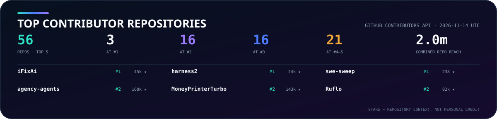
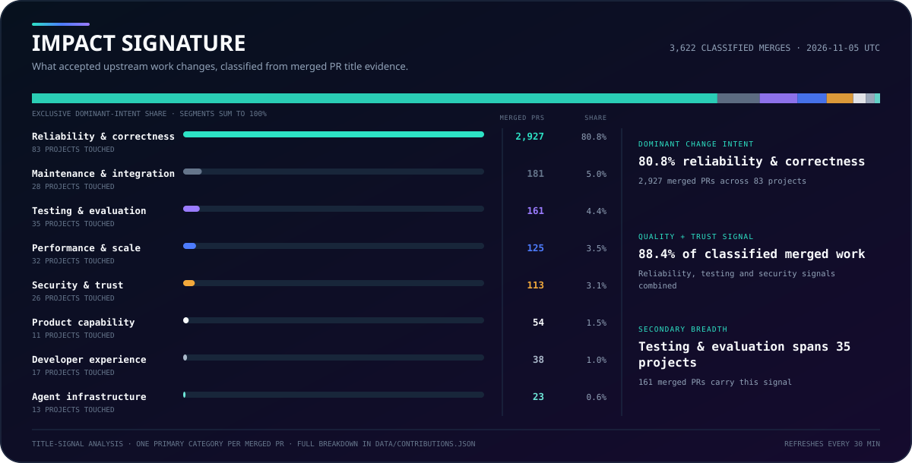

<div align="center">



<br />

[](https://www.linkedin.com/in/rudymizrahi/)
[](https://www.gradiahq.com)
[](https://orcid.org/0009-0000-7043-3766)
[](https://github.com/rudycelekli?tab=followers)

<!-- star-history-badge:start -->
<p align="center">
  <a href="https://www.star-history.com/rudycelekli">
    <picture>
      <source media="(prefers-color-scheme: dark)" srcset="https://api.star-history.com/badge?user=rudycelekli&amp;year=2026&amp;theme=dark" />
      <source media="(prefers-color-scheme: light)" srcset="https://api.star-history.com/badge?user=rudycelekli&amp;year=2026" />
      
    </picture>
  </a>
</p>
<!-- star-history-badge:end -->

**Charlotte-based Forward Deployed AI Researcher · Agentic AI Engineer**

<sub>Building verifiable, long-horizon agent systems · Research, implementation, and open source</sub>

[Gradia](https://www.gradiahq.com) · [Snorkel AI](https://snorkel.ai/) · [AxiomConsulting.ai](https://axiomconsulting.ai/) · [Agentics Foundation](https://agentics.org/leadership/)

</div>

## I build AI systems that can prove what happened.

**On a mission to make open source reliable enough to trust. One repository at a time.**

I am **Rudy Mizrahi Celekli**, also known professionally as **Rudy Celekli**. I research and build long-horizon agent systems, evaluation environments, and evidence-bound execution, with a focus on evaluator robustness, deterministic replay, and causal fault isolation.

The work has two connected fronts: building AI systems whose behavior can be inspected, and strengthening the open-source foundations those systems rely on.

Open source is shared infrastructure. A silent data error, a misleading evaluation, or an agent that fails without a useful trace can become someone else's production problem.

I work on those failure points: reproduce the problem, fix the cause, add a regression test, and get the change accepted upstream. Reliability and correctness are foundations of trust and safety.

An accepted fix improves a shared dependency. A regression test helps maintainers keep that failure from returning. My goal is fewer inherited failures and software people can depend on.

Research, owned products, upstream contributions, and measured results remain explicitly separate.

[**Canonical research profile**](https://rudycelekli.github.io/) · [**Model-readable evidence**](https://rudycelekli.github.io/llms.txt) · [**ORCID**](https://orcid.org/0009-0000-7043-3766) · [**Gradia research role**](https://www.gradiahq.com/about)

### Engineering case studies

[**Read the source-linked case studies →**](https://rudycelekli.github.io/engineering/)

- **Reject incomplete test evidence:** require a current-run Vitest report and a matching process verdict. [Case study](https://rudycelekli.github.io/engineering/vitest-execution-evidence.html) · [Merged Agentic QE #712](https://github.com/proffesor-for-testing/agentic-qe/pull/712).
- **Preserve exact Git source lines:** keep Unicode separators inside physical diff lines. [Case study](https://rudycelekli.github.io/engineering/git-physical-line-boundaries.html) · [Merged PR-Agent #4668](https://github.com/The-PR-Agent/pr-agent/pull/4668).
- **Validate AI review scores:** ignore out-of-range chunk scores while preserving valid zero. [Case study](https://rudycelekli.github.io/engineering/review-score-validation.html) · [Merged PR-Agent #4669](https://github.com/The-PR-Agent/pr-agent/pull/4669).

Each case separates the code change, original validation and limits. Upstream merge is acceptance evidence, not proof of customer deployment.

### Start with the evidence you need

| If you are… | Start here |
|:--|:--|
| **Researching agent reliability** | [Evaluation environments, replay, and research record](https://rudycelekli.github.io/) |
| **Maintaining open source** | [Live upstream contribution explorer](https://rudycelekli.github.io/contributions.html) |
| **Deploying AI in an enterprise** | [Gradia](https://www.gradiahq.com) and [AxiomConsulting.ai](https://axiomconsulting.ai/) |
| **Building the Charlotte AI community** | [AI Tinkerers Charlotte](https://charlotte.aitinkerers.org/) |

<!-- rcode:start -->
## rcode


**The coding agent you can hand to anyone.** Terminal, command center, or the Claude and Codex plan you already pay for. Every turn ends with a receipt.

[**github.com/rudycelekli/rcode**](https://github.com/rudycelekli/rcode) · MIT · macOS and Linux

```bash
curl -fsSL https://raw.githubusercontent.com/rudycelekli/rcode/main/install.sh | sh
```
<!-- rcode:end -->

<!-- top-contributor-proof:start -->
## Repositories where I’m a top contributor



**Currently ranked in the Top 5 across 56 repositories.**

**GitHub rank #1:** [**iFixAi**](https://github.com/ifixai-ai/iFixAi) · 45k ★ · [**harness2**](https://github.com/google-research/harness2) · 23k ★

**GitHub rank #2:** [**agency-agents**](https://github.com/msitarzewski/agency-agents) · 168k ★ · [**MoneyPrinterTurbo**](https://github.com/harry0703/MoneyPrinterTurbo) · 142k ★ · [**claude-mem**](https://github.com/thedotmack/claude-mem) · 116k ★ · [**Ruflo**](https://github.com/ruvnet/ruflo) · 81k ★ · [**marketingskills**](https://github.com/coreyhaines31/marketingskills) · 60k ★ · [**claude-seo**](https://github.com/AgriciDaniel/claude-seo) · 28k ★ · [**anatomy**](https://github.com/wheresryan22/anatomy) · 26k ★ · [**Horizon**](https://github.com/Thysrael/Horizon) · 13k ★ · [**openrig**](https://github.com/mvschwarz/openrig) · 8.8k ★ · [**Peekaboo**](https://github.com/openclaw/Peekaboo) · 5.5k ★ · [**CCBaga**](https://github.com/liseami/CCBaga) · 3.5k ★ · [**open-ontologies**](https://github.com/fabio-rovai/open-ontologies) · 2.9k ★ · [**edgequake**](https://github.com/raphaelmansuy/edgequake) · 2.3k ★ · [**graphicle**](https://github.com/Graphicle-AI/graphicle) · 556 ★ · [**Agentic-QE**](https://github.com/proffesor-for-testing/agentic-qe) · 525 ★ · [**cortexdb**](https://github.com/liliang-cn/cortexdb) · 478 ★ · [**imajev**](https://github.com/mohit67890/imajev) · 427 ★ · [**agent-chrome-relay**](https://github.com/aindeev/agent-chrome-relay) · 193 ★

**GitHub rank #3:** [**OpenMontage**](https://github.com/OpenMontageInc/OpenMontage) · 79k ★ · [**ai-job-search**](https://github.com/ai-job-search-dev/ai-job-search) · 71k ★ · [**diagram-design**](https://github.com/cathrynlavery/diagram-design) · 66k ★ · [**hallmark**](https://github.com/Nutlope/hallmark) · 53k ★ · [**CowAgent**](https://github.com/zhayujie/CowAgent) · 48k ★ · [**oh-my-claudecode**](https://github.com/Yeachan-Heo/oh-my-claudecode) · 41k ★ · [**ai-memory**](https://github.com/akitaonrails/ai-memory) · 16k ★ · [**e2e**](https://github.com/e2e-inc/e2e) · 14k ★ · [**autoharness**](https://github.com/tigerless-labs/autoharness) · 11k ★ · [**cost-xray**](https://github.com/tigerless-labs/cost-xray) · 5.8k ★ · [**harnessrouter**](https://github.com/HarnessRouter/harnessrouter) · 4.3k ★ · [**agent-memory**](https://github.com/tigerless-labs/agent-memory) · 4.3k ★ · [**helix-foundry**](https://github.com/HelixDB/helix-foundry) · 2.1k ★ · [**talorys**](https://github.com/rociiu/talorys) · 1.5k ★ · [**swe-sweep**](https://github.com/facebookresearch/swe-sweep) · 227 ★ · [**OpenGTM**](https://github.com/debpalash/OpenGTM) · 105 ★

**GitHub rank #4:** [**VoiceStudio**](https://github.com/debpalash/VoiceStudio) · 107k ★ · [**colibri**](https://github.com/JustVugg/colibri) · 50k ★ · [**Vibe-Trading**](https://github.com/HKUDS/Vibe-Trading) · 38k ★ · [**suparagent**](https://github.com/Anil-matcha/suparagent) · 7.0k ★ · [**VLMEvalKit**](https://github.com/open-compass/VLMEvalKit) · 4.5k ★ · [**Hands-On-AI-Engineering**](https://github.com/Sumanth077/Hands-On-AI-Engineering) · 4.1k ★ · [**floorplan**](https://github.com/haydenschmitty/floorplan) · 3.4k ★ · [**graphjin**](https://github.com/dosco/graphjin) · 3.2k ★ · [**retentioneering-tools**](https://github.com/retentioneering/retentioneering-tools) · 946 ★ · [**opentakeoff**](https://github.com/Kentucky-ai/opentakeoff) · 786 ★ · [**xmlquery**](https://github.com/antchfx/xmlquery) · 491 ★ · [**jsonquery**](https://github.com/antchfx/jsonquery) · 276 ★ · [**leantoken**](https://github.com/morluto/leantoken) · 156 ★

**GitHub rank #5:** [**rea**](https://github.com/morluto/rea) · 450k ★ · [**agent-skills**](https://github.com/addyosmani/agent-skills) · 115k ★ · [**mcp-go**](https://github.com/mark3labs/mcp-go) · 9.2k ★ · [**plexo**](https://github.com/anmolkapil/plexo) · 5.7k ★ · [**RuVector**](https://github.com/ruvnet/RuVector) · 4.7k ★ · [**agent-beacon**](https://github.com/Asymptote-Labs/agent-beacon) · 3.4k ★ · [**mcpproxy-go**](https://github.com/smart-mcp-proxy/mcpproxy-go) · 413 ★

[Explore these 56 repositories and their contribution evidence →](https://rudycelekli.github.io/contributions.html?sort=rank&top5=1)

<sub>All-time rank from GitHub's Contributors API · repository stars are reach, not personal credit · refreshed 2026-11-11 UTC</sub>
<!-- top-contributor-proof:end -->

<!-- building-now:start -->
## Three systems, one research program

| System | Problem | Inspectable response | Maturity |
|:--|:--|:--|:--|
| **[Gradia](https://www.gradiahq.com)** | AI implementation is difficult to reproduce, inspect, and improve across long-running work. | A research and implementation lab connecting **Blocks · Factory · Verify · Workers · Intelligence**, with [AxiomConsulting.ai](https://axiomconsulting.ai/) as its forward-deployed implementation arm. | Research foundation established; broader verified-software-factory products remain in development. |
| **[KYA Evidence](https://github.com/rudycelekli/kya-evidence)** | Agent identity and capability claims are usually broader than their evidence. | A portable, scope-bound Know Your Agent protocol that binds the exact system, evidence, and relying-party policy. | Experimental public reference implementation and standardization path, not an adopted industry standard. |
| **Proof stack** | Agent output can look plausible while its execution record, evaluator, or regression boundary is wrong. | [Gradia Guard](https://github.com/rudycelekli/gradia-guard) records proof-bound execution, [ProofSeal](https://github.com/rudycelekli/proofseal) retains behavioral claims, and [TestLore](https://github.com/rudycelekli/testlore) turns testing history into reusable quality intelligence. | Public source with linked code, releases, and explicit claim boundaries. |

**Current public frontier:** [TestLore](https://github.com/rudycelekli/testlore) · [Gradia Guard](https://github.com/rudycelekli/gradia-guard) · [ProofSeal](https://github.com/rudycelekli/proofseal) · [rcode](https://github.com/rudycelekli/rcode)

<sub>Frontier selections are re-ranked every 30 minutes from public reach, shipping recency, releases, attributed work, and repository completeness · last ranked 2026-11-11 UTC · private Gradia repository evidence remains private</sub>
<!-- building-now:end -->

<!-- contribution-stats:start -->
## Open-source impact, verified

Accepted upstream work, grouped by the problem addressed. Categories come from PR titles; each project links to the merged changes for inspection. Only merged PRs contribute accepted-code totals.



### Complete evidence ledger

All 109 verified upstream projects are shown here. **[Open the sortable evidence explorer →](https://rudycelekli.github.io/contributions.html)**

| Project, purpose and evidence | Primary impact | GitHub API rank | Attributed commits | Merged PRs | Accepted lines (+ / −) | Files | Repository reach |
|:--|:--|--:|--:|--:|--:|--:|--:|
| **[claude-mem](https://github.com/thedotmack/claude-mem)** · [GitHub-listed contributor](https://github.com/thedotmack/claude-mem/graphs/contributors)<br><sub>Persistent Context Across Sessions for Every Agent – Captures everything your agent does during sessions, compresses it with AI, and injects relevant…</sub> | **Reliability & correctness**<br><sub>246 of 259 merged PRs</sub> | [#2](https://github.com/thedotmack/claude-mem/graphs/contributors) | 260 | [259](https://github.com/thedotmack/claude-mem/pulls?q=is%3Apr+author%3Arudycelekli+is%3Amerged) | +29,226 / −2,470 | 896 | 115,826 ★ · 10,049 forks |
| **[iFixAi](https://github.com/ifixai-ai/iFixAi)** · [GitHub-listed contributor](https://github.com/ifixai-ai/iFixAi/graphs/contributors)<br><sub>Independent Auditing of AI Agents. Run by human or the agent itself, to answer the most crucial question in the AI Agent Economy. Is the agent doing…</sub> | **Reliability & correctness**<br><sub>178 of 234 merged PRs</sub> | [#1](https://github.com/ifixai-ai/iFixAi/graphs/contributors) | 234 | [234](https://github.com/ifixai-ai/iFixAi/pulls?q=is%3Apr+author%3Arudycelekli+is%3Amerged) | +27,348 / −1,117 | 713 | 44,558 ★ · 1,788 forks |
| **[openrig](https://github.com/mvschwarz/openrig)** · [GitHub-listed contributor](https://github.com/mvschwarz/openrig/graphs/contributors)<br><sub>Build your own network of agents from Claude Code, Codex and Pi: persistent teams with roles, shared context and owned work.</sub> | **Reliability & correctness**<br><sub>204 of 219 merged PRs</sub> | [#2](https://github.com/mvschwarz/openrig/graphs/contributors) | 219 | [219](https://github.com/mvschwarz/openrig/pulls?q=is%3Apr+author%3Arudycelekli+is%3Amerged) | +16,732 / −1,342 | 619 | 8,806 ★ · 745 forks |
| **[MoneyPrinterTurbo](https://github.com/harry0703/MoneyPrinterTurbo)** · [GitHub-listed contributor](https://github.com/harry0703/MoneyPrinterTurbo/graphs/contributors)<br><sub>Generate HD short videos from a topic or keyword with an automated AI workflow.</sub> | **Reliability & correctness**<br><sub>182 of 209 merged PRs</sub> | [#2](https://github.com/harry0703/MoneyPrinterTurbo/graphs/contributors) | 209 | [209](https://github.com/harry0703/MoneyPrinterTurbo/pulls?q=is%3Apr+author%3Arudycelekli+is%3Amerged) | +15,802 / −1,137 | 489 | 141,984 ★ · 22,667 forks |
| **[CowAgent](https://github.com/zhayujie/CowAgent)** · [GitHub-listed contributor](https://github.com/zhayujie/CowAgent/graphs/contributors)<br><sub>Open-source personal AI assistant &amp; Agent Harness. Plans tasks, runs tools and skills, self-evolves with memory and knowledge. Multi-agent, multi-mod…</sub> | **Reliability & correctness**<br><sub>190 of 207 merged PRs</sub> | [#3](https://github.com/zhayujie/CowAgent/graphs/contributors) | 241 | [207](https://github.com/zhayujie/CowAgent/pulls?q=is%3Apr+author%3Arudycelekli+is%3Amerged) | +17,577 / −1,343 | 512 | 47,872 ★ · 10,423 forks |
| **[agency-agents](https://github.com/msitarzewski/agency-agents)** · [GitHub-listed contributor](https://github.com/msitarzewski/agency-agents/graphs/contributors)<br><sub>A complete AI agency at your fingertips - From frontend wizards to Reddit community ninjas, from whimsy injectors to reality checkers. Each agent is…</sub> | **Reliability & correctness**<br><sub>98 of 177 merged PRs</sub> | [#2](https://github.com/msitarzewski/agency-agents/graphs/contributors) | 190 | [177](https://github.com/msitarzewski/agency-agents/pulls?q=is%3Apr+author%3Arudycelekli+is%3Amerged) | +2,879 / −1,038 | 212 | 167,670 ★ · 27,192 forks |
| **[Ruflo](https://github.com/ruvnet/ruflo)** · [GitHub-listed contributor](https://github.com/ruvnet/ruflo/graphs/contributors)<br><sub>Agent orchestration &amp; autonomous workflows.</sub> | **Reliability & correctness**<br><sub>145 of 168 merged PRs</sub> | [#2](https://github.com/ruvnet/ruflo/graphs/contributors) | 320 | [168](https://github.com/ruvnet/ruflo/pulls?q=is%3Apr+author%3Arudycelekli+is%3Amerged) | +15,527 / −2,076 | 522 | 81,436 ★ · 9,589 forks |
| **[marketingskills](https://github.com/coreyhaines31/marketingskills)** · [GitHub-listed contributor](https://github.com/coreyhaines31/marketingskills/graphs/contributors)<br><sub>Marketing skills for Claude Code and AI agents. CRO, copywriting, SEO, analytics, and growth engineering.</sub> | **Reliability & correctness**<br><sub>120 of 167 merged PRs</sub> | [#2](https://github.com/coreyhaines31/marketingskills/graphs/contributors) | 210 | [167](https://github.com/coreyhaines31/marketingskills/pulls?q=is%3Apr+author%3Arudycelekli+is%3Amerged) | +12,400 / −1,496 | 881 | 59,593 ★ · 8,699 forks |
| **[Agentic-QE](https://github.com/proffesor-for-testing/agentic-qe)** · [GitHub-listed contributor](https://github.com/proffesor-for-testing/agentic-qe/graphs/contributors)<br><sub>Agentic quality engineering infrastructure.</sub> | **Reliability & correctness**<br><sub>102 of 163 merged PRs</sub> | [#2](https://github.com/proffesor-for-testing/agentic-qe/graphs/contributors) | 257 | [163](https://github.com/proffesor-for-testing/agentic-qe/pulls?q=is%3Apr+author%3Arudycelekli+is%3Amerged) | +42,403 / −7,506 | 999 | 525 ★ · 105 forks |
| **[colibri](https://github.com/JustVugg/colibri)** · [GitHub-listed contributor](https://github.com/JustVugg/colibri/graphs/contributors)<br><sub>A hierarchical inference engine for frontier MoE models: hot experts on the GPU (CUDA, Vulkan), warm ones in RAM, cold ones streamed from NVMe. Writt…</sub> | **Reliability & correctness**<br><sub>126 of 140 merged PRs</sub> | [#4](https://github.com/JustVugg/colibri/graphs/contributors) | 139 | [140](https://github.com/JustVugg/colibri/pulls?q=is%3Apr+author%3Arudycelekli+is%3Amerged) | +9,948 / −526 | 339 | 49,770 ★ · 5,860 forks |
| **[ai-memory](https://github.com/akitaonrails/ai-memory)** · [GitHub-listed contributor](https://github.com/akitaonrails/ai-memory/graphs/contributors)<br><sub>Solution for long term memory for agent coding CLIs and to facilitate handoff between different agent vendors.</sub> | **Reliability & correctness**<br><sub>131 of 132 merged PRs</sub> | [#3](https://github.com/akitaonrails/ai-memory/graphs/contributors) | 203 | [132](https://github.com/akitaonrails/ai-memory/pulls?q=is%3Apr+author%3Arudycelekli+is%3Amerged) | +9,645 / −610 | 303 | 15,600 ★ · 1,142 forks |
| **[Vibe-Trading](https://github.com/HKUDS/Vibe-Trading)** · [GitHub-listed contributor](https://github.com/HKUDS/Vibe-Trading/graphs/contributors)<br><sub>&quot;Vibe-Trading: Your Personal Trading Agent&quot;.</sub> | **Reliability & correctness**<br><sub>111 of 130 merged PRs</sub> | [#4](https://github.com/HKUDS/Vibe-Trading/graphs/contributors) | 152 | [130](https://github.com/HKUDS/Vibe-Trading/pulls?q=is%3Apr+author%3Arudycelekli+is%3Amerged) | +8,222 / −698 | 333 | 38,006 ★ · 6,173 forks |
| **[agent-beacon](https://github.com/Asymptote-Labs/agent-beacon)** · [GitHub-listed contributor](https://github.com/Asymptote-Labs/agent-beacon/graphs/contributors)<br><sub>The cross-harness, self-improving memory layer for AI agents. Join our community: https://discord.com/invite/zdNChS2fBu.</sub> | **Reliability & correctness**<br><sub>109 of 120 merged PRs</sub> | [#5](https://github.com/Asymptote-Labs/agent-beacon/graphs/contributors) | 120 | [120](https://github.com/Asymptote-Labs/agent-beacon/pulls?q=is%3Apr+author%3Arudycelekli+is%3Amerged) | +10,750 / −2,758 | 489 | 3,420 ★ · 302 forks |
| **[rea](https://github.com/morluto/rea)** · [GitHub-listed contributor](https://github.com/morluto/rea/graphs/contributors)<br><sub>Reverse engineer anything with agents, from app behavior down to native binaries.</sub> | **Reliability & correctness**<br><sub>88 of 91 merged PRs</sub> | [#5](https://github.com/morluto/rea/graphs/contributors) | 99 | [91](https://github.com/morluto/rea/pulls?q=is%3Apr+author%3Arudycelekli+is%3Amerged) | +177,951 / −30,879 | 3,331 | 449,996 ★ · 110,751 forks |
| **[oh-my-claudecode](https://github.com/Yeachan-Heo/oh-my-claudecode)** · [GitHub-listed contributor](https://github.com/Yeachan-Heo/oh-my-claudecode/graphs/contributors)<br><sub>Teams-first Multi-agent orchestration for Claude Code.</sub> | **Reliability & correctness**<br><sub>77 of 83 merged PRs</sub> | [#3](https://github.com/Yeachan-Heo/oh-my-claudecode/graphs/contributors) | 99 | [83](https://github.com/Yeachan-Heo/oh-my-claudecode/pulls?q=is%3Apr+author%3Arudycelekli+is%3Amerged) | +130,121 / −102,928 | 3,031 | 40,748 ★ · 3,639 forks |
| **[Peekaboo](https://github.com/openclaw/Peekaboo)** · [GitHub-listed contributor](https://github.com/openclaw/Peekaboo/graphs/contributors)<br><sub>Peekaboo is a macOS CLI &amp; optional MCP server that enables AI agents to capture screenshots of applications, or the entire system, with optional visu…</sub> | **Reliability & correctness**<br><sub>64 of 72 merged PRs</sub> | [#2](https://github.com/openclaw/Peekaboo/graphs/contributors) | 72 | [72](https://github.com/openclaw/Peekaboo/pulls?q=is%3Apr+author%3Arudycelekli+is%3Amerged) | +7,122 / −922 | 297 | 5,467 ★ · 421 forks |
| **[cortexdb](https://github.com/liliang-cn/cortexdb)** · [GitHub-listed contributor](https://github.com/liliang-cn/cortexdb/graphs/contributors)<br><sub>Local-first AI agent memory with a knowledge graph, ontology constraints, and traceable reasoning—all in one SQLite file.</sub> | **Reliability & correctness**<br><sub>54 of 58 merged PRs</sub> | [#2](https://github.com/liliang-cn/cortexdb/graphs/contributors) | 58 | [58](https://github.com/liliang-cn/cortexdb/pulls?q=is%3Apr+author%3Arudycelekli+is%3Amerged) | +3,775 / −253 | 124 | 478 ★ · 27 forks |
| **[OpenGTM](https://github.com/debpalash/OpenGTM)** · [GitHub-listed contributor](https://github.com/debpalash/OpenGTM/graphs/contributors)<br><sub>Open-source, self-hosted alternative to Clay.com for lead sourcing, enrichment waterfalls, AI research, buying signals, and outbound automation.</sub> | **Reliability & correctness**<br><sub>50 of 53 merged PRs</sub> | [#3](https://github.com/debpalash/OpenGTM/graphs/contributors) | 60 | [53](https://github.com/debpalash/OpenGTM/pulls?q=is%3Apr+author%3Arudycelekli+is%3Amerged) | +4,852 / −251 | 138 | 105 ★ · 35 forks |
| **[ai-job-search](https://github.com/ai-job-search-dev/ai-job-search)** · [GitHub-listed contributor](https://github.com/ai-job-search-dev/ai-job-search/graphs/contributors)<br><sub>The job search that runs on your machine. AI job application framework built on Claude Code: evaluate postings, tailor CVs, write cover letters, prep…</sub> | **Reliability & correctness**<br><sub>46 of 53 merged PRs</sub> | [#3](https://github.com/ai-job-search-dev/ai-job-search/graphs/contributors) | 54 | [53](https://github.com/ai-job-search-dev/ai-job-search/pulls?q=is%3Apr+author%3Arudycelekli+is%3Amerged) | +4,101 / −243 | 169 | 71,103 ★ · 22,978 forks |
| **[gods-eye-view](https://github.com/bilawalsidhu/gods-eye-view)** · [GitHub-listed contributor](https://github.com/bilawalsidhu/gods-eye-view/graphs/contributors)<br><sub>A spy satellite simulator in your browser, except the data is real. Live open source spatial intelligence on a photorealistic 3D globe.</sub> | **Reliability & correctness**<br><sub>44 of 50 merged PRs</sub> | [#7](https://github.com/bilawalsidhu/gods-eye-view/graphs/contributors) | 95 | [50](https://github.com/bilawalsidhu/gods-eye-view/pulls?q=is%3Apr+author%3Arudycelekli+is%3Amerged) | +5,541 / −449 | 305 | 64,154 ★ · 12,644 forks |
| **[DeepTutor](https://github.com/HKUDS/DeepTutor)** · [GitHub-listed contributor](https://github.com/HKUDS/DeepTutor/graphs/contributors)<br><sub>DeepTutor: Lifelong Personalized Tutoring. https://deeptutor.info/.</sub> | **Reliability & correctness**<br><sub>48 of 49 merged PRs</sub> | [#7](https://github.com/HKUDS/DeepTutor/graphs/contributors) | 52 | [49](https://github.com/HKUDS/DeepTutor/pulls?q=is%3Apr+author%3Arudycelekli+is%3Amerged) | +2,591 / −168 | 120 | 57,989 ★ · 7,059 forks |
| **[e2e](https://github.com/e2e-inc/e2e)** · [GitHub-listed contributor](https://github.com/e2e-inc/e2e/graphs/contributors)<br><sub>Next generation e2e testing framework for web and mobile apps.</sub> | **Reliability & correctness**<br><sub>23 of 44 merged PRs</sub> | [#3](https://github.com/e2e-inc/e2e/graphs/contributors) | 44 | [44](https://github.com/e2e-inc/e2e/pulls?q=is%3Apr+author%3Arudycelekli+is%3Amerged) | +3,644 / −462 | 262 | 13,624 ★ · 714 forks |
| **[mcpproxy-go](https://github.com/smart-mcp-proxy/mcpproxy-go)** · [GitHub-listed contributor](https://github.com/smart-mcp-proxy/mcpproxy-go/graphs/contributors)<br><sub>Supercharge AI Agents, Safely.</sub> | **Reliability & correctness**<br><sub>32 of 44 merged PRs</sub> | [#5](https://github.com/smart-mcp-proxy/mcpproxy-go/graphs/contributors) | 44 | [44](https://github.com/smart-mcp-proxy/mcpproxy-go/pulls?q=is%3Apr+author%3Arudycelekli+is%3Amerged) | +2,886 / −240 | 116 | 413 ★ · 71 forks |
| **[autoharness](https://github.com/tigerless-labs/autoharness)** · [GitHub-listed contributor](https://github.com/tigerless-labs/autoharness/graphs/contributors)<br><sub>Building the self-learning layer next-gen agents will ship with, learning skills from real work.</sub> | **Reliability & correctness**<br><sub>38 of 40 merged PRs</sub> | [#3](https://github.com/tigerless-labs/autoharness/graphs/contributors) | 55 | [40](https://github.com/tigerless-labs/autoharness/pulls?q=is%3Apr+author%3Arudycelekli+is%3Amerged) | +2,528 / −135 | 118 | 10,925 ★ · 654 forks |
| **[utopia](https://github.com/deeplethe/utopia)** · [GitHub-listed contributor](https://github.com/deeplethe/utopia/graphs/contributors)<br><sub>World&#x27;s first open-source enterprise world model.</sub> | **Maintenance & integration**<br><sub>30 of 40 merged PRs</sub> | [#6](https://github.com/deeplethe/utopia/graphs/contributors) | 13 | [40](https://github.com/deeplethe/utopia/pulls?q=is%3Apr+author%3Arudycelekli+is%3Amerged) | +1,354 / −96 | 57 | 8,700 ★ · 1,187 forks |
| **[anatomy](https://github.com/wheresryan22/anatomy)** · [GitHub-listed contributor](https://github.com/wheresryan22/anatomy/graphs/contributors)<br><sub>An agent skill for creating detailed, interactive isometric illustrations of real-world machines and complex systems. Generates polished SVGs with op…</sub> | **Reliability & correctness**<br><sub>30 of 37 merged PRs</sub> | [#2](https://github.com/wheresryan22/anatomy/graphs/contributors) | 41 | [37](https://github.com/wheresryan22/anatomy/pulls?q=is%3Apr+author%3Arudycelekli+is%3Amerged) | +2,220 / −227 | 142 | 26,499 ★ · 2,232 forks |
| **[edgequake](https://github.com/raphaelmansuy/edgequake)** · [GitHub-listed contributor](https://github.com/raphaelmansuy/edgequake/graphs/contributors)<br><sub>EdegQuake 🌋 High-performance GraphRAG inspired from LightRag written in Rust; Transform documents into intelligent knowledge graphs for superior retr…</sub> | **Reliability & correctness**<br><sub>28 of 35 merged PRs</sub> | [#2](https://github.com/raphaelmansuy/edgequake/graphs/contributors) | 48 | [35](https://github.com/raphaelmansuy/edgequake/pulls?q=is%3Apr+author%3Arudycelekli+is%3Amerged) | +2,402 / −259 | 77 | 2,300 ★ · 275 forks |
| **[agent-skills](https://github.com/addyosmani/agent-skills)** · [GitHub-listed contributor](https://github.com/addyosmani/agent-skills/graphs/contributors)<br><sub>Production-grade engineering skills for AI coding agents.</sub> | **Reliability & correctness**<br><sub>18 of 34 merged PRs</sub> | [#5](https://github.com/addyosmani/agent-skills/graphs/contributors) | 34 | [34](https://github.com/addyosmani/agent-skills/pulls?q=is%3Apr+author%3Arudycelekli+is%3Amerged) | +288 / −65 | 45 | 115,166 ★ · 12,096 forks |
| **[open-ontologies](https://github.com/fabio-rovai/open-ontologies)** · [GitHub-listed contributor](https://github.com/fabio-rovai/open-ontologies/graphs/contributors)<br><sub>Plan, apply and roll back changes to a production ontology, with a blast radius report and a proof an auditor can re-check.</sub> | **Reliability & correctness**<br><sub>26 of 33 merged PRs</sub> | [#2](https://github.com/fabio-rovai/open-ontologies/graphs/contributors) | 55 | [33](https://github.com/fabio-rovai/open-ontologies/pulls?q=is%3Apr+author%3Arudycelekli+is%3Amerged) | +4,608 / −215 | 113 | 2,870 ★ · 323 forks |
| **[VLMEvalKit](https://github.com/open-compass/VLMEvalKit)** · [GitHub-listed contributor](https://github.com/open-compass/VLMEvalKit/graphs/contributors)<br><sub>Open-source evaluation toolkit of large multi-modality models (LMMs), support 220+ LMMs, 80+ benchmarks.</sub> | **Reliability & correctness**<br><sub>22 of 33 merged PRs</sub> | [#4](https://github.com/open-compass/VLMEvalKit/graphs/contributors) | 33 | [33](https://github.com/open-compass/VLMEvalKit/pulls?q=is%3Apr+author%3Arudycelekli+is%3Amerged) | +2,644 / −122 | 88 | 4,481 ★ · 797 forks |
| **[cost-xray](https://github.com/tigerless-labs/cost-xray)** · [GitHub-listed contributor](https://github.com/tigerless-labs/cost-xray/graphs/contributors)<br><sub>See what Claude Code and Codex actually send to the API — and what each part costs.</sub> | **Reliability & correctness**<br><sub>28 of 32 merged PRs</sub> | [#3](https://github.com/tigerless-labs/cost-xray/graphs/contributors) | 32 | [32](https://github.com/tigerless-labs/cost-xray/pulls?q=is%3Apr+author%3Arudycelekli+is%3Amerged) | +1,037 / −130 | 75 | 5,805 ★ · 377 forks |
| **[harnessrouter](https://github.com/HarnessRouter/harnessrouter)** · [GitHub-listed contributor](https://github.com/HarnessRouter/harnessrouter/graphs/contributors)<br><sub>HarnessRouter Community Edition: the self-hosted, Apache-2.0 edition of the unified interface for agent harnesses. Run Codex, Claude Code, Hermes, PI…</sub> | **Maintenance & integration**<br><sub>25 of 32 merged PRs</sub> | [#3](https://github.com/HarnessRouter/harnessrouter/graphs/contributors) | 32 | [32](https://github.com/HarnessRouter/harnessrouter/pulls?q=is%3Apr+author%3Arudycelekli+is%3Amerged) | +1,989 / −106 | 77 | 4,321 ★ · 479 forks |
| **[helix-foundry](https://github.com/HelixDB/helix-foundry)** · [GitHub-listed contributor](https://github.com/HelixDB/helix-foundry/graphs/contributors)<br><sub>Connect your company&#x27;s data, let an agent draft an ontology over it, and load it into HelixDB as one graph you can explore and ask questions of. Host…</sub> | **Reliability & correctness**<br><sub>16 of 32 merged PRs</sub> | [#3](https://github.com/HelixDB/helix-foundry/graphs/contributors) | 32 | [32](https://github.com/HelixDB/helix-foundry/pulls?q=is%3Apr+author%3Arudycelekli+is%3Amerged) | +6,690 / −277 | 122 | 2,104 ★ · 305 forks |
| **[agent-memory](https://github.com/tigerless-labs/agent-memory)** · [GitHub-listed contributor](https://github.com/tigerless-labs/agent-memory/graphs/contributors)<br><sub>Long-term memory runtime for AI agents — plain Markdown as the source of truth, local ranked retrieval, and an independent sleep-time Manage layer. C…</sub> | **Reliability & correctness**<br><sub>14 of 31 merged PRs</sub> | [#3](https://github.com/tigerless-labs/agent-memory/graphs/contributors) | 34 | [31](https://github.com/tigerless-labs/agent-memory/pulls?q=is%3Apr+author%3Arudycelekli+is%3Amerged) | +35,756 / −5,674 | 377 | 4,311 ★ · 206 forks |
| **[Hands-On-AI-Engineering](https://github.com/Sumanth077/Hands-On-AI-Engineering)** · [GitHub-listed contributor](https://github.com/Sumanth077/Hands-On-AI-Engineering/graphs/contributors)<br><sub>A curated collection of practical AI projects implementing OCR systems, RAG, AI agents, and other AI use cases.</sub> | **Reliability & correctness**<br><sub>28 of 30 merged PRs</sub> | [#4](https://github.com/Sumanth077/Hands-On-AI-Engineering/graphs/contributors) | 30 | [30](https://github.com/Sumanth077/Hands-On-AI-Engineering/pulls?q=is%3Apr+author%3Arudycelekli+is%3Amerged) | +3 / −1,014 | 95 | 4,097 ★ · 983 forks |
| **[graphjin](https://github.com/dosco/graphjin)** · [GitHub-listed contributor](https://github.com/dosco/graphjin/graphs/contributors)<br><sub>DeepORG (formerly GraphJin) — one governed AI agent for your whole organization: databases, APIs, files, and code over MCP.</sub> | **Reliability & correctness**<br><sub>27 of 30 merged PRs</sub> | [#4](https://github.com/dosco/graphjin/graphs/contributors) | 30 | [30](https://github.com/dosco/graphjin/pulls?q=is%3Apr+author%3Arudycelekli+is%3Amerged) | +2,562 / −166 | 75 | 3,235 ★ · 207 forks |
| **[openmed](https://github.com/maziyarpanahi/openmed)** · [GitHub-listed contributor](https://github.com/maziyarpanahi/openmed/graphs/contributors)<br><sub>Local-first healthcare AI: clinical NER and HIPAA PII de-identification on hardware you control. 2,200+ medical models, 35 model-backed PII languages…</sub> | **Product capability**<br><sub>14 of 29 merged PRs</sub> | [#16](https://github.com/maziyarpanahi/openmed/graphs/contributors) | 6 | [29](https://github.com/maziyarpanahi/openmed/pulls?q=is%3Apr+author%3Arudycelekli+is%3Amerged) | +14,269 / −0 | 177 | 5,797 ★ · 759 forks |
| **[diagram-design](https://github.com/cathrynlavery/diagram-design)** · [GitHub-listed contributor](https://github.com/cathrynlavery/diagram-design/graphs/contributors)<br><sub>Editorial diagram design for Claude Code, Codex, GitHub Copilot, Cursor, Factory Droid, Qoder, and Pi. 45 diagram types. Self-contained HTML + SVG. N…</sub> | **Reliability & correctness**<br><sub>27 of 27 merged PRs</sub> | [#3](https://github.com/cathrynlavery/diagram-design/graphs/contributors) | 27 | [27](https://github.com/cathrynlavery/diagram-design/pulls?q=is%3Apr+author%3Arudycelekli+is%3Amerged) | +3,393 / −233 | 85 | 66,322 ★ · 4,408 forks |
| **[talorys](https://github.com/rociiu/talorys)** · [GitHub-listed contributor](https://github.com/rociiu/talorys/graphs/contributors)<br><sub>Your personal AI agent in your own Cloudflare account. Chat, memory, tasks, notes and scheduled reminders, deployed with one command: npx create-talo…</sub> | **Reliability & correctness**<br><sub>17 of 27 merged PRs</sub> | [#3](https://github.com/rociiu/talorys/graphs/contributors) | 27 | [27](https://github.com/rociiu/talorys/pulls?q=is%3Apr+author%3Arudycelekli+is%3Amerged) | +1,027 / −97 | 62 | 1,460 ★ · 147 forks |
| **[OpenMontage](https://github.com/OpenMontageInc/OpenMontage)** · [GitHub-listed contributor](https://github.com/OpenMontageInc/OpenMontage/graphs/contributors)<br><sub>World&#x27;s first open-source, agentic video production system. 12 production pipelines, 100+ tools, 700+ agent skill and production-knowledge files. Tur…</sub> | **Reliability & correctness**<br><sub>16 of 26 merged PRs</sub> | [#3](https://github.com/OpenMontageInc/OpenMontage/graphs/contributors) | 27 | [26](https://github.com/OpenMontageInc/OpenMontage/pulls?q=is%3Apr+author%3Arudycelekli+is%3Amerged) | +13,227 / −909 | 160 | 79,427 ★ · 10,625 forks |
| **[suparagent](https://github.com/Anil-matcha/suparagent)** · [GitHub-listed contributor](https://github.com/Anil-matcha/suparagent/graphs/contributors)<br><sub>Open-source, self-hosted alternative to Grok Bot, Claude Duet, OpenAI Dots, Meta Muse, Instinct, Manus Cue: AI coworkers (named agents) with instruct…</sub> | **Reliability & correctness**<br><sub>18 of 25 merged PRs</sub> | [#4](https://github.com/Anil-matcha/suparagent/graphs/contributors) | 27 | [25](https://github.com/Anil-matcha/suparagent/pulls?q=is%3Apr+author%3Arudycelekli+is%3Amerged) | +2,505 / −115 | 57 | 7,006 ★ · 907 forks |
| **[hindsight](https://github.com/vectorize-io/hindsight)** · [GitHub-listed contributor](https://github.com/vectorize-io/hindsight/graphs/contributors)<br><sub>Hindsight: Agent Memory That Learns.</sub> | **Reliability & correctness**<br><sub>23 of 24 merged PRs</sub> | [#13](https://github.com/vectorize-io/hindsight/graphs/contributors) | 24 | [24](https://github.com/vectorize-io/hindsight/pulls?q=is%3Apr+author%3Arudycelekli+is%3Amerged) | +1,546 / −116 | 58 | 60,301 ★ · 7,357 forks |
| **[ghidra](https://github.com/NationalSecurityAgency/ghidra)** · [GitHub-listed contributor](https://github.com/NationalSecurityAgency/ghidra/graphs/contributors)<br><sub>Ghidra is a software reverse engineering (SRE) framework.</sub> | **Maintenance & integration**<br><sub>12 of 22 merged PRs</sub> | [#23](https://github.com/NationalSecurityAgency/ghidra/graphs/contributors) | 25 | [22](https://github.com/NationalSecurityAgency/ghidra/pulls?q=is%3Apr+author%3Arudycelekli+is%3Amerged) | +562 / −91 | 29 | 99,371 ★ · 11,281 forks |
| **[VoiceStudio](https://github.com/debpalash/VoiceStudio)** · [GitHub-listed contributor](https://github.com/debpalash/VoiceStudio/graphs/contributors)<br><sub>VoiceStudio is the open-source, fully-local ElevenLabs alternative — voice cloning, voice design, video dubbing, dictation, transcription &amp; audiobook…</sub> | **Reliability & correctness**<br><sub>19 of 20 merged PRs</sub> | [#4](https://github.com/debpalash/VoiceStudio/graphs/contributors) | 62 | [20](https://github.com/debpalash/VoiceStudio/pulls?q=is%3Apr+author%3Arudycelekli+is%3Amerged) | +3,785 / −201 | 131 | 107,284 ★ · 11,891 forks |
| **[headroom](https://github.com/headroomlabs-ai/headroom)** · [GitHub-listed contributor](https://github.com/headroomlabs-ai/headroom/graphs/contributors)<br><sub>Compress tool outputs, logs, files, and RAG chunks before they reach the LLM. 20% fewer tokens for coding agents, 60-95% fewer tokens for JSON, same…</sub> | **Reliability & correctness**<br><sub>16 of 20 merged PRs</sub> | [#17](https://github.com/headroomlabs-ai/headroom/graphs/contributors) | 20 | [20](https://github.com/headroomlabs-ai/headroom/pulls?q=is%3Apr+author%3Arudycelekli+is%3Amerged) | +2,127 / −107 | 51 | 79,318 ★ · 6,199 forks |
| **[mcp-go](https://github.com/mark3labs/mcp-go)** · [GitHub-listed contributor](https://github.com/mark3labs/mcp-go/graphs/contributors)<br><sub>A Go implementation of the Model Context Protocol (MCP), enabling seamless integration between LLM applications and external data sources and tools.</sub> | **Reliability & correctness**<br><sub>20 of 20 merged PRs</sub> | [#5](https://github.com/mark3labs/mcp-go/graphs/contributors) | 20 | [20](https://github.com/mark3labs/mcp-go/pulls?q=is%3Apr+author%3Arudycelekli+is%3Amerged) | +1,281 / −332 | 48 | 9,233 ★ · 944 forks |
| **[jacobian](https://github.com/morluto/jacobian)** · [GitHub-listed contributor](https://github.com/morluto/jacobian/graphs/contributors)<br><sub>Composable mathematics tools for agents.</sub> | **Reliability & correctness**<br><sub>16 of 18 merged PRs</sub> | [#7](https://github.com/morluto/jacobian/graphs/contributors) | 18 | [18](https://github.com/morluto/jacobian/pulls?q=is%3Apr+author%3Arudycelekli+is%3Amerged) | +3,318 / −131 | 54 | 367 ★ · 50 forks |
| **[Horizon](https://github.com/Thysrael/Horizon)** · [GitHub-listed contributor](https://github.com/Thysrael/Horizon/graphs/contributors)<br><sub>📡 Your own AI-powered news radar. Generates daily briefings in English &amp; Chinese. \| 用 AI 构建你专属的新闻雷达.</sub> | **Reliability & correctness**<br><sub>17 of 17 merged PRs</sub> | [#2](https://github.com/Thysrael/Horizon/graphs/contributors) | 29 | [17](https://github.com/Thysrael/Horizon/pulls?q=is%3Apr+author%3Arudycelekli+is%3Amerged) | +661 / −39 | 38 | 13,436 ★ · 1,901 forks |
| **[CCBaga](https://github.com/liseami/CCBaga)** · [GitHub-listed contributor](https://github.com/liseami/CCBaga/graphs/contributors)<br><sub>Open-source software.</sub> | **Reliability & correctness**<br><sub>14 of 15 merged PRs</sub> | [#2](https://github.com/liseami/CCBaga/graphs/contributors) | 24 | [15](https://github.com/liseami/CCBaga/pulls?q=is%3Apr+author%3Arudycelekli+is%3Amerged) | +1,913 / −78 | 59 | 3,506 ★ · 356 forks |
| **[claude-seo](https://github.com/AgriciDaniel/claude-seo)** · [GitHub-listed contributor](https://github.com/AgriciDaniel/claude-seo/graphs/contributors)<br><sub>Universal SEO skill for Claude Code. 26 sub-skills + 19 sub-agents covering technical SEO, E-E-A-T, schema, GEO/AEO, agent readiness (Lighthouse Agen…</sub> | **Reliability & correctness**<br><sub>14 of 15 merged PRs</sub> | [#2](https://github.com/AgriciDaniel/claude-seo/graphs/contributors) | 15 | [15](https://github.com/AgriciDaniel/claude-seo/pulls?q=is%3Apr+author%3Arudycelekli+is%3Amerged) | +695 / −36 | 38 | 27,924 ★ · 3,617 forks |
| **[pr-agent](https://github.com/The-PR-Agent/pr-agent)** · [GitHub-listed contributor](https://github.com/The-PR-Agent/pr-agent/graphs/contributors)<br><sub>🚀 PR Agent: The Original Open-Source PR Reviewer. This project is not the Qodo free tier.</sub> | **Reliability & correctness**<br><sub>14 of 14 merged PRs</sub> | [#33](https://github.com/The-PR-Agent/pr-agent/graphs/contributors) | 14 | [14](https://github.com/The-PR-Agent/pr-agent/pulls?q=is%3Apr+author%3Arudycelekli+is%3Amerged) | +512 / −27 | 30 | 15,881 ★ · 2,170 forks |
| **[benchmark-radar](https://github.com/ktwu01/benchmark-radar)** · [GitHub-listed contributor](https://github.com/ktwu01/benchmark-radar/graphs/contributors)<br><sub>Track 42,331+ AI benchmark, eval, dataset, and data-quality records from 40 public sources, with linked evidence and daily updates.</sub> | **Maintenance & integration**<br><sub>5 of 11 merged PRs</sub> | [#7](https://github.com/ktwu01/benchmark-radar/graphs/contributors) | 25 | [11](https://github.com/ktwu01/benchmark-radar/pulls?q=is%3Apr+author%3Arudycelekli+is%3Amerged) | +2,030 / −69 | 33 | 385 ★ · 62 forks |
| **[OpenBot](https://github.com/CopilotKit/OpenBot)** · [GitHub-listed contributor](https://github.com/CopilotKit/OpenBot/graphs/contributors)<br><sub>Open-source AI coworkers that each get a computer of their own: a browser, files and tools, with every action decided before it happens and recorded…</sub> | **Maintenance & integration**<br><sub>7 of 11 merged PRs</sub> | [#17](https://github.com/CopilotKit/OpenBot/graphs/contributors) | 11 | [11](https://github.com/CopilotKit/OpenBot/pulls?q=is%3Apr+author%3Arudycelekli+is%3Amerged) | +1,672 / −264 | 42 | 10,778 ★ · 1,335 forks |
| **[hallmark](https://github.com/Nutlope/hallmark)** · [GitHub-listed contributor](https://github.com/Nutlope/hallmark/graphs/contributors)<br><sub>Anti-AI-slop design skill for Claude Code, Cursor, and Codex.</sub> | **Maintenance & integration**<br><sub>6 of 10 merged PRs</sub> | [#3](https://github.com/Nutlope/hallmark/graphs/contributors) | 10 | [10](https://github.com/Nutlope/hallmark/pulls?q=is%3Apr+author%3Arudycelekli+is%3Amerged) | +360 / −31 | 16 | 52,612 ★ · 2,800 forks |
| **[WeKnora](https://github.com/Tencent/WeKnora)** · [GitHub-listed contributor](https://github.com/Tencent/WeKnora/graphs/contributors)<br><sub>Open-source LLM knowledge platform: turn raw documents into a queryable RAG, an autonomous reasoning agent, and a self-maintaining Wiki.</sub> | **Reliability & correctness**<br><sub>10 of 10 merged PRs</sub> | [#46](https://github.com/Tencent/WeKnora/graphs/contributors) | 10 | [10](https://github.com/Tencent/WeKnora/pulls?q=is%3Apr+author%3Arudycelekli+is%3Amerged) | +1,389 / −103 | 20 | 37,106 ★ · 5,126 forks |
| **[plexo](https://github.com/anmolkapil/plexo)** · [GitHub-listed contributor](https://github.com/anmolkapil/plexo/graphs/contributors)<br><sub>Speed up downloads by combining multiple network connections in parallel.</sub> | **Reliability & correctness**<br><sub>10 of 10 merged PRs</sub> | [#5](https://github.com/anmolkapil/plexo/graphs/contributors) | 10 | [10](https://github.com/anmolkapil/plexo/pulls?q=is%3Apr+author%3Arudycelekli+is%3Amerged) | +211 / −31 | 20 | 5,664 ★ · 415 forks |
| **[retentioneering-tools](https://github.com/retentioneering/retentioneering-tools)** · [GitHub-listed contributor](https://github.com/retentioneering/retentioneering-tools/graphs/contributors)<br><sub>Python toolkit, MCP server, and agent skills for reproducible, auditable clickstream and event log analytics. Helps AI agents, data scientists and an…</sub> | **Reliability & correctness**<br><sub>10 of 10 merged PRs</sub> | [#4](https://github.com/retentioneering/retentioneering-tools/graphs/contributors) | 10 | [10](https://github.com/retentioneering/retentioneering-tools/pulls?q=is%3Apr+author%3Arudycelekli+is%3Amerged) | +1,196 / −120 | 51 | 946 ★ · 144 forks |
| **[graphicle](https://github.com/Graphicle-AI/graphicle)** · [GitHub-listed contributor](https://github.com/Graphicle-AI/graphicle/graphs/contributors)<br><sub>Code graph and memory for your coding agents, in one Rust program. For Claude Code, Codex, Cursor and any MCP client.</sub> | **Reliability & correctness**<br><sub>9 of 9 merged PRs</sub> | [#2](https://github.com/Graphicle-AI/graphicle/graphs/contributors) | 9 | [9](https://github.com/Graphicle-AI/graphicle/pulls?q=is%3Apr+author%3Arudycelekli+is%3Amerged) | +382 / −31 | 16 | 556 ★ · 42 forks |
| **[archify](https://github.com/tt-a1i/archify)** · [GitHub-listed contributor](https://github.com/tt-a1i/archify/graphs/contributors)<br><sub>Turn any idea, plan, or codebase into a beautiful interactive diagram. An agent skill for Claude Code, Codex, and more.</sub> | **Reliability & correctness**<br><sub>5 of 8 merged PRs</sub> | [#13](https://github.com/tt-a1i/archify/graphs/contributors) | 8 | [8](https://github.com/tt-a1i/archify/pulls?q=is%3Apr+author%3Arudycelekli+is%3Amerged) | +480 / −125 | 72 | 95,381 ★ · 6,509 forks |
| **[hyperframes](https://github.com/heygen-com/hyperframes)** · [GitHub-listed contributor](https://github.com/heygen-com/hyperframes/graphs/contributors)<br><sub>Write HTML. Render video. Built for agents.</sub> | **Reliability & correctness**<br><sub>6 of 8 merged PRs</sub> | [#22](https://github.com/heygen-com/hyperframes/graphs/contributors) | 8 | [8](https://github.com/heygen-com/hyperframes/pulls?q=is%3Apr+author%3Arudycelekli+is%3Amerged) | +466 / −12 | 15 | 82,316 ★ · 7,610 forks |
| **[harness2](https://github.com/google-research/harness2)** · [GitHub-listed contributor](https://github.com/google-research/harness2/graphs/contributors)<br><sub>Open-source software.</sub> | **Reliability & correctness**<br><sub>8 of 8 merged PRs</sub> | [#1](https://github.com/google-research/harness2/graphs/contributors) | 8 | [8](https://github.com/google-research/harness2/pulls?q=is%3Apr+author%3Arudycelekli+is%3Amerged) | +3,201 / −12 | 31 | 23,395 ★ · 2,346 forks |
| **[agent-chrome-relay](https://github.com/aindeev/agent-chrome-relay)** · [GitHub-listed contributor](https://github.com/aindeev/agent-chrome-relay/graphs/contributors)<br><sub>Let your AI agents use your Chrome, signed in as you, in background tabs. By Alexey Indeev · blog: read.aindeev.com · X: @AlexeyIndeev.</sub> | **Reliability & correctness**<br><sub>7 of 7 merged PRs</sub> | [#2](https://github.com/aindeev/agent-chrome-relay/graphs/contributors) | 7 | [7](https://github.com/aindeev/agent-chrome-relay/pulls?q=is%3Apr+author%3Arudycelekli+is%3Amerged) | +715 / −33 | 25 | 193 ★ · 13 forks |
| **[RuVector](https://github.com/ruvnet/RuVector)** · [GitHub-listed contributor](https://github.com/ruvnet/RuVector/graphs/contributors)<br><sub>RuVector provides High Performance, Real-Time decisions and agent memory , Self-Learning Ai, Vector GNN DB built in Rust.</sub> | **Reliability & correctness**<br><sub>6 of 6 merged PRs</sub> | [#5](https://github.com/ruvnet/RuVector/graphs/contributors) | 26 | [6](https://github.com/ruvnet/RuVector/pulls?q=is%3Apr+author%3Arudycelekli+is%3Amerged) | +1,270 / −101 | 29 | 4,684 ★ · 629 forks |
| **[OpenSandbox](https://github.com/opensandbox-group/OpenSandbox)** · [GitHub-listed contributor](https://github.com/opensandbox-group/OpenSandbox/graphs/contributors)<br><sub>Secure, Fast, and Extensible Sandbox runtime for AI agents.</sub> | **Reliability & correctness**<br><sub>4 of 5 merged PRs</sub> | [#66](https://github.com/opensandbox-group/OpenSandbox/graphs/contributors) | 5 | [5](https://github.com/opensandbox-group/OpenSandbox/pulls?q=is%3Apr+author%3Arudycelekli+is%3Amerged) | +66 / −4 | 11 | 17,151 ★ · 1,621 forks |
| **[opentakeoff](https://github.com/Kentucky-ai/opentakeoff)** · [GitHub-listed contributor](https://github.com/Kentucky-ai/opentakeoff/graphs/contributors)<br><sub>Open-source (AGPL-3.0) PDF takeoff for construction &amp; flooring — the first engine an AI agent drives natively over MCP, not bolted on. Rooms measured…</sub> | **Reliability & correctness**<br><sub>5 of 5 merged PRs</sub> | [#4](https://github.com/Kentucky-ai/opentakeoff/graphs/contributors) | 5 | [5](https://github.com/Kentucky-ai/opentakeoff/pulls?q=is%3Apr+author%3Arudycelekli+is%3Amerged) | +108 / −23 | 20 | 786 ★ · 172 forks |
| **[AiSOC](https://github.com/beenuar/AiSOC)** · [GitHub-listed contributor](https://github.com/beenuar/AiSOC/graphs/contributors)<br><sub>Open-source AI Security Operations Center: alert fusion, LLM-agent triage, MITRE ATT&amp;CK investigation, and a replayable decision ledger for every age…</sub> | **Reliability & correctness**<br><sub>4 of 4 merged PRs</sub> | [#8](https://github.com/beenuar/AiSOC/graphs/contributors) | 7 | [4](https://github.com/beenuar/AiSOC/pulls?q=is%3Apr+author%3Arudycelekli+is%3Amerged) | +308 / −25 | 9 | 7,164 ★ · 735 forks |
| **[openclaw](https://github.com/openclaw/openclaw)** · [Default-branch commit verified](https://github.com/openclaw/openclaw/commits?author=rudycelekli)<br><sub>The AI that really does things. Any OS. Any Platform. The lobster way. 🦞.</sub> | **Reliability & correctness**<br><sub>4 of 4 merged PRs</sub> | — | 4 | [4](https://github.com/openclaw/openclaw/pulls?q=is%3Apr+author%3Arudycelekli+is%3Amerged) | +681 / −17 | 12 | 394,302 ★ · 82,862 forks |
| **[Ciphey](https://github.com/bee-san/Ciphey)** · [GitHub-listed contributor](https://github.com/bee-san/Ciphey/graphs/contributors)<br><sub>⚡ Automatically decrypt encryptions without knowing the key or cipher, decode encodings, and crack hashes ⚡.</sub> | **Reliability & correctness**<br><sub>4 of 4 merged PRs</sub> | [#25](https://github.com/bee-san/Ciphey/graphs/contributors) | 4 | [4](https://github.com/bee-san/Ciphey/pulls?q=is%3Apr+author%3Arudycelekli+is%3Amerged) | +166 / −17 | 4 | 21,753 ★ · 1,447 forks |
| **[pyWhat](https://github.com/bee-san/pyWhat)** · [GitHub-listed contributor](https://github.com/bee-san/pyWhat/graphs/contributors)<br><sub>🐸 Identify anything. pyWhat easily lets you identify emails, IP addresses, and more. Feed it a .pcap file or some text and it&#x27;ll tell you what it is!…</sub> | **Reliability & correctness**<br><sub>4 of 4 merged PRs</sub> | [#16](https://github.com/bee-san/pyWhat/graphs/contributors) | 4 | [4](https://github.com/bee-san/pyWhat/pulls?q=is%3Apr+author%3Arudycelekli+is%3Amerged) | +222 / −5 | 9 | 7,346 ★ · 391 forks |
| **[xpath](https://github.com/antchfx/xpath)** · [GitHub-listed contributor](https://github.com/antchfx/xpath/graphs/contributors)<br><sub>XPath package for golang, supports HTML, XML, JSON document query and more.</sub> | **Reliability & correctness**<br><sub>2 of 4 merged PRs</sub> | [#9](https://github.com/antchfx/xpath/graphs/contributors) | 4 | [4](https://github.com/antchfx/xpath/pulls?q=is%3Apr+author%3Arudycelekli+is%3Amerged) | +253 / −32 | 11 | 744 ★ · 119 forks |
| **[xmlquery](https://github.com/antchfx/xmlquery)** · [GitHub-listed contributor](https://github.com/antchfx/xmlquery/graphs/contributors)<br><sub>xmlquery is Golang XPath package for XML query.</sub> | **Maintenance & integration**<br><sub>3 of 4 merged PRs</sub> | [#4](https://github.com/antchfx/xmlquery/graphs/contributors) | 4 | [4](https://github.com/antchfx/xmlquery/pulls?q=is%3Apr+author%3Arudycelekli+is%3Amerged) | +259 / −5 | 8 | 491 ★ · 101 forks |
| **[Agent-Reach](https://github.com/Panniantong/Agent-Reach)** · [GitHub-listed contributor](https://github.com/Panniantong/Agent-Reach/graphs/contributors)<br><sub>Give your AI agent eyes to see the entire internet. Read &amp; search Twitter, Reddit, YouTube, GitHub, Bilibili, XiaoHongShu — one CLI, zero API fees.</sub> | **Reliability & correctness**<br><sub>3 of 3 merged PRs</sub> | [#8](https://github.com/Panniantong/Agent-Reach/graphs/contributors) | 3 | [3](https://github.com/Panniantong/Agent-Reach/pulls?q=is%3Apr+author%3Arudycelekli+is%3Amerged) | +140 / −19 | 6 | 110,916 ★ · 9,931 forks |
| **[trueforge](https://github.com/truefoundry/trueforge)** · [GitHub-listed contributor](https://github.com/truefoundry/trueforge/graphs/contributors)<br><sub>The open-source agent harness - the runtime layer that turns an LLM into a working agent.</sub> | **Developer experience**<br><sub>2 of 3 merged PRs</sub> | [#24](https://github.com/truefoundry/trueforge/graphs/contributors) | 3 | [3](https://github.com/truefoundry/trueforge/pulls?q=is%3Apr+author%3Arudycelekli+is%3Amerged) | +36 / −17 | 6 | 6,469 ★ · 554 forks |
| **[floorplan](https://github.com/haydenschmitty/floorplan)** · [GitHub-listed contributor](https://github.com/haydenschmitty/floorplan/graphs/contributors)<br><sub>See how your app actually fits together. An interactive, plain-English map of your codebase, drawn by Claude or Codex.</sub> | **Maintenance & integration**<br><sub>2 of 3 merged PRs</sub> | [#4](https://github.com/haydenschmitty/floorplan/graphs/contributors) | 3 | [3](https://github.com/haydenschmitty/floorplan/pulls?q=is%3Apr+author%3Arudycelekli+is%3Amerged) | +141 / −8 | 16 | 3,446 ★ · 274 forks |
| **[ms-365-mcp-server](https://github.com/Softeria/ms-365-mcp-server)** · [GitHub-listed contributor](https://github.com/Softeria/ms-365-mcp-server/graphs/contributors)<br><sub>A Model Context Protocol (MCP) server for interacting with Microsoft 365 and Microsoft Office services through the Graph API.</sub> | **Reliability & correctness**<br><sub>2 of 3 merged PRs</sub> | [#15](https://github.com/Softeria/ms-365-mcp-server/graphs/contributors) | 3 | [3](https://github.com/Softeria/ms-365-mcp-server/pulls?q=is%3Apr+author%3Arudycelekli+is%3Amerged) | +336 / −52 | 12 | 1,126 ★ · 412 forks |
| **[leantoken](https://github.com/morluto/leantoken)** · [GitHub-listed contributor](https://github.com/morluto/leantoken/graphs/contributors)<br><sub>Code intelligence for agents: find the code that matters and keep your context window and tokens lean.</sub> | **Reliability & correctness**<br><sub>3 of 3 merged PRs</sub> | [#4](https://github.com/morluto/leantoken/graphs/contributors) | 3 | [3](https://github.com/morluto/leantoken/pulls?q=is%3Apr+author%3Arudycelekli+is%3Amerged) | +430 / −22 | 8 | 156 ★ · 30 forks |
| **[nanobot](https://github.com/HKUDS/nanobot)** · [GitHub-listed contributor](https://github.com/HKUDS/nanobot/graphs/contributors)<br><sub>Your lightweight open-source personal agent.</sub> | **Reliability & correctness**<br><sub>2 of 2 merged PRs</sub> | [#114](https://github.com/HKUDS/nanobot/graphs/contributors) | 3 | [2](https://github.com/HKUDS/nanobot/pulls?q=is%3Apr+author%3Arudycelekli+is%3Amerged) | +163 / −52 | 7 | 49,997 ★ · 8,728 forks |
| **[browser](https://github.com/lightpanda-io/browser)** · [GitHub-listed contributor](https://github.com/lightpanda-io/browser/graphs/contributors)<br><sub>Lightpanda: the headless browser designed for AI and automation.</sub> | **Maintenance & integration**<br><sub>2 of 2 merged PRs</sub> | [#55](https://github.com/lightpanda-io/browser/graphs/contributors) | 2 | [2](https://github.com/lightpanda-io/browser/pulls?q=is%3Apr+author%3Arudycelekli+is%3Amerged) | +102 / −6 | 3 | 41,793 ★ · 2,088 forks |
| **[RustScan](https://github.com/bee-san/RustScan)** · [GitHub-listed contributor](https://github.com/bee-san/RustScan/graphs/contributors)<br><sub>🤖 The Modern Port Scanner 🤖.</sub> | **Reliability & correctness**<br><sub>2 of 2 merged PRs</sub> | [#27](https://github.com/bee-san/RustScan/graphs/contributors) | 2 | [2](https://github.com/bee-san/RustScan/pulls?q=is%3Apr+author%3Arudycelekli+is%3Amerged) | +68 / −2 | 2 | 20,696 ★ · 1,405 forks |
| **[OpenMausBot](https://github.com/milind-soni/OpenMausBot)** · [GitHub-listed contributor](https://github.com/milind-soni/OpenMausBot/graphs/contributors)<br><sub>Open-source Grok Bot alternative with a virtual machine that bots can use.</sub> | **Reliability & correctness**<br><sub>2 of 2 merged PRs</sub> | [#104](https://github.com/milind-soni/OpenMausBot/graphs/contributors) | 2 | [2](https://github.com/milind-soni/OpenMausBot/pulls?q=is%3Apr+author%3Arudycelekli+is%3Amerged) | +17 / −1 | 4 | 20,626 ★ · 2,859 forks |
| **[lz4](https://github.com/lz4/lz4)** · [GitHub-listed contributor](https://github.com/lz4/lz4/graphs/contributors)<br><sub>Extremely Fast Compression algorithm.</sub> | **Product capability**<br><sub>1 of 2 merged PRs</sub> | [#67](https://github.com/lz4/lz4/graphs/contributors) | 2 | [2](https://github.com/lz4/lz4/pulls?q=is%3Apr+author%3Arudycelekli+is%3Amerged) | +39 / −3 | 4 | 12,752 ★ · 1,653 forks |
| **[terminal-bench-science](https://github.com/harbor-framework/terminal-bench-science)** · [GitHub-listed contributor](https://github.com/harbor-framework/terminal-bench-science/graphs/contributors)<br><sub>Terminal-Bench-Science: Evaluating AI agents on research workflows across scientific domains.</sub> | **Performance & scale**<br><sub>1 of 2 merged PRs</sub> | [#29](https://github.com/harbor-framework/terminal-bench-science/graphs/contributors) | 2 | [2](https://github.com/harbor-framework/terminal-bench-science/pulls?q=is%3Apr+author%3Arudycelekli+is%3Amerged) | +45 / −2 | 3 | 870 ★ · 537 forks |
| **[jsonquery](https://github.com/antchfx/jsonquery)** · [GitHub-listed contributor](https://github.com/antchfx/jsonquery/graphs/contributors)<br><sub>JSON xpath query for Go. Golang XPath query for JSON query.</sub> | **Reliability & correctness**<br><sub>2 of 2 merged PRs</sub> | [#4](https://github.com/antchfx/jsonquery/graphs/contributors) | 2 | [2](https://github.com/antchfx/jsonquery/pulls?q=is%3Apr+author%3Arudycelekli+is%3Amerged) | +83 / −2 | 4 | 276 ★ · 37 forks |
| **[AstrBot](https://github.com/AstrBotDevs/AstrBot)** · [GitHub-listed contributor](https://github.com/AstrBotDevs/AstrBot/graphs/contributors)<br><sub>AI Agent Assistant &amp; development framework that integrates lots of IM platforms, LLMs, plugins and AI feature, and can be your openclaw alternative. ✨.</sub> | **Reliability & correctness**<br><sub>1 of 1 merged PRs</sub> | [#377](https://github.com/AstrBotDevs/AstrBot/graphs/contributors) | 1 | [1](https://github.com/AstrBotDevs/AstrBot/pulls?q=is%3Apr+author%3Arudycelekli+is%3Amerged) | +1 / −1 | 1 | 46,624 ★ · 3,485 forks |
| **[agno](https://github.com/agno-agi/agno)** · [GitHub-listed contributor](https://github.com/agno-agi/agno/graphs/contributors)<br><sub>The self-driving agent platform.</sub> | **Reliability & correctness**<br><sub>1 of 1 merged PRs</sub> | [#260](https://github.com/agno-agi/agno/graphs/contributors) | 1 | [1](https://github.com/agno-agi/agno/pulls?q=is%3Apr+author%3Arudycelekli+is%3Amerged) | +332 / −6 | 2 | 43,138 ★ · 6,275 forks |
| **[xerj](https://github.com/xerj-org/xerj)** · [GitHub-listed contributor](https://github.com/xerj-org/xerj/graphs/contributors)<br><sub>AI search engine and MCP server for bots and agents. One Rust binary indexes code, docs, logs, JSONL/CSV and PDFs for BM25 full-text, vector and hybr…</sub> | **Product capability**<br><sub>1 of 1 merged PRs</sub> | [#89](https://github.com/xerj-org/xerj/graphs/contributors) | 1 | [1](https://github.com/xerj-org/xerj/pulls?q=is%3Apr+author%3Arudycelekli+is%3Amerged) | +2 / −1 | 1 | 18,784 ★ · 1,379 forks |
| **[litestream](https://github.com/benbjohnson/litestream)** · [GitHub-listed contributor](https://github.com/benbjohnson/litestream/graphs/contributors)<br><sub>Streaming replication for SQLite.</sub> | **Reliability & correctness**<br><sub>1 of 1 merged PRs</sub> | [#37](https://github.com/benbjohnson/litestream/graphs/contributors) | 1 | [1](https://github.com/benbjohnson/litestream/pulls?q=is%3Apr+author%3Arudycelekli+is%3Amerged) | +83 / −2 | 2 | 14,607 ★ · 457 forks |
| **[worktrunk](https://github.com/max-sixty/worktrunk)** · [GitHub-listed contributor](https://github.com/max-sixty/worktrunk/graphs/contributors)<br><sub>Worktrunk is a CLI for Git worktree management, designed for parallel AI agent workflows.</sub> | **Reliability & correctness**<br><sub>1 of 1 merged PRs</sub> | [#30](https://github.com/max-sixty/worktrunk/graphs/contributors) | 1 | [1](https://github.com/max-sixty/worktrunk/pulls?q=is%3Apr+author%3Arudycelekli+is%3Amerged) | +39 / −2 | 2 | 12,394 ★ · 487 forks |
| **[agentsview](https://github.com/kenn-io/agentsview)** · [GitHub-listed contributor](https://github.com/kenn-io/agentsview/graphs/contributors)<br><sub>Local-first session search, analytics, insights, and token use statistics for coding agents, supporting Claude Code, Codex, and more than 50 other ag…</sub> | **Reliability & correctness**<br><sub>1 of 1 merged PRs</sub> | [#78](https://github.com/kenn-io/agentsview/graphs/contributors) | 1 | [1](https://github.com/kenn-io/agentsview/pulls?q=is%3Apr+author%3Arudycelekli+is%3Amerged) | +294 / −24 | 5 | 6,422 ★ · 681 forks |
| **[AReaL](https://github.com/areal-project/AReaL)** · [GitHub-listed contributor](https://github.com/areal-project/AReaL/graphs/contributors)<br><sub>The RL Bridge for LLM-based Agent Applications. Made Simple &amp; Flexible.</sub> | **Reliability & correctness**<br><sub>1 of 1 merged PRs</sub> | [#112](https://github.com/areal-project/AReaL/graphs/contributors) | 1 | [1](https://github.com/areal-project/AReaL/pulls?q=is%3Apr+author%3Arudycelekli+is%3Amerged) | +47 / −10 | 3 | 5,905 ★ · 652 forks |
| **[cookieconsent](https://github.com/orestbida/cookieconsent)** · [GitHub-listed contributor](https://github.com/orestbida/cookieconsent/graphs/contributors)<br><sub>:cookie: Simple cross-browser cookie-consent plugin written in vanilla js.</sub> | **Reliability & correctness**<br><sub>1 of 1 merged PRs</sub> | [#24](https://github.com/orestbida/cookieconsent/graphs/contributors) | 1 | [1](https://github.com/orestbida/cookieconsent/pulls?q=is%3Apr+author%3Arudycelekli+is%3Amerged) | +76 / −2 | 2 | 5,753 ★ · 506 forks |
| **[tokenspeed](https://github.com/lightseekorg/tokenspeed)** · [GitHub-listed contributor](https://github.com/lightseekorg/tokenspeed/graphs/contributors)<br><sub>TokenSpeed is a speed-of-light LLM inference engine.</sub> | **Reliability & correctness**<br><sub>1 of 1 merged PRs</sub> | [#89](https://github.com/lightseekorg/tokenspeed/graphs/contributors) | 1 | [1](https://github.com/lightseekorg/tokenspeed/pulls?q=is%3Apr+author%3Arudycelekli+is%3Amerged) | +102 / −3 | 2 | 2,915 ★ · 407 forks |
| **[yutto](https://github.com/yutto-dev/yutto)** · [GitHub-listed contributor](https://github.com/yutto-dev/yutto/graphs/contributors)<br><sub>:ice_cube: 一个可爱且任性的 B 站视频下载器.</sub> | **Reliability & correctness**<br><sub>1 of 1 merged PRs</sub> | [#23](https://github.com/yutto-dev/yutto/graphs/contributors) | 1 | [1](https://github.com/yutto-dev/yutto/pulls?q=is%3Apr+author%3Arudycelekli+is%3Amerged) | +5 / −5 | 1 | 2,155 ★ · 182 forks |
| **[cacheable](https://github.com/jaredwray/cacheable)** · [GitHub-listed contributor](https://github.com/jaredwray/cacheable/graphs/contributors)<br><sub>a robust, scalable, and maintained set of caching packages.</sub> | **Reliability & correctness**<br><sub>1 of 1 merged PRs</sub> | [#35](https://github.com/jaredwray/cacheable/graphs/contributors) | 1 | [1](https://github.com/jaredwray/cacheable/pulls?q=is%3Apr+author%3Arudycelekli+is%3Amerged) | +19 / −2 | 2 | 2,012 ★ · 206 forks |
| **[chunkhound](https://github.com/chunkhound/chunkhound)** · [GitHub-listed contributor](https://github.com/chunkhound/chunkhound/graphs/contributors)<br><sub>Your entire engineering context, deeply understood.</sub> | **Reliability & correctness**<br><sub>1 of 1 merged PRs</sub> | [#33](https://github.com/chunkhound/chunkhound/graphs/contributors) | 1 | [1](https://github.com/chunkhound/chunkhound/pulls?q=is%3Apr+author%3Arudycelekli+is%3Amerged) | +45 / −1 | 2 | 1,460 ★ · 161 forks |
| **[htmlquery](https://github.com/antchfx/htmlquery)** · [GitHub-listed contributor](https://github.com/antchfx/htmlquery/graphs/contributors)<br><sub>htmlquery is golang XPath package for HTML query.</sub> | **Maintenance & integration**<br><sub>1 of 1 merged PRs</sub> | [#13](https://github.com/antchfx/htmlquery/graphs/contributors) | 1 | [1](https://github.com/antchfx/htmlquery/pulls?q=is%3Apr+author%3Arudycelekli+is%3Amerged) | +27 / −0 | 2 | 783 ★ · 84 forks |
| **[imajev](https://github.com/mohit67890/imajev)** · [GitHub-listed contributor](https://github.com/mohit67890/imajev/graphs/contributors)<br><sub>Open Jev-style typed-decision model that also takes images: photo + app state + typed questions in, calibrated probabilities out, locally.</sub> | **Maintenance & integration**<br><sub>1 of 1 merged PRs</sub> | [#2](https://github.com/mohit67890/imajev/graphs/contributors) | 1 | [1](https://github.com/mohit67890/imajev/pulls?q=is%3Apr+author%3Arudycelekli+is%3Amerged) | +164 / −2 | 4 | 427 ★ · 52 forks |
| **[swe-sweep](https://github.com/facebookresearch/swe-sweep)** · [GitHub-listed contributor](https://github.com/facebookresearch/swe-sweep/graphs/contributors)<br><sub>How many bugs can LMs find &amp; fix in large codebases?</sub> | **Reliability & correctness**<br><sub>1 of 1 merged PRs</sub> | [#3](https://github.com/facebookresearch/swe-sweep/graphs/contributors) | 1 | [1](https://github.com/facebookresearch/swe-sweep/pulls?q=is%3Apr+author%3Arudycelekli+is%3Amerged) | +58 / −3 | 2 | 227 ★ · 28 forks |
| **[benchmark-radar-paper](https://github.com/ktwu01/benchmark-radar-paper)** · [GitHub-listed contributor](https://github.com/ktwu01/benchmark-radar-paper/graphs/contributors)<br><sub>Benchmark Radar technical paper: LaTeX manuscript, figures, and Overleaf collaboration.</sub> | **Security & trust**<br><sub>1 of 1 merged PRs</sub> | [#9](https://github.com/ktwu01/benchmark-radar-paper/graphs/contributors) | 1 | [1](https://github.com/ktwu01/benchmark-radar-paper/pulls?q=is%3Apr+author%3Arudycelekli+is%3Amerged) | +7 / −4 | 3 | 4 ★ · 11 forks |
| **[graphify](https://github.com/Graphify-Labs/graphify)** · [GitHub-listed contributor](https://github.com/Graphify-Labs/graphify/graphs/contributors)<br><sub>Turn any codebase, with its docs, SQL schemas, configs, and PDFs, into a queryable knowledge graph. A /graphify skill for Claude Code, Cursor, Codex,…</sub> | **Repository contribution**<br><sub>GitHub commit attribution</sub> | [#23](https://github.com/Graphify-Labs/graphify/graphs/contributors) | 13 | [0](https://github.com/Graphify-Labs/graphify/pulls?q=is%3Apr+author%3Arudycelekli+is%3Amerged) | — | — | 145,650 ★ · 13,946 forks |
| **[text-to-cad](https://github.com/earthtojake/text-to-cad)** · [GitHub graph verified](https://github.com/rudycelekli?tab=overview&from=2026-10-01&to=2026-10-31)<br><sub>Design physical products with AI.</sub> | **Repository contribution**<br><sub>GitHub commit attribution</sub> | — | 5 | [0](https://github.com/earthtojake/text-to-cad/pulls?q=is%3Apr+author%3Arudycelekli+is%3Amerged) | — | — | 25,988 ★ · 2,473 forks |
| **[hermes-agent](https://github.com/NousResearch/hermes-agent)** · [Default-branch commit verified](https://github.com/NousResearch/hermes-agent/commits?author=rudycelekli)<br><sub>The agent that grows with you.</sub> | **Default-branch engineering**<br><sub>GitHub commit attribution</sub> | — | 4 | [0](https://github.com/NousResearch/hermes-agent/pulls?q=is%3Apr+author%3Arudycelekli+is%3Amerged) | — | — | 262,450 ★ · 58,655 forks |
| **[plugins](https://github.com/cursor/plugins)** · [GitHub graph verified](https://github.com/rudycelekli?tab=overview&from=2026-10-01&to=2026-10-31)<br><sub>Cursor plugin specification and official plugins.</sub> | **Repository contribution**<br><sub>GitHub commit attribution</sub> | — | 3 | [0](https://github.com/cursor/plugins/pulls?q=is%3Apr+author%3Arudycelekli+is%3Amerged) | — | — | 15,969 ★ · 1,675 forks |
| **[goplaces](https://github.com/openclaw/goplaces)** · [GitHub graph verified](https://github.com/rudycelekli?tab=overview&from=2026-10-01&to=2026-10-31)<br><sub>Modern Google Places CLI in Go.</sub> | **Repository contribution**<br><sub>GitHub commit attribution</sub> | — | 3 | [0](https://github.com/openclaw/goplaces/pulls?q=is%3Apr+author%3Arudycelekli+is%3Amerged) | — | — | 264 ★ · 37 forks |
| **[mcporter](https://github.com/openclaw/mcporter)** · [GitHub graph verified](https://github.com/rudycelekli?tab=overview&from=2026-10-01&to=2026-10-31)<br><sub>Call MCPs via TypeScript, masquerading as simple TypeScript API. Or package them as cli.</sub> | **Repository contribution**<br><sub>GitHub commit attribution</sub> | — | 2 | [0](https://github.com/openclaw/mcporter/pulls?q=is%3Apr+author%3Arudycelekli+is%3Amerged) | — | — | 5,110 ★ · 363 forks |
| **[concordia](https://github.com/google-deepmind/concordia)** · [GitHub-listed contributor](https://github.com/google-deepmind/concordia/graphs/contributors)<br><sub>A library for generative social simulation.</sub> | **Repository contribution**<br><sub>GitHub commit attribution</sub> | [#36](https://github.com/google-deepmind/concordia/graphs/contributors) | 2 | [0](https://github.com/google-deepmind/concordia/pulls?q=is%3Apr+author%3Arudycelekli+is%3Amerged) | — | — | 1,876 ★ · 402 forks |
| **[poltergeist](https://github.com/steipete/poltergeist)** · [GitHub graph verified](https://github.com/rudycelekli?tab=overview&from=2026-10-01&to=2026-10-31)<br><sub>The ghost that keeps your builds fresh - Universal hot reload, file watcher and build automation for any language.</sub> | **Repository contribution**<br><sub>GitHub commit attribution</sub> | — | 2 | [0](https://github.com/steipete/poltergeist/pulls?q=is%3Apr+author%3Arudycelekli+is%3Amerged) | — | — | 449 ★ · 39 forks |
| **[paperclip](https://github.com/paperclipai/paperclip)** · [GitHub graph verified](https://github.com/rudycelekli?tab=overview&from=2026-11-01&to=2026-11-30)<br><sub>The open-source app everyone uses to manage agents at work.</sub> | **Repository contribution**<br><sub>GitHub commit attribution</sub> | — | 1 | [0](https://github.com/paperclipai/paperclip/pulls?q=is%3Apr+author%3Arudycelekli+is%3Amerged) | — | — | 112,953 ★ · 18,738 forks |
| **[wcmatch](https://github.com/facelessuser/wcmatch)** · [GitHub-listed contributor](https://github.com/facelessuser/wcmatch/graphs/contributors)<br><sub>Wilcard File Name matching library.</sub> | **Repository contribution**<br><sub>GitHub commit attribution</sub> | [#16](https://github.com/facelessuser/wcmatch/graphs/contributors) | 1 | [0](https://github.com/facelessuser/wcmatch/pulls?q=is%3Apr+author%3Arudycelekli+is%3Amerged) | — | — | 169 ★ · 34 forks |

<sub>Showing all 109 verified upstream projects · 30 qualifying owned public repositories tracked separately · [sortable explorer](https://rudycelekli.github.io/contributions.html) · [machine-readable evidence](./data/contributions.json)</sub>

<sub>Impact categories are deterministic dominant-intent signals from merged PR titles, not a substitute for code review. GitHub contributor rank is the API's one-based all-time ordering; unavailable rank is not treated as zero.</sub>
<sub>Last verified 2026-11-11 UTC · visual + evidence refreshed every 30 minutes by [GitHub Actions](./.github/workflows/refresh-contribution-stats.yml) · [machine-readable evidence](./data/contributions.json)</sub>
<!-- contribution-stats:end -->

<!-- refresh-health:start -->
<sub>Evidence snapshot: 2026-11-11 UTC. Private-work coverage through 2026-11-03. [Refresh status](./data/refresh-health.json) · [Refresh runs](https://github.com/rudycelekli/rudycelekli/actions/workflows/refresh-contribution-stats.yml)</sub>
<!-- refresh-health:end -->

## Agentic Power over time

[Agentic Power](https://heroforge-agentic-power.artful-fly-4358.chatgpt.site/) compares modeled task-equivalent work with human direction. This rolling view covers the last 12 calendar months, using authored work in my own repositories and accepted public upstream contributions.

<!-- agentic-power-profile:start -->


**Direction assumption: 2 hours a day, approximately 14 hours a week.** A full 30-day month uses 60 hours; a 31-day month uses 62. The current month uses elapsed UTC dates only. The line is monthly AP, not cumulative AP.

Accepted PR work follows its attributed authored months, with explicitly counted creation-month fallbacks below. Later merges can backfill those work months. Owned default-branch commits follow their UTC authored dates; duplicate implementation commits are excluded across both lanes.

<details>
<summary>Monthly inputs, coverage, and calculation method</summary>

| Work month | Accepted PRs with work | Own commits, public / private | Modeled HEH | Direction h | AP |
|:--|--:|--:|--:|--:|--:|
| 2025-12 | 0 | 0 / 107 | 169.50 | 62 | 2.73× |
| 2026-01 | 0 | 0 / 53 | 48.50 | 62 | 0.78× |
| 2026-02 | 0 | 0 / 191 | 102.50 | 56 | 1.83× |
| 2026-03 | 0 | 24 / 321 | 185.50 | 62 | 2.99× |
| 2026-04 | 0 | 0 / 731 | 506.00 | 60 | 8.43× |
| 2026-05 | 0 | 3 / 392 | 507.50 | 62 | 8.19× |
| 2026-06 | 0 | 161 / 925 | 893.25 | 60 | 14.89× |
| 2026-07 | 0 | 0 / 839 | 788.75 | 62 | 12.72× |
| 2026-08 | 0 | 62 / 1,227 | 1,875.75 | 62 | 30.25× |
| 2026-09 | 377 | 141 / 1,574 | 5,530.91 | 60 | 92.18× |
| 2026-10 | 3,298 | 433 / 1,316 | 35,092.57 | 62 | 566.01× |
| 2026-11 (partial month) (partial evidence) | 223 | 86 / 419 | 2,230.59 | 22 | 101.39× |

Public owned-repository evidence through **2026-11-11**; private owned-repository evidence through **2026-11-03**. A missing or stale private refresh is marked per month, not filled with zeros or interpolated from an old monthly aggregate.

Public PR timing fallback: **17 PRs** use their creation month because no attributed non-merge commit timeline is available. Other PRs are allocated in proportion to attributed commit counts in each UTC month; each PR's estimated hours are computed once and conserved across those allocations.

HEH is estimated task-equivalent effort: PR-title categories and change statistics for accepted upstream work, and conventional-title classes for owned default-branch commits. Authorship dates are attribution evidence, not a timesheet. Owned default-branch presence is an acceptance proxy, not independent maintainer review. These models do not establish measured labor, time saved, or downstream impact.

Reuse excluded: 555 repeated public-PR commit entries and 0 owned commits already covered by PR work. The first accepted PR receives implementation credit; later PR estimates count only the proportion of newly credited implementation commits, with no additional integration-effort estimate.

The 12-month AP is total modeled HEH divided by total assumed direction hours, not an average of the monthly multipliers. When coverage is incomplete, the aggregate is labeled recorded-work only, not an account-wide total. The model rolls forward automatically; new activity does not rescale other months. Historical evidence corrections and later acceptance can revise the affected work months.

Private repository names, raw commit SHAs, exact dates, URLs, code, and commit text stay private. One-way commit digests support deduplication against public PRs. The scope is personally owned non-fork repositories plus public upstream contributions; employer/client organization repositories, forks, the profile repository, and explicit authorship exceptions are excluded.

[Framework and attribution](https://heroforge-agentic-power.artful-fly-4358.chatgpt.site/) · [Method](./docs/agentic-power.md) · [Monthly calculations](./data/agentic-power.json) · [Redacted owned-work receipts](./data/owned-repository-work.json) · [Public PR commit timelines](./data/public-pr-work-timing.json) · [Evidence explorer](https://rudycelekli.github.io/contributions.html)

</details>
<!-- agentic-power-profile:end -->

## Operating principles

```text
Direct       goals, constraints, acceptance criteria, escalation
Orchestrate  models, agents, tools, memory, and bounded loops
Verify       receipts, replay, tests, independent challenge
Improve      measured failure becomes a better next run
```

- **Can we trust the record?** Proof-bound execution evidence.
- **Can we trust the score?** Adversarial evaluator stress testing.
- **Can we reproduce the result?** Deterministic replay and committed artifacts.
- **Can an agent remember?** Regression memory before another change reaches history.

The standard is not that an AI system sounds convincing. It is that the system can show its work without asking you to trust the system.

## Building the human layer

I lead [**AI Tinkerers Charlotte**](https://charlotte.aitinkerers.org/), a demo-first room for people shipping real AI systems, and serve as [**Regional Ambassador for the Agentics Foundation**](https://agentics.org/leadership/), connecting builders working on practical agentic AI.

---

<div align="center">

### Building AI that can survive contact with reality.

[**Connect on LinkedIn →**](https://www.linkedin.com/in/rudymizrahi/) &nbsp;&nbsp; [**Explore Gradia →**](https://www.gradiahq.com) &nbsp;&nbsp; [**Inspect the evidence →**](https://rudycelekli.github.io/contributions.html) &nbsp;&nbsp; [**Research record →**](https://orcid.org/0009-0000-7043-3766)

<sub>Based in Charlotte · working in public · claims stay attached to evidence</sub>

</div>
